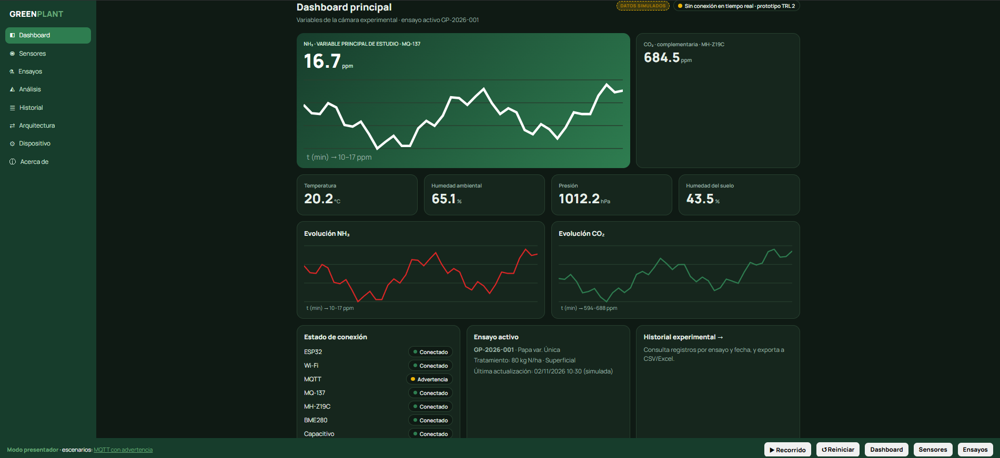

# GREENPLANT — TRL 2
## Formulación del concepto tecnológico

> **Proyecto:** Sistema experimental de laboratorio para el monitoreo de NH₃(g), CO₂(g) y variables ambientales durante ensayos de fertilización con urea en papa (*Solanum tuberosum*), variedad Única.

## Datos del informe

| Campo | Información |
|:---|:---|
| **Curso** | Proyecto Integrador |
| **Integrantes** | Cesar Rodrigo Milla Gómez; Anderson Josue Delerna Infantes; Kevin Esty Carvallo Neciosup; Shedira Lumeris Sihuincha Palacin |
| **Ingenieros** | Umbert Lewis De La Cruz, Maria Rejas, Harry Rivera y Renzo Chan |
| **Fecha de actualización** | 02/11/2026 |
| **Institución** | Universidad Peruana Cayetano Heredia |
| **Tema** | TRL 2 de GREENPLANT — Formulación conceptual de la propuesta tecnológica |

---

# 1. Introducción

## 1.1 ¿Qué representa el TRL 2?

El nivel de madurez tecnológica TRL 2 corresponde a la formulación del concepto tecnológico y al análisis de sus posibles aplicaciones. A partir de los principios científicos identificados en el TRL 1, se define una propuesta de solución, se estudian antecedentes científicos y tecnológicos, se plantea una arquitectura conceptual y se analiza preliminarmente su posible protección intelectual.

En esta etapa la aplicación tecnológica todavía se encuentra en una fase conceptual. Por ello, el objetivo no es demostrar experimentalmente el funcionamiento del sistema completo, sino sustentar por qué la solución propuesta podría funcionar y cómo se organizarían sus componentes. Mankins describe los niveles de madurez tecnológica como una escala que avanza desde la identificación de principios básicos hasta la operación de sistemas probados [[1]](#ref1).

Para GREENPLANT, las evidencias del TRL 2 comprenden el estado del arte, la selección conceptual de sensores, el diseño de la cámara, la arquitectura electrónica y de comunicación, la propuesta de interfaz de visualización, el análisis preliminar de patentabilidad y la formulación del plan experimental.

## 1.2 Antecedentes provenientes del TRL 1

Durante el TRL 1 se estudiaron los principios de funcionamiento de sensores destinados a medir amoníaco gaseoso (NH₃), dióxido de carbono (CO₂), temperatura y humedad ambiental, y humedad del sustrato. También se revisaron los fundamentos de adquisición de datos mediante microcontroladores y las tecnologías de comunicación que podrían utilizarse para transmitir las mediciones.

A partir de esa revisión se formuló una solución que combina una cámara experimental, sensores de gases y variables ambientales, un microcontrolador ESP32 y una plataforma de consulta de datos. La selección vigente de sensores establecida por el equipo para esta versión del TRL 2 es: MQ-137, MH-Z19C, BME280 y sensor capacitivo de humedad del suelo.

**Actualización de selección:** en documentos anteriores del proyecto aparecen los modelos MH-Z19B, ZE03-NH₃, ME3-NH₃ o SCD30 como antecedentes o alternativas. Para este documento se adopta la selección definitiva comunicada por el equipo: **MQ-137, MH-Z19C, BME280 y sensor capacitivo de humedad del suelo**. Las referencias y diseños previos que mencionen un modelo diferente deberán actualizarse cuando se revise la matriz morfológica y la documentación electrónica.

## 1.3 Objetivo del TRL 2

Formular el concepto tecnológico de **GREENPLANT**, un sistema experimental de laboratorio orientado al monitoreo de NH₃(g), CO₂(g), temperatura y humedad ambiental, presión atmosférica y humedad del suelo durante ensayos de fertilización con urea en plantas de papa de la variedad Única.

Para ello se revisan antecedentes científicos y tecnológicos, se justifican los sensores seleccionados, se describe la cámara experimental, se establece la arquitectura conceptual de adquisición y transmisión de datos, se presenta una propuesta visual del dashboard y se realiza un análisis preliminar de propiedad intelectual y patentabilidad.

---

# 2. Estado del arte de la propuesta tecnológica

## 2.1 Monitoreo de amoníaco gaseoso mediante sensores de bajo costo

La volatilización de amoníaco es una de las vías por las que puede perderse parte del nitrógeno aplicado mediante fertilizantes que contienen urea. La magnitud del proceso depende de las propiedades del suelo y de las condiciones de aplicación [[3]](#ref3), [[40]](#ref40). Por esta razón, el registro de NH₃(g) resulta relevante para estudiar la variación de su concentración bajo diferentes condiciones de fertilización y del ambiente.

Petric et al. desarrollaron un dispositivo de monitoreo de amoníaco mediante un sensor MQ-137 conectado a una placa Croduino Basic 2. Sus registros fueron comparados con un analizador Geotech GA5000 y el estudio consideró procedimientos de calibración y evaluación de repetibilidad. Este antecedente muestra la posibilidad de utilizar el MQ-137 en un sistema electrónico de bajo costo, siempre que su respuesta sea caracterizada y contrastada con una referencia [[5]](#ref5).

De acuerdo con la documentación del fabricante, el MQ-137 es un sensor semiconductor cuyo material sensible está basado en dióxido de estaño (SnO₂). Está destinado a detectar NH₃ en un rango de 5 a 500 ppm bajo las condiciones especificadas por el fabricante y requiere un periodo de precalentamiento superior a 48 horas [[6]](#ref6). Estas características condicionan el diseño de alimentación, el acondicionamiento de su señal y el procedimiento que se deberá seguir antes de realizar ensayos.

Huerta et al. analizaron la influencia de la temperatura y la humedad sobre la respuesta de sensores químicos y describieron métodos para reducir la interferencia de estas variables durante el monitoreo continuo [[8]](#ref8). En consecuencia, GREENPLANT considera importante registrar simultáneamente la temperatura y la humedad ambiental mediante el BME280, de manera que estos factores puedan tenerse en cuenta al interpretar las variaciones de la señal de NH₃.

Además, la patente CN115097075B describe un dispositivo para la detección en línea de la volatilización de amoníaco que incorpora sensores MQ-137, una unidad electrónica de procesamiento y comunicación inalámbrica [[7]](#ref7). Este antecedente es relevante porque demuestra que existen propuestas tecnológicas que combinan sensores de NH₃ con sistemas electrónicos para estudiar la volatilización.

## 2.2 Monitoreo de dióxido de carbono mediante tecnología NDIR

El dióxido de carbono (CO₂) es una variable complementaria de GREENPLANT, debido a que su concentración dentro de la cámara puede relacionarse con la respiración de las raíces, la actividad de los microorganismos del suelo y la fotosíntesis de la planta. Por ello, sus variaciones deberán interpretarse considerando las condiciones del cultivo y el manejo de la cámara, sin atribuirlas automáticamente a la aplicación de urea.

Othman et al. desarrollaron un marco de cámara de calibración para evaluar sensores de calidad del aire de bajo costo. En su estudio se consideró el MH-Z19B y se compararon sus mediciones con un monitor de referencia, aplicando procedimientos de evaluación y corrección de lecturas [[9]](#ref9). Aunque el estudio citado utilizó el modelo MH-Z19B y no el MH-Z19C seleccionado actualmente por GREENPLANT, aporta un antecedente metodológico sobre la evaluación de sensores NDIR en cámaras controladas.

Dubey et al. evaluaron sensores de CO₂ basados en tecnología infrarroja no dispersiva (NDIR) y resaltaron la importancia de contrastar sus lecturas con instrumentos de referencia antes de utilizar los datos en análisis posteriores [[10]](#ref10).

Para GREENPLANT se seleccionó el **MH-Z19C**, sensor NDIR que detecta CO₂ mediante la absorción de radiación infrarroja. El fabricante contempla distintas configuraciones de rango —400–2000 ppm, 400–5000 ppm o 400–10000 ppm—, alimentación de 5,0 ± 0,1 V y comunicación mediante UART o PWM. La configuración exacta del rango debe verificarse en el componente adquirido y su documentación [[11]](#ref11).

Por tanto, el MH-Z19C se considera adecuado como alternativa conceptual para registrar CO₂ dentro de la cámara, pero su comportamiento en las condiciones específicas de GREENPLANT deberá comprobarse posteriormente mediante procedimientos de verificación y comparación con una referencia.

## 2.3 Monitoreo de condiciones ambientales y del sustrato

La temperatura, la humedad relativa y la presión atmosférica permiten describir las condiciones del aire presentes durante los ensayos. El BME280 integra estas tres mediciones en un mismo dispositivo y dispone de interfaces digitales I²C y SPI, lo que facilita su conexión con microcontroladores [[12]](#ref12).

Bezborodov documentó un sistema de monitoreo ambiental basado en ESP32 que integra el BME280 y un sensor de CO₂ de la familia MH-Z19. Este antecedente muestra una arquitectura de adquisición en la que un microcontrolador recibe y organiza mediciones ambientales y de gases [[13]](#ref13). No obstante, su implementación no constituye una validación directa del sistema GREENPLANT ni del modelo MH-Z19C.

Para la humedad del suelo se considera una sonda capacitiva de humedad del suelo. Placidi et al. estudiaron sensores de bajo costo para la medición del contenido de agua del suelo en un escenario de agricultura de precisión e integraron mediciones ambientales y del sustrato en una arquitectura IoT [[14]](#ref14).

La respuesta de la sonda capacitiva depende de las características del sustrato y de las condiciones de instalación. Por ello, GREENPLANT plantea caracterizarla posteriormente en el mismo sustrato del ensayo, contrastando su señal con un método de referencia, como la determinación gravimétrica del contenido de humedad.

## 2.4 Medición de gases mediante cámaras experimentales

Las cámaras experimentales permiten estudiar la concentración de gases en un volumen delimitado. Sin embargo, las mediciones pueden verse afectadas por el volumen interno, las fugas, el tiempo de cierre, la mezcla del aire, la ubicación de los sensores y las condiciones ambientales.

Davidson et al. analizaron fuentes de error y sesgos en mediciones de gases mediante cámaras, destacando la necesidad de controlar o documentar el volumen, el tiempo de medición y las perturbaciones introducidas por el propio sistema [[15]](#ref15).

Baneschi et al. presentaron un protocolo de cámara cerrada para medir la respiración del suelo mediante CO₂. Su trabajo destaca la importancia de seleccionar intervalos adecuados de medición, repetir ensayos y utilizar procedimientos de análisis que reduzcan la incertidumbre [[16]](#ref16).

Estos antecedentes orientan el diseño de la cámara de GREENPLANT. En particular, justifican que se documente su volumen útil, que se controle el tiempo de cierre, que se revise el sellado y que se mantenga un procedimiento reproducible para cada medición.

## 2.5 Integración de sensores, microcontroladores y tecnologías IoT

La integración de sensores con microcontroladores permite concentrar las lecturas de diferentes variables y transferirlas hacia sistemas de almacenamiento y visualización.

Berrios Gomez y Rivera Herrera desarrollaron un sistema IoT basado en ESP32 para el monitoreo de variables ambientales y del suelo en un invernadero, demostrando la aplicación de este microcontrolador en sistemas de agricultura de precisión [[18]](#ref18).

Por otra parte, el protocolo MQTT establece un mecanismo ligero de publicación y suscripción para intercambiar mensajes entre dispositivos y aplicaciones. Su utilización se considera en GREENPLANT como una alternativa para enviar los datos adquiridos por el ESP32 hacia una plataforma de registro y visualización [[24]](#ref24).

La arquitectura propuesta contempla que el ESP32 lea los sensores, organice las mediciones, incorpore la identificación del ensayo y transmita los datos mediante Wi-Fi y MQTT. La comunicación y la visualización se plantean como parte del concepto tecnológico; su integración y validación completa corresponden a etapas posteriores.

## 2.6 Comparación de antecedentes tecnológicos

| Antecedente | Variables o función | Tecnología / método | Aporte para GREENPLANT |
|---|---|---|---|
| Petric et al. [[5]](#ref5) | Detección de NH₃ | MQ-137 y microcontrolador; comparación con analizador de referencia | Sustenta la selección conceptual del MQ-137 y la necesidad de calibración. |
| Huerta et al. [[8]](#ref8) | Influencia de temperatura y humedad en sensores químicos | Corrección de interferencias ambientales | Sustenta el registro simultáneo de temperatura y humedad ambiental. |
| Othman et al. [[9]](#ref9) | Validación de sensores de calidad del aire | Cámara de calibración y comparación con referencia; incluye MH-Z19B | Aporta una metodología de evaluación en cámara; no valida directamente el MH-Z19C. |
| Dubey et al. [[10]](#ref10) | Medición de CO₂ | Sensores NDIR y calibración | Respalda la necesidad de contrastar las lecturas de CO₂. |
| Bosch Sensortec [[12]](#ref12) | Temperatura, humedad y presión | BME280 con I²C/SPI | Sustenta la selección del sensor ambiental. |
| Placidi et al. [[14]](#ref14) | Humedad del suelo | Sensor de humedad de bajo costo en agricultura de precisión | Sustenta la medición del contenido de agua del sustrato y su calibración. |
| Davidson et al. [[15]](#ref15) y Baneschi et al. [[16]](#ref16) | Medición de gases en cámaras | Protocolos y análisis de mediciones en cámaras | Orientan el diseño de la cámara y el procedimiento experimental. |
| Berrios Gomez y Rivera Herrera [[18]](#ref18) | Variables ambientales y del suelo | ESP32 y arquitectura IoT | Aporta un antecedente de integración de sensores con ESP32. |
| **GREENPLANT** | **NH₃, CO₂, temperatura, humedad ambiental, presión y humedad del suelo** | **MQ-137, MH-Z19C, BME280, sensor capacitivo y ESP32; comunicación Wi-Fi/MQTT propuesta** | **Monitoreo experimental en cámara de plantas de papa para comparar condiciones de fertilización con urea.** |

Los antecedentes revisados respaldan la viabilidad conceptual de integrar sensores de gases, variables ambientales y humedad del suelo en un sistema de adquisición basado en ESP32. Sin embargo, la combinación específica propuesta por GREENPLANT, su disposición en la cámara y su aplicación a ensayos con papa variedad Única deberán evaluarse en las siguientes etapas de madurez tecnológica.

---

# 3. Formulación del concepto tecnológico

## 3.1 Concepto de GREENPLANT

GREENPLANT se plantea como un sistema experimental de laboratorio que permite registrar las concentraciones de NH₃(g) y CO₂(g), junto con variables ambientales y del sustrato, durante ensayos de fertilización con urea en plantas de papa (*Solanum tuberosum*) de la variedad Única. La variedad Única cuenta con antecedentes de caracterización agronómica para el mercado fresco y procesamiento, así como de evaluación en condiciones de cultivo protegido [[2]](#ref2), [[41]](#ref41). La relevancia nacional del cultivo de papa también sustenta el interés de estudiar tecnologías aplicadas a su producción [[35]](#ref35).

La solución integra una cámara experimental, cuatro sensores, un microcontrolador ESP32, una placa electrónica y una plataforma de visualización. Su propósito es obtener registros organizados para comparar la concentración de NH₃ bajo diferentes dosis y formas de aplicación de urea, considerando las condiciones ambientales del ensayo.

La variable principal es la concentración de NH₃. El CO₂ se registra como variable complementaria para describir el comportamiento gaseoso del sistema suelo-planta.

## 3.2 Problema y justificación

La urea es un fertilizante nitrogenado utilizado en la agricultura. Después de su aplicación, puede transformarse en el suelo mediante procesos asociados a la actividad de la enzima ureasa. Parte del nitrógeno puede perderse hacia la atmósfera como amoníaco gaseoso (NH₃), proceso cuya magnitud depende de factores como el pH, la temperatura, la humedad del suelo, las propiedades del sustrato y la forma de aplicación [[3]](#ref3), [[4]](#ref4).

En el cultivo de papa se han desarrollado investigaciones que analizan la relación entre la dosis de nitrógeno, el tipo de fertilizante y la volatilización de NH₃. Wan et al. estudiaron el efecto de la dosis de nitrógeno y del inhibidor de ureasa sobre la volatilización de amoníaco en campos de papa [[17]](#ref17). Lee et al. compararon la volatilización de amoníaco en suelos fertilizados con urea y sulfato de amonio durante cultivos que incluyeron papa [[36]](#ref36). Asimismo, Rochette et al. analizaron la influencia de la profundidad de incorporación de la urea sobre la volatilización y la retención de nitrógeno [[37]](#ref37).

En este contexto, resulta útil contar con una herramienta experimental que permita observar variaciones de NH₃ bajo diferentes condiciones de fertilización. GREENPLANT busca generar registros comparables mediante sensores y una cámara experimental.

El CO₂ también se considera una variable de interés porque puede provenir de la respiración de las raíces, la actividad microbiana y la descomposición de materia orgánica en el suelo. Además, la fotosíntesis puede modificar su concentración cuando la planta recibe luz [[26]](#ref26), [[27]](#ref27). Por este motivo, sus variaciones deberán interpretarse considerando el intercambio gaseoso y las condiciones del ensayo.

**Precisión científica:** el NH₃(g) es un contaminante atmosférico reactivo y una forma de nitrógeno que puede perderse del sistema suelo-planta; no debe describirse como un gas de efecto invernadero. El CO₂ sí es un gas de efecto invernadero, pero su concentración dentro de la cámara no debe atribuirse automáticamente a la aplicación de urea. Las lecturas expresadas en ppm describen la concentración registrada en el volumen de la cámara y no equivalen, por sí solas, a la masa total de nitrógeno perdida.

## 3.3 Pregunta de investigación e hipótesis

**Pregunta de investigación**

¿Cómo varía la concentración de NH₃(g) registrada en una cámara experimental de laboratorio con plantas de papa variedad Única, según la dosis y la forma de aplicación de la urea, considerando las concentraciones de CO₂(g), las condiciones del aire y la humedad del sustrato?

**Hipótesis de trabajo (H₁)**

Con la misma dosis de nitrógeno, la aplicación superficial de urea producirá concentraciones registradas de NH₃(g) mayores que la aplicación incorporada. Asimismo, manteniendo la misma forma de aplicación, la dosis de 160 kg N/ha producirá concentraciones registradas de NH₃(g) mayores que la dosis de 80 kg N/ha.

Esta hipótesis se plantea a partir de antecedentes sobre la influencia de la forma de aplicación y la dosis de nitrógeno en la volatilización de amoníaco [[3]](#ref3), [[4]](#ref4), [[17]](#ref17), [[37]](#ref37).

**Hipótesis nula (H₀)**

La dosis y la forma de aplicación de la urea no producen diferencias en las concentraciones de NH₃(g) registradas en las condiciones experimentales planteadas.

## 3.4 Objetivos

### Objetivo general

Desarrollar conceptualmente un sistema experimental de laboratorio que permita registrar NH₃(g), CO₂(g), temperatura y humedad ambiental, presión atmosférica y humedad del suelo, para comparar de manera relativa las concentraciones de NH₃(g) bajo diferentes dosis y formas de aplicación de urea en plantas de papa variedad Única.

### Objetivos específicos

- Sustentar la selección de los sensores y la arquitectura de medición mediante antecedentes científicos y documentación técnica.
- Definir el diseño conceptual de la cámara experimental y la distribución de los sensores.
- Plantear la integración de los cuatro sensores con un microcontrolador ESP32 para la adquisición de datos.
- Establecer una arquitectura conceptual de comunicación y registro de las mediciones mediante Wi-Fi y MQTT.
- Formular un procedimiento experimental que permita comparar las concentraciones registradas de NH₃(g) entre dosis y formas de aplicación de urea.
- Proponer una interfaz de visualización que permita consultar las mediciones y comparar ensayos.

## 3.5 Variables y sensores seleccionados

La configuración definitiva comunicada por el equipo está compuesta por cuatro sensores:

| N.º | Sensor | Variable medida | Principio / interfaz considerada | Función en GREENPLANT |
|---:|---|---|---|---|
| 1 | **MQ-137** | Amoníaco gaseoso (NH₃) | Sensor semiconductor basado en SnO₂; requiere circuito de calentamiento y lectura de señal | Medición de la variable principal de estudio. |
| 2 | **MH-Z19C** | Dióxido de carbono (CO₂) | Sensor infrarrojo NDIR; comunicación UART o PWM | Medición de la variable gaseosa complementaria. |
| 3 | **BME280** | Temperatura, humedad relativa y presión atmosférica | Sensor digital; interfaces I²C o SPI | Registro de condiciones ambientales. |
| 4 | **Sensor capacitivo de humedad del suelo** | Humedad del suelo | Lectura de señal eléctrica, prevista mediante entrada analógica | Registro de la condición hídrica del sustrato. |

La adquisición y organización de las lecturas estará a cargo de un **ESP32**, que funciona como unidad de procesamiento y comunicación; no se trata de un sensor.

### 3.5.1 Consideraciones técnicas de los sensores

**MQ-137 – NH₃**

El MQ-137 es un sensor semiconductor para la detección de amoníaco. La documentación del fabricante indica un rango de detección de 5 a 500 ppm bajo las condiciones de ensayo especificadas, un calentador de 5 V y un tiempo de precalentamiento superior a 48 horas [[6]](#ref6). Antes de incorporarlo a un procedimiento experimental se deberá caracterizar su respuesta y contrastarla con una referencia.

**MH-Z19C – CO₂**

El MH-Z19C utiliza tecnología NDIR y dispone de salida UART y PWM. El fabricante contempla rangos configurables de 400–2000 ppm, 400–5000 ppm y 400–10000 ppm, alimentación de 5,0 ± 0,1 V y nivel lógico de comunicación de 3,3 V [[11]](#ref11). El rango exacto dependerá de la versión adquirida y deberá verificarse antes de configurar el firmware.

**BME280 – variables ambientales**

El BME280 mide temperatura, humedad relativa y presión atmosférica. Su comunicación digital puede realizarse mediante I²C o SPI [[12]](#ref12). Se plantea ubicarlo alejado de las fuentes de calor de la placa, del regulador y del calentador del MQ-137, para reducir la influencia térmica de la electrónica sobre las mediciones.

**Sensor capacitivo – humedad del suelo**

La sonda capacitiva se utilizará para registrar la humedad del sustrato. Su señal deberá relacionarse con el contenido de agua del suelo mediante una calibración realizada en el sustrato utilizado en los ensayos. La calibración se plantea como actividad posterior y no se considera validada en esta etapa.

### 3.5.2 Variables registradas y variables de contexto

| Tipo | Variable | Unidad / identificación | Procedencia |
|---|---|---|---|
| Principal | Concentración de NH₃ | ppm | MQ-137 |
| Complementaria | Concentración de CO₂ | ppm | MH-Z19C |
| Ambiental | Temperatura | °C | BME280 |
| Ambiental | Humedad relativa | % | BME280 |
| Ambiental | Presión atmosférica | hPa | BME280 |
| Sustrato | Humedad del suelo | Señal calibrada o % estimado | Sensor capacitivo |
| Experimental | Tiempo de medición | min / fecha / hora | ESP32 o sistema de registro |
| Experimental | Identificación de ensayo | Código | Registro del usuario |
| Experimental | Dosis de nitrógeno | kg N/ha | Configuración del tratamiento |
| Experimental | Forma de aplicación | Superficial / incorporada | Configuración del tratamiento |
| Experimental | Estado de iluminación | Encendida / apagada y duración | Registro del procedimiento |

La iluminación se considera una condición experimental que debe documentarse. No se incluye un quinto sensor de iluminación en la selección definitiva de cuatro sensores.

## 3.6 Propuesta de solución tecnológica

La propuesta consiste en una cámara experimental que aloja una planta joven de papa y su sustrato. En la cámara se ubican los sensores encargados de registrar las concentraciones gaseosas y las variables ambientales. La sonda capacitiva se instala en el sustrato para registrar su humedad.

El ESP32 recibe las señales de los sensores, organiza las lecturas y las asocia con la identificación del ensayo y el tiempo de medición. La arquitectura de comunicación propuesta utiliza Wi-Fi y MQTT para transmitir los registros hacia una aplicación de visualización.

La plataforma permitirá consultar las mediciones, revisar su evolución temporal y comparar los resultados entre condiciones experimentales. La interfaz propuesta constituye una representación conceptual del software y no implica que exista una conexión en tiempo real con los sensores en esta etapa.

---

# 4. Arquitectura conceptual de GREENPLANT

## 4.1 Cámara experimental

La cámara experimental es el espacio donde se ubicará una planta joven de papa junto con su sustrato. Su diseño debe permitir la observación del cultivo, la instalación de sensores y el control de las condiciones de medición.

El modelo tridimensional preliminar fue desarrollado en Onshape y considera tres piezas principales fabricables mediante impresión 3D con PETG: base, soporte/planta y tapa. Las piezas se organizan sobre una misma huella de 180 × 180 mm.

Las dimensiones descritas en el diseño son:

| Elemento | Dimensión / característica |
|---|---|
| Huella de la base | 180 × 180 mm |
| Lado exterior del soporte/planta | 180 mm |
| Distancia interior entre paredes | 170 mm |
| Altura del soporte/planta | 200 mm |
| Tapa | 180 × 180 mm |
| Espesor de tapa | 4,082 mm |
| Fijación de tapa | Cuatro perforaciones en las esquinas |
| Material previsto | PETG |

La base aloja la placa electrónica y la fuente de alimentación. Su cara superior contempla aberturas para comunicar los sensores con el aire de la cámara, mientras que la parte frontal incluye un soporte inclinado para la pantalla. La pieza soporte/planta forma las paredes de la cámara y mantiene una cara de acceso para colocar o retirar la maceta. Durante las mediciones, esa abertura deberá cerrarse mediante un panel para reducir el intercambio de aire no controlado.

## 4.2 Volumen interno y condiciones de medición

De acuerdo con las cotas interiores del modelo, se estima un volumen de cámara de aproximadamente 5,8 L. Considerando una maceta de 15 cm de diámetro superior, 12 cm de diámetro inferior y 13 cm de altura, el volumen ocupado por la maceta se estima en 1,9 L. Por tanto, el volumen de aire disponible sería de aproximadamente 3,9 L.

Estas cantidades son estimaciones derivadas del modelo y deberán verificarse cuando se disponga de la estructura fabricada. El volumen útil es importante para interpretar la variación de concentración de los gases y comparar mediciones realizadas bajo el mismo procedimiento [[15]](#ref15), [[16]](#ref16).

Con el volumen de aire estimado se elaboró un cálculo preliminar de orden de magnitud para evaluar si el MQ-137 podría detectar las concentraciones esperadas de NH₃. El cálculo considera una maceta de aproximadamente 0,018 m², pérdidas hipotéticas de entre 5 % y 20 % del nitrógeno aplicado y una distribución temporal de la volatilización durante los primeros días. Bajo esas hipótesis, se estimó que un cierre de 10 minutos podría generar concentraciones aproximadas de 4 a 35 ppm y un cierre de 30 minutos de 13 a 105 ppm. Como el rango del MQ-137 inicia en 5 ppm, la estimación sugiere que el tiempo de cierre propuesto podría mejorar la posibilidad de registrar concentraciones bajas. **Estos valores son una estimación analítica preliminar, no mediciones experimentales**, y no consideran fugas, adsorción en paredes ni variaciones reales de la tasa de volatilización; deberán revisarse y contrastarse durante el TRL 3 [[4]](#ref4), [[6]](#ref6), [[15]](#ref15), [[16]](#ref16), [[17]](#ref17).

Debido a que la altura libre sobre el sustrato es limitada, la cámara se plantea inicialmente para mediciones en plantas jóvenes y durante los primeros días posteriores a la aplicación de urea. Para estudiar plantas de mayor desarrollo será necesario revisar la altura de la pieza soporte/planta.

## 4.3 Distribución conceptual de los sensores

La ubicación de los sensores deberá responder a la variable que mide cada uno:

- El MQ-137 se ubicará en comunicación con el aire interno de la cámara, sin contacto directo con el sustrato.
- El MH-Z19C se ubicará en el espacio de aire de la cámara, manteniendo libre su zona de difusión y respetando las recomendaciones del fabricante [[11]](#ref11).
- El BME280 se colocará en una zona alejada de fuentes de calor de la electrónica y del calentador del MQ-137.
- El sensor capacitivo se insertará en el sustrato, procurando mantener una profundidad y posición reproducibles entre ensayos.

La distribución final deberá permitir la revisión y el reemplazo individual de los sensores sin desmontar completamente la cámara.

## 4.4 Módulo electrónico y placa PCB

El ESP32 constituye la unidad central de adquisición de datos. La documentación del proyecto describe una placa electrónica propia, denominada PCB3, diseñada en EasyEDA Pro como una placa de dos capas de aproximadamente 107 × 110 mm, con cuatro perforaciones de 3,1 mm para tornillos M3.

La PCB3 contempla conectores para los sensores, el microcontrolador, la pantalla LCD 1602, el módulo de relés y la distribución de alimentación. Los archivos de fabricación fueron preparados, pero la documentación del proyecto indica que la PCB3 todavía no había sido fabricada ni probada al momento de elaborar el diseño conceptual.

**Compatibilidad con el sensor definitivo MH-Z19C:** el diseño original de la PCB3 documenta el uso de un MH-Z19B. Como el equipo confirmó posteriormente el MH-Z19C, antes de fabricar una nueva versión de la placa deberá verificarse la correspondencia de pines, alimentación, UART/PWM y conector del modelo MH-Z19C. Aunque el MH-Z19C también contempla alimentación de 5 V y comunicación UART/PWM, no debe asumirse que el montaje físico queda aprobado sin revisar el modelo adquirido y su manual [[11]](#ref11).

## 4.5 Alimentación y acondicionamiento de señales

La arquitectura eléctrica documentada contempla una entrada de 12 V y un convertidor reductor LM2596 para obtener una línea de 5 V destinada al ESP32, sensores, pantalla y módulo de relés. La línea de 12 V se considera para cargas como el ventilador y la iluminación LED [[19]](#ref19). La pantalla LCD 1602 se plantea mediante un adaptador I²C, que puede incorporar un expansor de entradas/salidas como el PCF8574 [[21]](#ref21). Cuando se conecten dispositivos con niveles lógicos diferentes, deberá comprobarse la necesidad de conversión de nivel para proteger las interfaces digitales [[22]](#ref22). Para controlar cargas como el ventilador y la luz LED, el diseño considera un módulo de relés de 5 V; la selección y conexión de sus contactos deberá verificarse antes de energizar las cargas [[25]](#ref25).

El MQ-137 utiliza un calentador de 5 V y su circuito de salida debe acondicionarse para que la señal sea compatible con las entradas del ESP32. En la revisión de la PCB3 se identificó que las salidas del MQ-137 llegaban directamente al microcontrolador. Por ello, el diseño posterior deberá incorporar el divisor resistivo o acondicionamiento correspondiente, evitando aplicar a una entrada del ESP32 una tensión superior a la permitida [[6]](#ref6), [[20]](#ref20), [[23]](#ref23).

La sonda capacitiva también deberá revisarse para asegurar que su salida se encuentre dentro del rango admitido por el ADC del ESP32. La alimentación y las referencias de tensión se verificarán antes de conectar los sensores definitivos.

## 4.6 Adquisición y comunicación de datos

La arquitectura propuesta considera la siguiente secuencia:

1. El ESP32 inicializa los sensores y las interfaces de comunicación.
2. El sistema obtiene las lecturas de NH₃, CO₂, temperatura, humedad ambiental, presión y humedad del suelo.
3. Cada registro se asocia con la fecha, hora, identificador del ensayo y condición experimental.
4. Los datos se organizan en una estructura de información, prevista en formato JSON.
5. El ESP32 transmite los registros mediante Wi-Fi y MQTT.
6. La aplicación receptora almacena los registros y los presenta en un dashboard.

MQTT se plantea como protocolo de mensajería entre el dispositivo y la aplicación de monitoreo, siguiendo el modelo de publicación y suscripción descrito por OASIS [[24]](#ref24).

La comunicación Wi-Fi/MQTT constituye la arquitectura prevista. Su implementación completa, la persistencia de datos y la transmisión en tiempo real deberán verificarse en etapas posteriores.

## 4.7 Dashboard y visualización conceptual

Se plantea una interfaz web para facilitar la consulta de las variables registradas por GREENPLANT. El dashboard permitirá observar las concentraciones de NH₃ y CO₂, las variables ambientales y la humedad del suelo, además del estado conceptual de los componentes del sistema.

La propuesta visual considera:

- Una tarjeta principal para NH₃, por ser la variable principal de investigación.
- Una tarjeta para CO₂ como variable complementaria.
- Indicadores para temperatura, humedad ambiental, presión atmosférica y humedad del suelo.
- Gráficos de evolución temporal.
- Identificación del ensayo activo.
- Consulta de registros históricos y comparación entre tratamientos.
- Estado de conexión del ESP32 y de los sensores.

El prototipo visual generado para revisar la interfaz utiliza valores de ejemplo identificados como **DATOS SIMULADOS**. Estos valores se incluyen únicamente para representar la distribución y el comportamiento visual del dashboard. No corresponden a mediciones reales, calibraciones, pruebas de precisión ni datos adquiridos por el ESP32.

## 4.8 Flujo conceptual del sistema

**Flujo general:**

**Cultivo → Cámara experimental → Sensores → ESP32 → Wi-Fi/MQTT → Registro de datos → Dashboard → Análisis y comparación.**

---

# 5. Evidencias del diseño conceptual

Esta sección reúne los documentos y representaciones que sustentan la formulación del concepto tecnológico. Las evidencias de diseño no deben confundirse con resultados de pruebas experimentales.

## 5.1 Matriz morfológica y selección de componentes

La matriz morfológica del proyecto compara alternativas para las funciones de sensado, procesamiento, estructura, alimentación, control, comunicación y visualización.

El documento de evaluación de la matriz morfológica registra alternativas para la detección de NH₃ y CO₂, la medición ambiental, el monitoreo del suelo, la cámara, la alimentación y la comunicación. La matriz original incluye modelos que posteriormente fueron sustituidos o ajustados por decisión del equipo.

Para esta versión del TRL 2 se adopta la configuración final comunicada por el equipo:

| Subsistema | Componente seleccionado | Función |
|---|---|---|
| Detección de NH₃ | MQ-137 | Medir amoníaco gaseoso. |
| Detección de CO₂ | MH-Z19C | Medir dióxido de carbono. |
| Variables ambientales | BME280 | Medir temperatura, humedad relativa y presión. |
| Humedad del suelo | Sensor capacitivo | Registrar la humedad del sustrato. |
| Procesamiento | ESP32 | Adquirir y organizar las señales. |
| Cámara | Estructura modular | Alojar la planta y delimitar el volumen de medición. |
| Comunicación | Wi-Fi + MQTT | Transmitir los registros hacia la aplicación. |
| Visualización | Dashboard web | Consultar mediciones e historial. |

**Nota de consistencia documental:** la matriz morfológica original del repositorio presenta una selección previa diferente (ZE03-NH₃ y MH-Z19B). Para evitar contradicciones, el equipo deberá actualizar también ese documento y reflejar allí la selección vigente MQ-137 y MH-Z19C.

Documentos relacionados:

- [Evaluación de Matriz Morfológica](../Entregables/Evaluación%20de%20Matriz%20Morfológica.md)
- [Matriz Morfológica (PDF)](../Entregables/Matriz%20Morfológica.pdf)

## 5.2 Caja negra y esquema de funciones

La caja negra y el esquema de funciones describen las entradas, procesos y salidas principales de GREENPLANT.

En términos funcionales, el sistema recibe como entradas las condiciones del cultivo, la concentración de gases y las variables ambientales y del sustrato. El proceso tecnológico comprende la medición mediante sensores, la adquisición de datos por el ESP32 y la organización de las mediciones. Las salidas previstas son los registros de NH₃, CO₂ y variables complementarias, junto con información para comparar ensayos.

Documentos de referencia:

- [Caja Negra de GREENPLANT (PDF)](../Entregables/Caja%20Negra.pdf)
- [Esquema de Funciones (PDF)](../Entregables/Esquema%20de%20Funciones.pdf)
- [Diagrama de flujo (PDF)](../Entregables/Diagrama%20de%20flujo.pdf)

## 5.3 Bocetos conceptuales

Los bocetos permiten representar alternativas de distribución física para la cámara experimental, la planta, los sensores y los componentes electrónicos. Su finalidad es anticipar la disposición de los elementos y facilitar la definición del modelo tridimensional.

[Consultar Bocetos-GREENPLANT (PDF)](../Entregables/Bocetos-GREENPLANT.pdf)

## 5.4 Modelado tridimensional de la cámara

El equipo elaboró en Onshape un modelo compuesto por tres piezas principales: base, soporte/planta y tapa. La distribución propuesta separa la electrónica del espacio de aire donde se realizan las mediciones y contempla puntos de acceso para instalar los sensores.

*Figura 1. Vista de conjunto del prototipo modelado en Onshape: tapa, cámara (soporte/planta) y base.*

*Figura 2. Plano de la base: vistas superior, frontal, lateral e isométrica.*

*Figura 3. Plano del soporte/planta: cámara experimental con una cara de acceso.*

*Figura 4. Plano de la tapa: placa de 180 × 180 mm con perforaciones de fijación.*

## 5.5 Diseño electrónico preliminar

La documentación describe una PCB3 diseñada en EasyEDA Pro, con dos capas y dimensiones aproximadas de 107 × 110 mm. La placa contempla conexiones para los sensores, el ESP32, la pantalla, la alimentación y los módulos de salida.

*Figura 5. Guía de la PCB3, cara superior, generada a partir de los archivos Gerber.*

Los archivos de fabricación de PCB3 fueron preparados, pero el documento técnico indica que la placa aún no había sido fabricada ni probada. También se identificaron correcciones necesarias en la adaptación de señales del MQ-137 y en el control de cargas mediante relés.

Además, la documentación electrónica deberá actualizarse para reflejar el sensor MH-Z19C como modelo definitivo, en sustitución de la referencia anterior al MH-Z19B. La compatibilidad final deberá confirmarse con la ficha del componente adquirido.

## 5.6 Diseño conceptual del dashboard GREENPLANT

Se elaboró un prototipo visual navegable como referencia para la futura interfaz de monitoreo de GREENPLANT. La propuesta tiene como pantalla central un dashboard que destaca la concentración de NH₃ y presenta el CO₂ y las variables ambientales y del suelo como indicadores complementarios.

El dashboard contempla tarjetas de medición, gráficos temporales, estado de los componentes y acceso a información del ensayo. Su función en el TRL 2 es representar cómo el investigador podrá consultar los datos cuando la arquitectura de adquisición y comunicación se encuentre implementada.

La siguiente imagen corresponde a la captura que se incorporará desde la carpeta de evidencias del TRL 2:

*Figura 6. Propuesta conceptual del dashboard principal de GREENPLANT. Las lecturas que aparecen en el prototipo son datos simulados y no corresponden a mediciones experimentales reales.*

**Nota sobre el prototipo:** la captura representa el diseño conceptual de la interfaz. No demuestra que el dashboard esté conectado a los sensores, al ESP32 o a un broker MQTT. Tampoco representa resultados experimentales, calibraciones ni umbrales validados.

---

# 6. Requisitos conceptuales de GREENPLANT

A partir de la propuesta tecnológica, se establecen los requisitos conceptuales que deberá cumplir el sistema en etapas posteriores.

## 6.1 Monitoreo de gases

El sistema deberá registrar la concentración de NH₃(g) mediante el MQ-137 y la concentración de CO₂(g) mediante el MH-Z19C. NH₃ constituye la variable principal de investigación y CO₂ se utilizará como variable complementaria.

## 6.2 Monitoreo ambiental

El BME280 deberá registrar temperatura, humedad relativa y presión atmosférica durante los ensayos, de modo que las condiciones del aire puedan documentarse al interpretar las variaciones de los gases.

## 6.3 Monitoreo del sustrato

El sensor capacitivo deberá registrar la humedad del suelo. Su lectura deberá caracterizarse en el mismo sustrato utilizado en los ensayos antes de interpretar el valor como contenido de humedad.

## 6.4 Cámara experimental

La cámara deberá permitir alojar una planta joven de papa y su sustrato, mantener los sensores en posiciones reproducibles y delimitar el volumen de aire usado durante la medición. El diseño deberá facilitar el acceso para colocar la maceta, revisar los componentes y limpiar la estructura entre ensayos.

## 6.5 Adquisición de datos

El ESP32 deberá recibir las señales de los cuatro sensores, organizarlas y asociarlas con fecha, hora, identificación del ensayo y condición experimental.

## 6.6 Comunicación

La arquitectura propuesta deberá permitir la transmisión de datos mediante Wi-Fi y MQTT. El registro local o remoto deberá preservar la identificación del ensayo para facilitar la comparación posterior.

## 6.7 Visualización

La interfaz deberá mostrar los valores de NH₃, CO₂, temperatura, humedad ambiental, presión y humedad del suelo. También deberá permitir revisar tendencias, consultar registros y comparar las condiciones de fertilización.

## 6.8 Comparación experimental

El sistema deberá permitir organizar los datos por tratamiento, dosis, forma de aplicación, repetición y día de medición. La comparación principal se realizará sobre las concentraciones registradas de NH₃.

## 6.9 Mantenimiento y seguridad

La disposición de los sensores y conexiones deberá facilitar su inspección y reemplazo. La electrónica deberá mantenerse protegida frente a la humedad y el contacto accidental con el sustrato. Antes de abrir la cámara después de una medición deberá seguirse un procedimiento de ventilación.

---

# 7. Análisis de patentabilidad y protección

## 7.1 Requisitos generales de patentabilidad

El análisis preliminar se basa en la Decisión 486 de la Comunidad Andina, que establece el régimen común de propiedad industrial aplicable en los países miembros [[28]](#ref28).

De acuerdo con esta norma, una invención debe cumplir requisitos de novedad, nivel inventivo y aplicación industrial para acceder a una patente de invención. La misma Decisión contempla el modelo de utilidad para nuevas formas, configuraciones o disposiciones de elementos de un objeto que proporcionen una ventaja técnica o un uso diferente [[28]](#ref28).

En GREENPLANT se utilizan sensores comerciales y un microcontrolador de uso extendido. Por ello, el análisis de protección debe prestar atención a la configuración física de la cámara, la disposición de los componentes y las ventajas técnicas concretas que pudieran demostrarse.

## 7.2 Búsqueda de patentes relacionadas

La revisión preliminar del proyecto identificó documentos relacionados con detección de amoníaco, cámaras de crecimiento y monitoreo ambiental.

La patente china CN115097075B, de la Universidad de Ciencia y Tecnología de Kunming, describe un equipo para detectar en línea la volatilización de amoníaco mediante una cámara de gas, sensores MQ-137, placas Arduino y comunicación inalámbrica [[7]](#ref7). Es un antecedente cercano porque utiliza un sensor de la misma familia para estudiar la volatilización de NH₃. Sin embargo, la propuesta descrita en GREENPLANT se orienta a ensayos de laboratorio con macetas de papa y contempla también CO₂, variables ambientales y humedad del sustrato.

La patente estadounidense US5341595A describe una cámara ambiental para el análisis del crecimiento de plantas y la medición de CO₂ [[29]](#ref29). Este documento constituye un antecedente de cámaras utilizadas para estudiar el intercambio gaseoso en plantas, aunque su configuración y aplicación no son idénticas a las de GREENPLANT.

La solicitud china CN114365649A describe un sistema de monitoreo y control ambiental para invernaderos, que integra sensores ambientales y del suelo, ventilación e iluminación [[30]](#ref30). Su enfoque se relaciona con la integración de sensores y control ambiental, pero no corresponde al mismo propósito experimental de medir NH₃ y CO₂ durante ensayos de aplicación de urea en papa.

La patente US7341694B2 protege una tecnología de sensor de amoníaco basada en un material sensible específico [[31]](#ref31). GREENPLANT, en cambio, propone utilizar sensores comerciales y no desarrollar un nuevo principio de detección.

La búsqueda es preliminar y no constituye una opinión legal definitiva sobre la patentabilidad del proyecto.

## 7.3 Comparación con GREENPLANT

| Documento relacionado | Elemento en común | Diferencia frente a GREENPLANT |
|---|---|---|
| CN115097075B [[7]](#ref7) | Detección de volatilización de NH₃ mediante MQ-137 y electrónica | GREENPLANT plantea ensayos de laboratorio con papa e incorpora CO₂, variables ambientales y humedad del sustrato. |
| US5341595A [[29]](#ref29) | Cámara para análisis de crecimiento e intercambio gaseoso de plantas | GREENPLANT se enfoca en la medición conjunta de NH₃ y CO₂ durante ensayos de fertilización con urea. |
| CN114365649A [[30]](#ref30) | Sensores ambientales y del suelo, control y monitoreo | GREENPLANT se centra en el registro experimental de gases y condiciones de cultivo en una cámara. |
| US7341694B2 [[31]](#ref31) | Detección de amoníaco | GREENPLANT no desarrolla un nuevo elemento sensor; integra un sensor comercial en una plataforma experimental. |

## 7.4 Evaluación preliminar y estrategia de protección

La combinación de sensores comerciales con un microcontrolador es una práctica conocida en sistemas IoT. En consecuencia, no se puede afirmar que el sistema completo cumpla por sí mismo los requisitos de novedad y nivel inventivo.

La configuración física de la cámara podría evaluarse como posible modelo de utilidad si se identifica y demuestra una ventaja técnica concreta, por ejemplo, una disposición que reduzca la influencia térmica de la electrónica sobre las mediciones o que facilite el montaje, mantenimiento y control del volumen de aire. Esta posibilidad requeriría un análisis más detallado del estado de la técnica y de las reivindicaciones de documentos similares [[28]](#ref28), [[32]](#ref32).

El software que se desarrolle para adquirir, organizar, transmitir y visualizar los datos puede analizarse desde la perspectiva de los derechos de autor como programa de ordenador, conservando versiones, autoría y licencias de componentes de terceros, de acuerdo con los procedimientos de registro disponibles en INDECOPI [[33]](#ref33).

La divulgación pública del proyecto debe documentarse si el equipo evalúa solicitar protección industrial. La aplicación de los plazos y excepciones legales deberá revisarse con orientación especializada antes de presentar una solicitud [[34]](#ref34).

---

# 8. Perfil del proyecto GREENPLANT

## 8.1 Título

**GREENPLANT: sistema experimental de laboratorio para el monitoreo de NH₃(g), CO₂(g) y variables ambientales durante ensayos de fertilización con urea en papa (*Solanum tuberosum*) variedad Única.**

## 8.2 Usuarios y beneficiarios

El sistema está orientado principalmente a estudiantes, investigadores y responsables de ensayos experimentales agrícolas que necesiten registrar y comparar concentraciones de gases y condiciones ambientales durante pruebas controladas de fertilización.

La información obtenida podrá apoyar el análisis experimental del comportamiento del NH₃ y de las condiciones relacionadas con la aplicación de urea. No sustituirá el análisis agronómico del suelo ni la validación en campo.

## 8.3 Plan experimental propuesto

El plan experimental considera cinco tratamientos:

| Código | Condición | Dosis de nitrógeno | Forma de aplicación |
|---|---|---:|---|
| T0 | Control | 0 kg N/ha | Sin urea |
| T1 | Dosis baja | 80 kg N/ha | Superficial |
| T2 | Dosis baja | 80 kg N/ha | Incorporada |
| T3 | Dosis alta | 160 kg N/ha | Superficial |
| T4 | Dosis alta | 160 kg N/ha | Incorporada |

Las dosis de 80 y 160 kg N/ha se consideran como condiciones de comparación experimental y no como recomendaciones agronómicas para el cultivo. Se toman como niveles de referencia documentados en trabajos de fertilización de papa, aunque los estudios consultados no representan necesariamente la misma variedad ni las mismas condiciones del presente ensayo [[38]](#ref38). La aplicación incorporada se plantea a una profundidad aproximada de 5 cm, tomando como referencia los antecedentes sobre incorporación de urea [[37]](#ref37).

### 8.3.1 Equivalencia de la dosis de nitrógeno y masa de urea

Para estimar la cantidad de urea por maceta se considera una superficie aproximada de 0,018 m², correspondiente a una maceta de 15 cm de diámetro. Tomando como referencia una urea comercial etiquetada con 46 % de nitrógeno, se utiliza:

\[
\text{Urea (kg/ha)}=\frac{\text{N (kg/ha)}}{0,46}
\]

| Tratamiento | Dosis de N | Urea equivalente por hectárea | N aproximado por maceta | Urea aproximada por maceta |
|---|---:|---:|---:|---:|
| T0 | 0 kg N/ha | 0 kg urea/ha | 0 g | 0 g |
| T1 / T2 | 80 kg N/ha | 173,9 kg urea/ha | 0,144 g | 0,31 g |
| T3 / T4 | 160 kg N/ha | 347,8 kg urea/ha | 0,288 g | 0,63 g |

Los valores por maceta son estimaciones y deberán ajustarse a la superficie real utilizada y al porcentaje de nitrógeno declarado en la etiqueta del fertilizante adquirido. La cantidad de urea no debe confundirse con la dosis de nitrógeno.

### 8.3.2 Repeticiones y organización temporal

Se plantean tres repeticiones por tratamiento, lo que representa 15 macetas en total. La cantidad de repeticiones se considera una propuesta inicial y deberá revisarse según la disponibilidad de plantas y las condiciones experimentales. Existen antecedentes de evaluación de la variedad Única en condiciones de cultivo protegido que pueden servir como referencia agronómica, sin que sus resultados validen por sí solos el diseño experimental de GREENPLANT [[41]](#ref41). Debido a que el prototipo considera una sola cámara, las macetas se medirán de manera secuencial, manteniendo condiciones comparables fuera de la cámara cuando no estén siendo evaluadas.

El plan contempla tres ciclos sucesivos. Cada ciclo incluirá una repetición de los cinco tratamientos. Se propone un día de línea de base previo a la fertilización y siete días de mediciones posteriores, de modo que se pueda registrar el comportamiento durante el periodo inicial después de la aplicación.

Para cada maceta se plantea un cierre de cámara de aproximadamente 30 minutos y un periodo posterior de ventilación de aproximadamente 10 minutos. Estos tiempos son parte del procedimiento propuesto y deberán ajustarse a partir de las verificaciones instrumentales y de la respuesta observada durante las etapas experimentales. La aplicación de urea en la siembra se plantea como una condición experimental acotada por la altura de la cámara y por el interés en observar el periodo inicial posterior a la fertilización. Las guías de buenas prácticas del cultivo de papa describen esquemas de fertilización fraccionada, por lo que el tratamiento de GREENPLANT deberá interpretarse como una condición de ensayo y no como una recomendación de manejo comercial [[39]](#ref39).

### 8.3.3 Variables y registros por ensayo

Durante cada medición se propone registrar:

- Concentración de NH₃(g) en función del tiempo.
- Concentración de CO₂(g).
- Temperatura ambiental.
- Humedad relativa.
- Presión atmosférica.
- Humedad del sustrato.
- Fecha, hora, tratamiento, repetición e identificación de la maceta.
- Condición de iluminación y observaciones del ensayo.

La variable principal de comparación será la concentración de NH₃ registrada bajo cada tratamiento. También podrá analizarse la pendiente de acumulación de NH₃ durante el periodo de cierre, siempre que el procedimiento de medición y el volumen de aire se encuentren documentados.

## 8.4 Criterios de interpretación de resultados

Las mediciones de NH₃ y CO₂ se expresarán como concentraciones registradas dentro de la cámara, en ppm. Una concentración expresada en ppm no equivale directamente a la masa total de gas emitida ni al porcentaje de nitrógeno perdido.

Para estimar un flujo en una cámara cerrada se requeriría considerar la pendiente de cambio de concentración, el volumen efectivo de aire y el área de suelo cubierta. De forma simplificada, el flujo puede relacionarse con:

\[
F=\frac{\Delta C}{\Delta t}\times\frac{V}{A}
\]

donde:

- \(\Delta C/\Delta t\): pendiente de cambio de concentración en el tiempo;
- \(V\): volumen efectivo de aire de la cámara;
- \(A\): superficie de sustrato cubierta por la cámara.

La conversión a masa de NH₃ o nitrógeno requerirá definir unidades, condiciones de temperatura y presión, y un procedimiento de cálculo validado. Por tanto, la comparación inicial se limitará al comportamiento relativo de las concentraciones registradas y no a determinar pérdidas absolutas de nitrógeno.

El CO₂ se interpretará considerando la respiración del suelo y las raíces, la actividad microbiana y la fotosíntesis, además de las condiciones de ventilación e iluminación [[26]](#ref26), [[27]](#ref27).

## 8.5 Resultados esperados

A nivel conceptual, se espera disponer de:

- Una arquitectura definida para el monitoreo experimental de GREENPLANT.
- Una selección de cuatro sensores y un ESP32 como unidad de adquisición.
- Un modelo de cámara experimental documentado en Onshape.
- Un diseño electrónico preliminar que permita organizar las conexiones.
- Una propuesta de comunicación mediante Wi-Fi y MQTT.
- Un dashboard conceptual para visualizar las variables del ensayo.
- Un plan experimental para comparar dosis y formas de aplicación de urea.
- Criterios para registrar, organizar e interpretar los datos.

Estos resultados son productos de formulación y diseño conceptual. No deben presentarse como pruebas de funcionamiento o resultados experimentales ya obtenidos.

## 8.6 Alcance del TRL 2

El TRL 2 de GREENPLANT se limita a formular y sustentar el concepto tecnológico. Incluye la revisión de literatura, la selección conceptual de sensores, la definición de la arquitectura, el modelo mecánico, el diseño electrónico preliminar, la propuesta de interfaz y el plan experimental.

No se considera que el sistema esté validado ni que los sensores hayan alcanzado una precisión determinada. La fabricación y prueba de los componentes, la calibración, la integración del prototipo y los ensayos de laboratorio se desarrollarán en niveles posteriores.

## 8.7 Limitaciones identificadas

Entre las principales limitaciones que deberán atenderse en las siguientes etapas se encuentran:

- La necesidad de calibrar el MQ-137 y caracterizar la influencia de temperatura y humedad sobre su respuesta.
- La necesidad de verificar el rango configurado y la respuesta del MH-Z19C frente a una referencia.
- La calibración de la sonda capacitiva en el sustrato utilizado.
- La verificación del volumen real de la cámara y de su hermeticidad.
- La revisión de la ubicación de sensores y de la mezcla del aire.
- La corrección de las adaptaciones eléctricas identificadas en PCB3.
- La actualización del diseño electrónico para el sensor MH-Z19C definitivo.
- La implementación y verificación de la comunicación Wi-Fi/MQTT.
- La validación del almacenamiento, visualización y comparación de los registros.

---

# 9. Cumplimiento de los indicadores del TRL 2

| Indicador del TRL 2 | Evidencia desarrollada en GREENPLANT |
|---|---|
| Antecedentes científicos relacionados con la propuesta | Revisión de investigaciones sobre volatilización de NH₃, medición de CO₂, sensores ambientales, humedad del suelo y cámaras experimentales. |
| Estado del arte de la aplicación tecnológica | Comparación de sensores, cámaras, sistemas de monitoreo agrícola e integración IoT. |
| Formulación del concepto tecnológico | Definición de GREENPLANT como sistema experimental de laboratorio para el monitoreo de NH₃, CO₂ y variables ambientales y del sustrato en papa. |
| Selección conceptual de sensores | MQ-137, MH-Z19C, BME280 y sensor capacitivo de humedad del suelo. |
| Arquitectura conceptual | Cámara experimental, sensores, ESP32, comunicación Wi-Fi/MQTT, registro de datos y dashboard. |
| Diseño conceptual mecánico | Modelo tridimensional de base, soporte/planta y tapa en Onshape. |
| Diseño electrónico preliminar | Documentación de PCB3 y requerimientos de corrección y actualización para compatibilidad con los sensores definitivos. |
| Diseño conceptual de interfaz | Propuesta visual del dashboard para consultar NH₃, CO₂ y las variables ambientales y del suelo. |
| Análisis de patentabilidad y protección | Revisión preliminar de patentes relacionadas con detección de NH₃, cámaras y monitoreo ambiental. |
| Perfil del proyecto | Problema, pregunta de investigación, hipótesis, objetivos, usuarios, plan experimental, alcance y limitaciones. |

---

# 10. Conclusión

Durante el TRL 2 se formuló el concepto tecnológico de GREENPLANT como un sistema experimental de laboratorio orientado al monitoreo de NH₃(g), CO₂(g), temperatura y humedad ambiental, presión atmosférica y humedad del suelo durante ensayos de fertilización con urea en plantas de papa variedad Única.

A partir de la revisión de antecedentes científicos y tecnológicos se estableció la selección vigente de cuatro sensores: MQ-137 para amoníaco, MH-Z19C para dióxido de carbono, BME280 para temperatura, humedad ambiental y presión atmosférica, y un sensor capacitivo para humedad del suelo. Se definió además al ESP32 como unidad central de adquisición y procesamiento, con una arquitectura de comunicación propuesta mediante Wi-Fi y MQTT.

El diseño conceptual de la cámara, la documentación electrónica preliminar y la propuesta visual del dashboard permiten describir cómo se organizaría el sistema y cómo se consultarían las mediciones. Asimismo, el plan experimental establece condiciones iniciales para comparar la concentración registrada de NH₃ bajo diferentes dosis y formas de aplicación de urea.

En consecuencia, GREENPLANT cuenta con un concepto tecnológico formulado y sustentado mediante antecedentes científicos, diseño conceptual y una propuesta de aplicación experimental. La fabricación, calibración, prueba de concepto e integración del sistema completo quedan como actividades de las siguientes etapas de madurez tecnológica.

---

# Referencias bibliográficas

[1] J. C. Mankins, “Technology readiness assessments: A retrospective,” Acta Astronautica, vol. 65, n.os 9–10, pp. 1216–1223, 2009, doi: 10.1016/j.actaastro.2009.03.058. Disponible: https://doi.org/10.1016/j.actaastro.2009.03.058

[2] R. O. Gutiérrez-Rosales, J. A. Espinoza-Trelles y M. Bonierbale, “UNICA: variedad peruana para mercado fresco y papa frita con tolerancia y resistencia para condiciones climáticas adversas,” Revista Latinoamericana de la Papa, vol. 14, n.º 1, pp. 41–50, 2007. Consultado: 30-oct-2026. [En línea]. Disponible: https://dialnet.unirioja.es/descarga/articulo/5512141.pdf

[3] N. Rayne y C. Bandura, “Ammonia loss from urea-containing fertilizers,” University of Wisconsin–Madison Division of Extension, Crops and Soils. Consultado: 30-oct-2026. [En línea]. Disponible: https://cropsandsoils.extension.wisc.edu/articles/ammonia-loss-from-urea-containing-fertilizers/

[4] FAO e IFA, Global Estimates of Gaseous Emissions of NH₃, NO and N₂O from Agricultural Land. Roma, Italia: Food and Agriculture Organization of the United Nations e International Fertilizer Industry Association, 2001. Consultado: 30-oct-2026. [En línea]. Disponible: https://www.fao.org/4/y2780e/y2780e00.htm

[5] M. Petric, F. Dodigović, I. Grčić, P. Markužić, L. Radetić y M. Topić, “Ammonia concentration monitoring using Arduino platform,” Environmental Engineering – Inženjerstvo okoliša, vol. 6, n.º 1, pp. 21–26, 2019, doi: 10.37023/ee.6.1.4. Disponible: https://doi.org/10.37023/ee.6.1.4

[6] Zhengzhou Winsen Electronics Technology Co., Ltd., “Ammonia gas sensor (model: MQ137): Manual,” ver. 1.6, jul. 2021. Consultado: 30-oct-2026. [En línea]. Disponible: https://www.winsen-sensor.com/d/files/manual/mq137.pdf

[7] Kunming University of Science and Technology, “Ammonia volatilization online detection device based on Arduino board,” patente de China CN115097075B, solicitud CN202210747868.2, 29-jun-2022. Consultado: 30-oct-2026. [En línea]. Disponible: https://eureka.patsnap.com/patent/CN115097075B

[8] R. Huerta, T. S. Mosqueiro, J. Fonollosa, N. F. Rulkov e I. Rodriguez-Lujan, “Online decorrelation of humidity and temperature in chemical sensors for continuous monitoring,” Chemometrics and Intelligent Laboratory Systems, vol. 157, pp. 169–176, 2016, doi: 10.1016/j.chemolab.2016.07.004. Disponible: https://doi.org/10.1016/j.chemolab.2016.07.004

[9] H. Othman, G. Sieves, T. Guimarães y R. Azari, “A calibration chamber framework for low-cost indoor air quality sensor validation,” Building and Environment, vol. 287, art. 113856, ene. 2026, doi: 10.1016/j.buildenv.2025.113856. Disponible: https://doi.org/10.1016/j.buildenv.2025.113856

[10] R. Dubey et al., “Low-cost CO₂ NDIR sensors: Performance evaluation and calibration using machine learning techniques,” Sensors, vol. 24, n.º 17, art. 5675, 2024, doi: 10.3390/s24175675. Disponible: https://doi.org/10.3390/s24175675

[11] Zhengzhou Winsen Electronics Technology Co., Ltd., “Infrared CO₂ sensor module (model: MH-Z19C): User’s manual,” documentación técnica del fabricante. Consultado: 02-nov-2026. [En línea]. Disponible: https://www.winsen-sensor.com/d/files/manual/mh-z19c.pdf. Ficha del producto: https://www.winsen-sensor.com/product/mh-z19c.html

[12] Bosch Sensortec, “BME280: Data sheet,” rev. 1.24, feb. 2024. Consultado: 28-oct-2026. [En línea]. Disponible: https://www.bosch-sensortec.com/media/boschsensortec/downloads/datasheets/bst-bme280-ds002.pdf

[13] A. A. Bezborodov, “Розробка системи перевірки якості повітря на основі ESP32” [Desarrollo de un sistema de monitoreo de calidad del aire basado en ESP32], tesis de grado, especialidad de Ciencias de la Computación, Universidad Nacional V. N. Karazin de Járkiv, Járkiv, Ucrania, 2025. Consultado: 28-oct-2026. [En línea]. Disponible: https://ekhnuir.karazin.ua/handle/123456789/26414

[14] P. Placidi, R. Morbidelli, D. Fortunati, N. Papini, F. Gobbi y A. Scorzoni, “Monitoring soil and ambient parameters in the IoT precision agriculture scenario: An original modeling approach dedicated to low-cost soil water content sensors,” Sensors, vol. 21, n.º 15, art. 5110, 2021, doi: 10.3390/s21155110. Disponible: https://doi.org/10.3390/s21155110

[15] E. A. Davidson, K. Savage, L. V. Verchot y R. Navarro, “Minimizing artifacts and biases in chamber-based measurements of soil respiration,” Agricultural and Forest Meteorology, vol. 113, pp. 21–37, 2002, doi: 10.1016/S0168-1923(02)00100-4. Disponible: https://doi.org/10.1016/S0168-1923(02)00100-4

[16] I. Baneschi et al., “Non-steady-state closed dynamic chamber to measure soil CO₂ respiration: A protocol to reduce uncertainty,” Frontiers in Environmental Science, vol. 10, art. 1048948, 2023, doi: 10.3389/fenvs.2022.1048948. Disponible: https://doi.org/10.3389/fenvs.2022.1048948

[17] W.-f. Wan, F. Li, M. Hong, F. Chang y H.-y. Gao, “Effects of nitrogen rate and urease inhibitor on N₂O emission and NH₃ volatilization in drip irrigated potato fields,” Journal of Plant Nutrition and Fertilizers, vol. 24, n.º 3, pp. 693–702, 2018, doi: 10.11674/zwyf.17197. Disponible: https://doi.org/10.11674/zwyf.17197

[18] S. Berrios Gomez y H. J. Rivera Herrera, “Sistema IoT basado en ESP32 para el control y monitoreo de cultivos en invernadero con enfoque de agricultura 4.0,” Ingeniería Investiga, vol. 4, art. e624, 2022, doi: 10.47796/ing.v4i0.624. Disponible: https://doi.org/10.47796/ing.v4i0.624

[19] Texas Instruments, “LM2596 SIMPLE SWITCHER® power converter 150-kHz 3-A step-down voltage regulator,” SNVS124G, mar. 2023. Consultado: 30-oct-2026. [En línea]. Disponible: https://www.ti.com/lit/gpn/lm2596

[20] Espressif Systems, “ESP32 series datasheet,” ver. 5.3. Consultado: 28-oct-2026. [En línea]. Disponible: https://documentation.espressif.com/esp32_datasheet_en.html

[21] Texas Instruments, “PCF8574 remote 8-bit I/O expander for I²C bus,” SCPS068K, sep. 2024. Consultado: 30-oct-2026. [En línea]. Disponible: https://www.ti.com/lit/gpn/pcf8574

[22] NXP Semiconductors, “Level shifting techniques in I²C-bus design,” nota de aplicación AN10441. Consultado: 30-oct-2026. [En línea]. Disponible: https://www.mouser.com/pdfDocs/AN10441.pdf

[23] Espressif Systems, “Analog to Digital Converter,” ESP-IDF Programming Guide, v3.1.6. Consultado: 30-oct-2026. [En línea]. Disponible: https://docs.espressif.com/projects/esp-idf/en/v3.1.6/api-reference/peripherals/adc.html

[24] OASIS, MQTT Version 5.0, OASIS Standard, 7-mar-2019. Consultado: 28-oct-2026. [En línea]. Disponible: https://docs.oasis-open.org/mqtt/mqtt/v5.0/os/mqtt-v5.0-os.html

[25] Ningbo Songle Relay, “SRD-05VDC-SL-C,” ficha del componente. Consultado: 30-oct-2026. [En línea]. Disponible: https://www.lcsc.com/product-detail/C35449.html

[26] Y. Kuzyakov, “Sources of CO₂ efflux from soil and review of partitioning methods,” Soil Biology and Biochemistry, vol. 38, n.º 3, pp. 425–448, 2006, doi: 10.1016/j.soilbio.2005.08.020. Disponible: https://doi.org/10.1016/j.soilbio.2005.08.020

[27] J. Li et al., “Evaluating LED parameters in a growth chamber to maintain potato yield and enhance minitubers production in greenhouse with molecular insights,” Scientific Reports, vol. 16, art. 16976, 2026, doi: 10.1038/s41598-026-37163-0. Disponible: https://doi.org/10.1038/s41598-026-37163-0

[28] Comunidad Andina, “Decisión 486: Régimen Común sobre Propiedad Industrial,” 14-sep-2000. Consultado: 30-oct-2026. [En línea]. Disponible: https://www.comunidadandina.org/StaticFiles/DocOf/DEC486.pdf

[29] S. H. Griggs, W. E. Bartley y A. O. Rule III, “Environmental chamber for plant growth analysis,” patente de EE. UU. US5341595A, 30-ago-1994. [En línea]. Disponible: https://patents.google.com/patent/US5341595

[30] D. Liu, “Smart greenhouse environment monitoring and control system,” solicitud de patente de China CN114365649A, 19-abr-2022. Consultado: 30-oct-2026. [En línea]. Disponible: https://patents.google.com/patent/CN114365649A/en

[31] H. Nishiyama et al., “Ammonia sensor,” patente de EE. UU. US7341694B2, 11-mar-2008. [En línea]. Disponible: https://patents.google.com/patent/US7341694B2/en

[32] INDECOPI, “Formulario de solicitud de registro de modelo de utilidad,” jun. 2026. Consultado: 28-oct-2026. [En línea]. Disponible: https://www.gob.pe/institucion/indecopi/informes-publicaciones/1272433-formulario-de-solicitud-de-registro-de-modelo-de-utilidad

[33] INDECOPI, “El Indecopi habilita servicio para que creadores de software registren sus programas a través de la plataforma de Registro Virtual de Obras,” 2024. Consultado: 28-oct-2026. [En línea]. Disponible: https://www.gob.pe/institucion/indecopi/noticias/906591-el-indecopi-habilita-servicio-para-que-creadores-de-software-registren-sus-programas-a-traves-de-la-plataforma-de-registro-virtual-de-obras

[34] Organización Mundial de la Propiedad Intelectual (OMPI), “Período de gracia: disposiciones de las legislaciones nacionales y regionales,” Comité Permanente sobre el Derecho de Patentes. Consultado: 30-oct-2026. [En línea]. Disponible: https://www.wipo.int/documents/d/scp/docs-es-national-laws-grace-period.pdf

[35] Ministerio de Desarrollo Agrario y Riego (MIDAGRI), “Más de 700 mil agricultores de 19 regiones sustentan la producción de papa en el país,” 2025. Consultado: 30-oct-2026. [En línea]. Disponible: https://www.gob.pe/institucion/midagri/noticias/1178150-midagri-mas-de-700-mil-agricultores-de-19-regiones-sustentan-la-produccion-de-papa-en-el-pais

[36] Y.-J. Lee et al., “Comparison of ammonia volatilization in paddy and field soils fertilized with urea and ammonium sulfate during rice, potato, and Chinese cabbage cultivation,” Atmospheric Pollution Research, vol. 15, n.º 4, art. 102049, 2024, doi: 10.1016/j.apr.2024.102049. Disponible: https://doi.org/10.1016/j.apr.2024.102049

[37] P. Rochette et al., “Ammonia volatilization and nitrogen retention: How deep to incorporate urea?,” Journal of Environmental Quality, vol. 42, n.º 6, pp. 1635–1642, 2013, doi: 10.2134/jeq2013.05.0192. Disponible: https://doi.org/10.2134/jeq2013.05.0192

[38] L. Zúñiga, A. Oswald y J. Sánchez, “Efecto de la fertilización orgánica e inorgánica sobre variedades de papas nativas en la sierra central de Perú,” en XXIII Congreso de la Asociación Latinoamericana de la Papa: Memorias, Universidad Nacional de Mar del Plata, Argentina, 2008, pp. 123–124. Consultado: 30-oct-2026. [En línea]. Disponible: https://pgc-snia.inia.gob.pe:8443/jspui/bitstream/inia/784/1/Zu%c3%b1iga-Efecto_fertilizaci%c3%b3n_org%c3%a1nica_inorg%c3%a1nica.pdf

[39] H. A. Cabrera Hoyos y F. Escobal Valencia, Buenas prácticas agrícolas en el cultivo de papa. Cajamarca, Perú: Instituto Nacional de Innovación Agraria, Estación Experimental Agraria Baños del Inca, 2013. Consultado: 30-oct-2026. [En línea]. Disponible: https://pgc-snia.inia.gob.pe:8443/jspui/bitstream/inia/109/1/Cultivo_papa_Cajamarca_2013.pdf

[40] B. Sunderlage y R. L. Cook, “Soil property and fertilizer additive effects on ammonia volatilization from urea,” Soil Science Society of America Journal, vol. 82, n.º 1, pp. 253–259, 2018, doi: 10.2136/sssaj2017.05.0151. Disponible: https://doi.org/10.2136/sssaj2017.05.0151

[41] Y. C. Miguel García, “Efecto de los enraizadores naturales en la producción de tubérculos de papa (Solanum tuberosum L.) prebásica en dos cultivares,” tesis de grado, Facultad de Agronomía, Universidad Nacional del Centro del Perú, Huancayo, Perú, 2025. Consultado: 30-oct-2026. [En línea]. Disponible: https://repositorio.uncp.edu.pe/server/api/core/bitstreams/0a9dd4ea-009f-4b03-aa02-e823a37e3458/content
