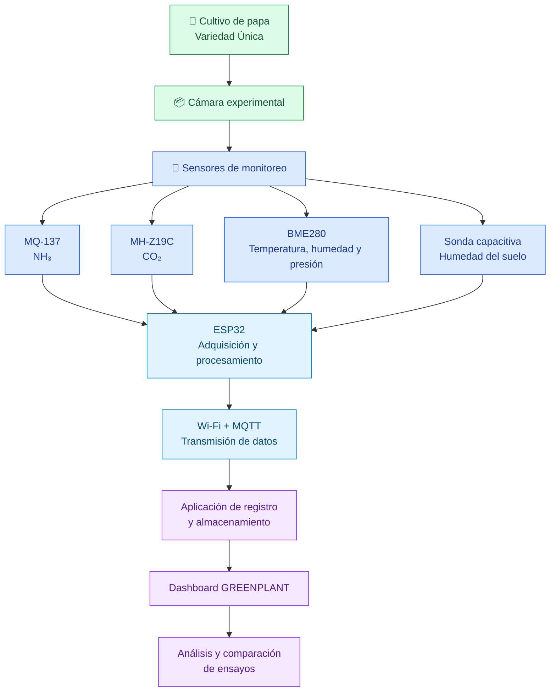

# GREENPLANT — TRL 2
## Formulación del concepto tecnológico

> **Proyecto:** sistema experimental de laboratorio para el monitoreo de NH₃(g), CO₂(g) y variables ambientales durante ensayos de fertilización con urea en papa (*Solanum tuberosum*), variedad Única.

## Datos del informe

| Campo | Información |
|:---|:---|
| **Curso** | Proyecto Integrador |
| **Integrantes** | Cesar Rodrigo Milla Gómez; Anderson Josue Delerna Infantes; Kevin Esty Carvallo Neciosup; Shedira Lumeris Sihuincha Palacin |
| **Ingenieros** | Umbert Lewis De La Cruz, Maria Rejas, Harry Rivera y Renzo Chan |
| **Fecha de actualización** | 03/11/2026 |
| **Institución** | Universidad Peruana Cayetano Heredia |
| **Tema** | TRL 2 de GREENPLANT — Formulación conceptual de la propuesta tecnológica |

## Contenido

1. [Introducción](#1-introducción)
2. [Estado del arte: artículos científicos que respaldan la propuesta](#2-estado-del-arte-artículos-científicos-que-respaldan-la-propuesta)
3. [Formulación del concepto tecnológico](#3-formulación-del-concepto-tecnológico)
4. [Arquitectura conceptual de GREENPLANT](#4-arquitectura-conceptual-de-greenplant)
5. [Evidencias del diseño conceptual](#5-evidencias-del-diseño-conceptual)
6. [Requisitos conceptuales](#6-requisitos-conceptuales)
7. [Análisis de patentabilidad y protección](#7-análisis-de-patentabilidad-y-protección)
8. [Perfil del proyecto](#8-perfil-del-proyecto)
9. [Cumplimiento de los indicadores del TRL 2](#9-cumplimiento-de-los-indicadores-del-trl-2)
10. [Conclusión](#10-conclusión)
11. [Referencias bibliográficas](#referencias-bibliográficas)

---

# 1. Introducción

## 1.1 Qué representa el TRL 2

Mankins describe los niveles de madurez tecnológica (TRL, por sus siglas en inglés) como una escala que avanza desde la observación de principios básicos hasta la operación de un sistema probado [[1]](#ref1). En el TRL 2 se formula el concepto tecnológico y se exploran sus aplicaciones prácticas, que todavía son especulativas. Este nivel se apoya en el análisis del estado del arte, da importancia a la propiedad intelectual y se desarrolla en un entorno de laboratorio.

Por ello, el objetivo de este informe no es demostrar que el sistema funciona, sino explicar por qué la solución podría funcionar, cómo se organizarían sus componentes y qué evidencia científica respalda cada decisión. Las pruebas de funcionamiento corresponden al TRL 3.

Para GREENPLANT, las evidencias del TRL 2 son seis: el estado del arte (sección 2), la formulación del concepto y la selección de sensores (sección 3), la arquitectura de la cámara, la electrónica y la comunicación (sección 4), los diseños conceptuales con sus figuras (sección 5), el análisis de patentabilidad (sección 7) y el perfil del proyecto con su plan experimental (sección 8).

## 1.2 Antecedentes provenientes del TRL 1

En el TRL 1 se estudiaron los principios físicos de los sensores para medir amoníaco gaseoso (NH₃), dióxido de carbono (CO₂), temperatura y humedad del aire, y humedad del sustrato. También se revisaron los fundamentos de la adquisición de datos con microcontroladores y de la transmisión de mediciones por Wi-Fi y MQTT.

En aquella etapa, el CO₂ se estudió con el sensor MH-Z19B. Para el TRL 2 se mantiene el mismo principio de medición, la absorción infrarroja no dispersiva (NDIR), pero se adopta el modelo MH-Z19C del mismo fabricante, por las razones que se explican en la sección 2.2. La selección vigente queda formada por cuatro sensores: **MQ-137** (NH₃), **MH-Z19C** (CO₂), **BME280** (temperatura, humedad y presión del aire) y una **sonda capacitiva v1.2** (humedad del suelo).

## 1.3 Objetivo del TRL 2

Formular el concepto tecnológico de **GREENPLANT**, un sistema experimental de laboratorio para monitorear NH₃(g), CO₂(g), temperatura, humedad relativa, presión atmosférica y humedad del suelo durante ensayos de fertilización con urea en plantas de papa de la variedad Única. Para ello se revisan los antecedentes científicos y tecnológicos, se justifican los sensores, se describe la cámara experimental, se define la arquitectura de adquisición y transmisión de datos, se presenta una propuesta visual del dashboard y se analiza la posibilidad de proteger la propuesta.

---

# 2. Estado del arte: artículos científicos que respaldan la propuesta

## 2.1 Monitoreo de amoníaco con sensores de bajo costo

Cuando la urea se aplica al suelo, la enzima ureasa la descompone en amonio y carbonato. Esta reacción eleva el pH alrededor del gránulo y favorece que parte del nitrógeno pase al aire como amoníaco gaseoso [[2]](#ref2). La magnitud de esta pérdida depende de las propiedades del suelo, como su capacidad de intercambio catiónico [[3]](#ref3), y de la forma de aplicación: la FAO y la IFA estiman pérdidas de 15 a 20 % del nitrógeno aplicado en superficie y de 5 a 15 % cuando la urea se incorpora [[4]](#ref4). Por eso, registrar el NH₃(g) permite estudiar cómo cambia su concentración bajo distintas condiciones de fertilización.

Petric et al. desarrollaron un dispositivo de monitoreo de amoníaco con un sensor MQ-137 conectado a una placa Croduino Basic 2 y compararon sus registros con un analizador Geotech GA5000. El estudio incluyó procedimientos de calibración y de evaluación de la repetibilidad [[5]](#ref5). Este trabajo demuestra que el MQ-137 puede usarse en un sistema electrónico de bajo costo, siempre que su respuesta se calibre frente a una referencia.

Según su fabricante, el MQ-137 es un sensor semiconductor cuyo material sensible es dióxido de estaño (SnO₂); detecta NH₃ entre 5 y 500 ppm, funciona con un calentador de 5 V y necesita más de 48 horas de precalentamiento antes de usarse [[6]](#ref6). Estas características definen la alimentación del sensor, el acondicionamiento de su señal y el procedimiento previo a los ensayos.

Huerta et al. mostraron que la temperatura y la humedad del aire alteran la respuesta de los sensores químicos de óxido metálico y propusieron un método para corregir esa interferencia durante el monitoreo continuo [[7]](#ref7). En consecuencia, GREENPLANT registrará la temperatura y la humedad del aire con el BME280 en el mismo instante que la señal de NH₃.

Finalmente, la patente china CN115097075B describe un equipo de campo para detectar en línea la volatilización de amoníaco. El equipo combina cuatro sensores de NH₃, uno de ellos un MQ-137, placas Arduino y un módulo inalámbrico ESP8266; sus lecturas se contrastaron con gas patrón y con el método de absorción en ácido [[8]](#ref8). Este documento confirma que la combinación de sensores de NH₃ con electrónica de bajo costo ya se aplica al estudio de la volatilización.

## 2.2 Monitoreo de dióxido de carbono con tecnología NDIR

El CO₂ es una variable complementaria en GREENPLANT. Dentro de la cámara, su concentración depende de la respiración de las raíces, de la actividad de los microorganismos y de la descomposición de la materia orgánica del suelo [[9]](#ref9), y también de la fotosíntesis de la planta cuando recibe luz [[10]](#ref10). Por ello, sus variaciones no se atribuirán solo a la urea.

Othman et al. construyeron una cámara de calibración para validar sensores de calidad del aire de bajo costo. En su estudio evaluaron el MH-Z19B frente a un monitor de referencia y corrigieron sus lecturas mediante regresión [[11]](#ref11). Aunque ese trabajo usó el MH-Z19B y no el MH-Z19C, ambos modelos miden con el mismo principio NDIR, por lo que el estudio aporta el método que GREENPLANT seguirá para evaluar su sensor en cámara. De forma complementaria, Dubey et al. evaluaron otros sensores NDIR y concluyeron que sus lecturas deben contrastarse con un instrumento de referencia antes de usarse en análisis posteriores [[12]](#ref12).

El MH-Z19C se eligió por cuatro características documentadas por el fabricante [[13]](#ref13): mide CO₂ por NDIR en rangos configurables de 400–2000, 400–5000 o 400–10000 ppm; funciona con 5,0 ± 0,1 V; se comunica por UART con nivel lógico de 3,3 V, el mismo que usa el ESP32, o por PWM; y necesita solo 1 minuto de precalentamiento. El fabricante también indica mantener ventilada su ventana de difusión y alejarlo de fuentes de calor [[13]](#ref13). El rango que traiga el sensor adquirido se verificará antes de configurar el firmware.

## 2.3 Monitoreo de las condiciones del aire y del sustrato

El BME280 mide temperatura, humedad relativa y presión atmosférica en un solo dispositivo y se comunica por I²C o SPI, lo que facilita su conexión con microcontroladores [[14]](#ref14). Bezborodov documentó un sistema de monitoreo ambiental basado en ESP32 que integra el BME280 y un sensor de CO₂ de la familia MH-Z19 [[15]](#ref15). Ese trabajo muestra una arquitectura en la que un microcontrolador recibe y organiza mediciones ambientales y de gases, aunque no valida el sistema GREENPLANT.

Para la humedad del suelo se usará una sonda capacitiva v1.2. Placidi et al. estudiaron sensores de bajo costo para medir el contenido de agua del suelo dentro de una arquitectura IoT de agricultura de precisión y relacionaron su señal con mediciones de referencia [[16]](#ref16). Como la respuesta de la sonda depende del sustrato y de su instalación, GREENPLANT la calibrará en el mismo sustrato del ensayo, comparando su señal con el contenido de agua obtenido por el método gravimétrico, es decir, pesando muestras húmedas y secas.

## 2.4 Medición de gases en cámaras experimentales

Una cámara experimental delimita el volumen de aire en el que se miden los gases. Davidson et al. analizaron las fuentes de error de este método y concluyeron que el volumen, el tiempo de medición, las fugas, el mezclado del aire y las perturbaciones que introduce la propia cámara deben controlarse o documentarse [[17]](#ref17). Baneschi et al. propusieron un protocolo para cámaras cerradas que recomienda elegir con cuidado el intervalo de medición, repetir los ensayos y ajustar la curva de concentración por regresión lineal, la opción que obtuvo la mejor reproducibilidad [[18]](#ref18).

Estos dos trabajos definen los criterios de diseño de la cámara de GREENPLANT: documentar su volumen útil, controlar el tiempo de cierre, revisar el sellado y repetir el mismo procedimiento en cada medición (sección 4).

## 2.5 Integración de sensores con ESP32 y comunicación IoT

Berrios Gomez y Rivera Herrera desarrollaron en el Perú un sistema IoT basado en ESP32 para monitorear variables ambientales y del suelo en un invernadero de lechugas, con nodos que enviaban la información a un nodo central para almacenarla y consultarla [[19]](#ref19). Este antecedente respalda el uso del ESP32 como unidad de adquisición en aplicaciones agrícolas.

Para la transmisión de datos se propone MQTT, un protocolo ligero de publicación y suscripción estandarizado por OASIS [[20]](#ref20). En GREENPLANT, el ESP32 leerá los sensores, agregará la identificación del ensayo y publicará cada registro por Wi-Fi hacia una aplicación de registro y visualización. La implementación y validación de esta comunicación corresponden al TRL 3.

## 2.6 Comparación de antecedentes

La Tabla 1 resume qué aporta cada antecedente y qué parte de GREENPLANT respalda.

*Tabla 1. Antecedentes científicos y tecnológicos que respaldan GREENPLANT.*

| Antecedente | Variable o función | Tecnología o método | Aporte para GREENPLANT |
|---|---|---|---|
| Petric et al. [[5]](#ref5) | Detección de NH₃ | MQ-137 con microcontrolador, comparado con un analizador | Sustenta el uso del MQ-137 y la necesidad de calibrarlo. |
| CN115097075B [[8]](#ref8) | Volatilización de NH₃ | Cuatro sensores de NH₃ (incluido un MQ-137), Arduino y ESP8266 | Confirma el uso de sensores de NH₃ con electrónica de bajo costo y su validación con gas patrón. |
| Huerta et al. [[7]](#ref7) | Efecto de la temperatura y la humedad en sensores químicos | Corrección de interferencias ambientales | Sustenta el registro simultáneo del aire con el BME280. |
| Othman et al. [[11]](#ref11) | Validación de sensores de calidad del aire | Cámara de calibración; incluye el MH-Z19B | Aporta el método de evaluación en cámara para el sensor NDIR. |
| Dubey et al. [[12]](#ref12) | Medición de CO₂ | Sensores NDIR y calibración | Respalda el contraste de las lecturas de CO₂ con una referencia. |
| Bezborodov [[15]](#ref15) | Monitoreo ambiental | ESP32, BME280 y sensor MH-Z19 | Muestra la compatibilidad de estos componentes. |
| Placidi et al. [[16]](#ref16) | Humedad del suelo | Sensores de bajo costo en agricultura de precisión | Sustenta la medición de la humedad del sustrato y su calibración. |
| Davidson et al. [[17]](#ref17) y Baneschi et al. [[18]](#ref18) | Medición de gases en cámaras | Análisis de errores y protocolo de cámara cerrada | Orientan el diseño de la cámara y el procedimiento de medición. |
| Berrios Gomez y Rivera Herrera [[19]](#ref19) | Variables ambientales y del suelo | ESP32 y arquitectura IoT | Respalda la integración de sensores con ESP32. |
| **GREENPLANT** | **NH₃, CO₂, aire y humedad del suelo** | **MQ-137, MH-Z19C, BME280, sonda capacitiva, ESP32 y Wi-Fi/MQTT** | **Comparar en laboratorio el NH₃ registrado bajo distintas dosis y formas de aplicación de urea en papa.** |

En conjunto, estos antecedentes muestran que es viable integrar sensores de gases, del aire y del suelo en un sistema basado en ESP32. Sin embargo, ninguno combina estos sensores en una cámara de laboratorio para comparar tratamientos de urea en papa variedad Única; ese es el espacio que GREENPLANT explora y que deberá comprobarse en las siguientes etapas.

---

# 3. Formulación del concepto tecnológico

## 3.1 Concepto de GREENPLANT

GREENPLANT es un sistema experimental de laboratorio que registra las concentraciones de NH₃(g) y CO₂(g), junto con las condiciones del aire y la humedad del sustrato, durante ensayos de fertilización con urea en plantas de papa de la variedad Única.

Se eligió esta variedad porque fue liberada en el Perú en 1998 por la Universidad Nacional San Luis Gonzaga de Ica y el Centro Internacional de la Papa, se cultiva desde la costa hasta la sierra y tolera el calor, lo que favorece su manejo en un laboratorio de Lima [[21]](#ref21). Además, existe un antecedente de su cultivo en invernadero con fertilización con urea [[22]](#ref22). La relevancia del cultivo también justifica el proyecto: más de 700 mil agricultores de 19 regiones sostienen la producción de papa en el país [[23]](#ref23).

El sistema integra una cámara experimental, cuatro sensores, un microcontrolador ESP32, una placa electrónica propia y una plataforma de visualización. La variable principal es la concentración de NH₃; el CO₂ se registra como variable complementaria.

## 3.2 Problema y justificación

Parte del nitrógeno de la urea puede perderse hacia la atmósfera como NH₃(g). La magnitud de esa pérdida depende del pH, la temperatura, la humedad del suelo, las propiedades del sustrato y la forma de aplicación [[2]](#ref2), [[4]](#ref4).

En papa, Wan et al. estudiaron el efecto de la dosis de nitrógeno y de un inhibidor de ureasa sobre la volatilización de amoníaco y observaron picos entre uno y cinco días después de fertilizar, además de mayor volatilización con dosis más altas [[24]](#ref24). Lee et al. compararon la volatilización de amoníaco en suelos fertilizados con urea y sulfato de amonio durante cultivos que incluyeron papa [[25]](#ref25). Por su parte, Rochette et al. demostraron que la profundidad de incorporación de la urea modifica la volatilización y la retención de nitrógeno [[26]](#ref26).

Estos estudios se realizaron en campo y con otras variedades. Hace falta una herramienta de laboratorio, de bajo costo, que permita comparar el efecto de la dosis y de la forma de aplicación con la variedad Única bajo condiciones controladas. GREENPLANT responde a esa necesidad.

> **Precisión sobre las unidades:** las lecturas en ppm describen la concentración de gas dentro de la cámara. Por sí solas no equivalen a la masa de nitrógeno perdida; para calcularla se necesita el procedimiento de la sección 8.4.

## 3.3 Pregunta de investigación e hipótesis

**Pregunta de investigación.** ¿Cómo varía la concentración de NH₃(g) registrada en una cámara experimental con plantas de papa variedad Única según la dosis (80 o 160 kg N/ha) y la forma de aplicación (superficial o incorporada) de la urea, considerando el CO₂(g), las condiciones del aire y la humedad del sustrato?

**Hipótesis de trabajo (H₁).** Con la misma dosis, la urea aplicada en superficie producirá concentraciones de NH₃(g) mayores que la urea incorporada. Con la misma forma de aplicación, la dosis de 160 kg N/ha producirá concentraciones mayores que la de 80 kg N/ha. Esta dirección se basa en las mayores pérdidas reportadas para la aplicación superficial [[4]](#ref4), [[2]](#ref2), en el efecto de la profundidad de incorporación [[26]](#ref26) y en el aumento de la volatilización con la dosis observado en papa [[24]](#ref24).

**Hipótesis nula (H₀).** La dosis y la forma de aplicación de la urea no producen diferencias en la concentración de NH₃(g) registrada.

## 3.4 Objetivos

**Objetivo general.** Formular un sistema experimental de laboratorio que registre NH₃(g), CO₂(g), temperatura, humedad relativa, presión atmosférica y humedad del suelo, y que permita comparar de forma relativa la concentración de NH₃(g) entre dosis y formas de aplicación de urea en plantas de papa variedad Única.

**Objetivos específicos.**

1. Sustentar la selección de los sensores y del esquema de medición con artículos científicos y documentación técnica.
2. Definir el diseño conceptual de la cámara experimental y la ubicación de los sensores.
3. Plantear la integración de los cuatro sensores con un ESP32 en una placa electrónica propia.
4. Definir la arquitectura de comunicación y registro de datos mediante Wi-Fi y MQTT.
5. Proponer una interfaz de visualización para consultar las mediciones y comparar ensayos.
6. Formular el procedimiento experimental para comparar el NH₃ registrado entre tratamientos.

## 3.5 Sensores seleccionados

La Tabla 2 presenta los cuatro sensores y la función de cada uno. El ESP32 no es un sensor: es la unidad que lee, organiza y transmite las mediciones.

*Tabla 2. Sensores seleccionados para GREENPLANT.*

| N.º | Sensor | Variable medida | Principio e interfaz | Función |
|---:|---|---|---|---|
| 1 | **MQ-137** | NH₃ | Semiconductor de SnO₂ con calentador de 5 V; salida analógica [[6]](#ref6) | Medir la variable principal. |
| 2 | **MH-Z19C** | CO₂ | Infrarrojo NDIR; salida UART (3,3 V) o PWM [[13]](#ref13) | Medir la variable complementaria. |
| 3 | **BME280** | Temperatura, humedad relativa y presión | Sensor digital; I²C o SPI [[14]](#ref14) | Registrar las condiciones del aire. |
| 4 | **Sonda capacitiva v1.2** | Humedad del suelo | Salida analógica que se calibra en el sustrato [[16]](#ref16) | Registrar la humedad del sustrato. |

Cada sensor requiere una preparación antes de usarse en los ensayos:

- **MQ-137:** precalentamiento de más de 48 horas y calibración con gas patrón de concentración conocida [[6]](#ref6), [[5]](#ref5).
- **MH-Z19C:** verificación del rango configurado y contraste con una referencia [[13]](#ref13), [[11]](#ref11).
- **BME280:** ubicación lejos del regulador de voltaje y del calentador del MQ-137, porque su lectura de temperatura se ve afectada por el calor del circuito [[14]](#ref14).
- **Sonda capacitiva:** calibración gravimétrica en el sustrato del ensayo [[16]](#ref16).

## 3.6 Variables registradas

*Tabla 3. Variables que registrará GREENPLANT.*

| Tipo | Variable | Unidad o identificación | Procedencia |
|---|---|---|---|
| Principal | Concentración de NH₃ | ppm | MQ-137 |
| Complementaria | Concentración de CO₂ | ppm | MH-Z19C |
| Ambiental | Temperatura | °C | BME280 |
| Ambiental | Humedad relativa | % | BME280 |
| Ambiental | Presión atmosférica | hPa | BME280 |
| Sustrato | Humedad del suelo | % (después de la calibración) | Sonda capacitiva |
| Experimental | Fecha, hora y tiempo de cierre | fecha / hora / min | ESP32 |
| Experimental | Tratamiento, repetición y maceta | Código | Registro del usuario |
| Experimental | Dosis de nitrógeno | kg N/ha | Diseño del ensayo |
| Experimental | Forma de aplicación | Superficial / incorporada | Diseño del ensayo |
| Experimental | Iluminación | Encendida / apagada y duración | Registro del procedimiento |

La iluminación se registra como condición del ensayo porque la fotosíntesis modifica el CO₂ [[10]](#ref10); no se incluye un sensor de luz.

---

# 4. Arquitectura conceptual de GREENPLANT

## 4.1 Cámara experimental

La cámara es el espacio donde se coloca una planta joven de papa con su sustrato. Se modeló en Onshape como tres piezas fabricables por impresión 3D en PETG que se apilan sobre una misma huella de 180 × 180 mm: la base, el soporte/planta y la tapa (Figuras 6 a 9).

*Tabla 4. Dimensiones del modelo de la cámara.*

| Elemento | Dimensión o característica |
|---|---|
| Huella de la base | 180 × 180 mm |
| Lado exterior del soporte/planta | 180 mm |
| Distancia interior entre paredes | 170 mm |
| Altura del soporte/planta | 200 mm |
| Tapa | 180 × 180 mm, 4,082 mm de espesor |
| Fijación de la tapa | Cuatro perforaciones en las esquinas |
| Material | PETG |

La base aloja la placa electrónica y la fuente de alimentación, separadas del aire que se mide. Su cara superior tiene aberturas que comunican los sensores con la cámara y su frente incluye un soporte inclinado para la pantalla. El soporte/planta forma las paredes de la cámara y deja una cara abierta para colocar o retirar la maceta; durante las mediciones, esa cara se cerrará con un panel para evitar el intercambio de aire no controlado [[17]](#ref17).

## 4.2 Volumen interno y concentración esperada

Con las cotas interiores del modelo (170 × 170 × 200 mm), la cámara tiene un volumen de 5,8 L. Una maceta de 15 cm de diámetro superior, 12 cm de diámetro inferior y 13 cm de altura ocupa 1,9 L, por lo que quedan unos 3,9 L de aire. Este volumen se verificará cuando la cámara esté impresa, porque es necesario para interpretar las concentraciones medidas [[17]](#ref17), [[18]](#ref18).

Con ese volumen se estimó si el MQ-137 podrá detectar el amoníaco esperado. El cálculo sigue tres pasos:

1. **Nitrógeno aplicado por maceta.** La superficie de la maceta es de 0,0177 m². Una dosis de 80 kg N/ha equivale a 8 g N/m², es decir, 0,14 g de N por maceta; 160 kg N/ha equivalen a 0,28 g.
2. **Amoníaco liberado durante el cierre.** Se supone que se pierde entre 5 y 20 % de ese nitrógeno, rango reportado por la FAO y la IFA [[4]](#ref4), repartido en los cinco días en que Wan et al. observaron los picos [[24]](#ref24). La masa de nitrógeno se convierte en masa de NH₃ multiplicándola por 17,03/14,01, y se toma la fracción correspondiente al tiempo de cierre.
3. **Concentración en la cámara.** La masa de NH₃ se divide entre los 3,9 L de aire y se convierte a ppm con el volumen molar del aire a 25 °C y 1 atm (24,45 L/mol):

$$
C_{\text{ppm}}=\frac{m_{\text{NH}_3}\ (\text{mg})}{V\ (\text{m}^3)}\times\frac{24{,}45}{17{,}03}
$$

Con estos supuestos, un cierre de 10 minutos produciría entre 4 y 35 ppm, y uno de 30 minutos, entre 13 y 105 ppm. Como el MQ-137 detecta desde 5 ppm [[6]](#ref6), el cierre de 10 minutos dejaría el caso más bajo por debajo de su rango; por eso se propone cerrar la cámara 30 minutos. **Esta es una estimación de orden de magnitud y no una medición:** no considera fugas, adsorción en las paredes ni picos mayores al promedio diario, y se comprobará en el TRL 3.

Como la maceta mide 13 cm y la cámara 20 cm, quedan unos 7 cm libres sobre el sustrato. Por eso las mediciones se concentran en plantas jóvenes y en los primeros días después de aplicar la urea; para estudiar plantas más desarrolladas habrá que aumentar la altura del soporte/planta.

## 4.3 Ubicación de los sensores

Cada sensor se ubicará según la variable que mide:

- **MQ-137:** en contacto con el aire interno de la cámara, sin tocar el sustrato.
- **MH-Z19C:** en el aire de la cámara, con su ventana de difusión libre y lejos de fuentes de calor, como indica el fabricante [[13]](#ref13).
- **BME280:** lejos del regulador LM2596 y del calentador del MQ-137 [[14]](#ref14), [[6]](#ref6).
- **Sonda capacitiva:** insertada en el sustrato a la misma profundidad y en la misma posición en todos los ensayos.

La distribución permitirá revisar y reemplazar cada sensor sin desmontar toda la cámara.

## 4.4 Módulo electrónico: placa PCB3

El ESP32 es la unidad central de adquisición. El equipo diseñó en EasyEDA Pro una placa propia, la PCB3, de dos capas y aproximadamente 107 × 110 mm, con cuatro perforaciones de 3,1 mm para tornillos M3, de modo que cabe dentro de la base (Figuras 10 a 14). La placa reúne los conectores de los sensores, el ESP32, la pantalla LCD 1602, el módulo de relés y la distribución de la alimentación. Sus archivos de fabricación están listos, pero la placa todavía no se ha fabricado ni probado.

**Compatibilidad con el MH-Z19C.** La PCB3 se diseñó cuando el sensor previsto era el MH-Z19B. Su conector de cuatro pines lleva 5 V, tierra, RX y TX, las mismas señales que el manual del MH-Z19C define como Vin, GND, Rx y Tx, con UART de 3,3 V [[13]](#ref13). Por tanto, la conexión eléctrica es compatible. Antes de fabricar la siguiente versión debe confirmarse que el orden de pines rotulado junto al conector (Tx, Rx, −, +; Figura 12) coincide con el del modelo adquirido, y cambiar en la serigrafía el rótulo «MH-Z19B» por «MH-Z19C» (Figura 13).

## 4.5 Alimentación y acondicionamiento de señales

La alimentación entra a 12 V. Un convertidor reductor LM2596 obtiene 5 V para el ESP32, los sensores, la pantalla y el módulo de relés [[27]](#ref27), mientras que la línea de 12 V alimenta el ventilador y la iluminación LED. La pantalla LCD 1602 se conecta mediante un adaptador I²C basado en un expansor de entradas y salidas como el PCF8574 [[28]](#ref28); como trabaja a 5 V y el ESP32 a 3,3 V, la placa incluye un conversor de nivel lógico, técnica descrita por NXP para buses I²C [[29]](#ref29).

La revisión de la PCB3 detectó dos errores de diseño que se corregirán en la siguiente versión de la placa (PCB4):

1. **Salidas del MQ-137 sin adaptación.** El circuito del MQ-137 trabaja con 5 V [[6]](#ref6), por lo que su salida puede acercarse a ese valor, mientras que las entradas del ESP32 admiten como máximo 3,3 V [[30]](#ref30). Además, con una atenuación de 11 dB, el intervalo de medición recomendado del convertidor analógico-digital es de 150 a 2450 mV [[31]](#ref31). La PCB4 incluirá un divisor resistivo en la salida analógica y una adaptación de nivel en la salida digital; la sonda capacitiva recibirá la misma corrección si su salida supera ese intervalo.
2. **Ventilador y luz LED sin control.** En la PCB3 ambos reciben 12 V directamente, de modo que los relés no pueden encenderlos ni apagarlos. En la PCB4, la línea positiva de cada carga pasará por los contactos de un relé de 5 V [[32]](#ref32), para que el ESP32 controle el mezclado del aire y el periodo de luz.

Las entradas analógicas se asignaron a GPIO32 y GPIO34, que pertenecen al ADC1 del ESP32, porque el ADC2 no puede usarse mientras el Wi-Fi está activo [[31]](#ref31).

## 4.6 Adquisición y comunicación de datos

La adquisición seguirá esta secuencia:

1. El ESP32 inicializa los sensores y las interfaces de comunicación.
2. Lee NH₃, CO₂, temperatura, humedad relativa, presión y humedad del suelo.
3. Asocia cada lectura con la fecha, la hora, el ensayo y la condición experimental.
4. Organiza los datos en formato JSON.
5. Publica los registros por Wi-Fi mediante MQTT [[20]](#ref20).
6. La aplicación receptora almacena los registros y los muestra en el dashboard.

Cada registro conservará la señal original del sensor y el valor calculado, para poder recalcular los datos si cambia la calibración.

## 4.7 Dashboard

Se propone una interfaz web para consultar las mediciones. Incluye una tarjeta principal para el NH₃, una para el CO₂, indicadores de temperatura, humedad, presión y humedad del suelo, gráficos de evolución temporal, la identificación del ensayo activo, el historial de registros, la comparación entre tratamientos y el estado de conexión del ESP32 y de los sensores (Figuras 15 a 21).

Las pantallas del prototipo muestran valores de ejemplo marcados como **DATOS SIMULADOS**. Sirven solo para mostrar la distribución de la interfaz: no son mediciones reales ni datos adquiridos por el ESP32.

## 4.8 Flujo conceptual del sistema

La Figura 1 resume el recorrido de la información, desde el cultivo hasta el análisis de los ensayos.

<em>Figura 1. Flujo conceptual de la información en GREENPLANT.</em>

---

# 5. Evidencias del diseño conceptual

Esta sección reúne las figuras que documentan el diseño. Son evidencias de formulación, no resultados de pruebas.

## 5.1 Matriz morfológica

La matriz morfológica comparó alternativas para cada función del sistema: sensado de gases, medición ambiental, monitoreo del suelo, procesamiento, estructura, alimentación, comunicación y visualización (Figura 2). La matriz conserva las opciones evaluadas en ese momento, entre ellas el ZE03-NH₃ y el MH-Z19B, que no forman parte de la selección final.

La selección final se justifica así. El **MQ-137** reemplazó a la alternativa electroquímica porque cuenta con un antecedente experimental de calibración frente a un analizador [[5]](#ref5), ya se usa en un equipo patentado para medir la volatilización de amoníaco [[8]](#ref8) y su rango de 5 a 500 ppm [[6]](#ref6) cubre las concentraciones estimadas en la sección 4.2 (13 a 105 ppm). El **MH-Z19C** reemplazó al MH-Z19B porque mantiene el principio NDIR que Othman et al. evaluaron en cámara [[11]](#ref11), ofrece rangos configurables hasta 10000 ppm, usa la misma interfaz UART de 3,3 V y necesita solo 1 minuto de precalentamiento [[13]](#ref13).

*Tabla 5. Configuración final de GREENPLANT.*

| Subsistema | Componente seleccionado | Función |
|---|---|---|
| Detección de NH₃ | MQ-137 | Medir el amoníaco gaseoso. |
| Detección de CO₂ | MH-Z19C | Medir el dióxido de carbono. |
| Condiciones del aire | BME280 | Medir temperatura, humedad relativa y presión. |
| Humedad del suelo | Sonda capacitiva v1.2 | Registrar la humedad del sustrato. |
| Procesamiento | ESP32 | Adquirir y organizar las señales. |
| Cámara | Estructura modular de PETG | Alojar la planta y delimitar el volumen de medición. |
| Comunicación | Wi-Fi + MQTT | Transmitir los registros a la aplicación. |
| Visualización | Dashboard web | Consultar las mediciones y el historial. |

  

<em>Figura 2. Matriz morfológica de GREENPLANT con las alternativas evaluadas para cada función.</em>

## 5.2 Bocetos conceptuales

Los bocetos representan alternativas de distribución de la cámara, la planta, los sensores y la electrónica. Sirvieron para definir el modelo tridimensional (Figuras 3 a 5).

  

<em>Figura 3. Primera propuesta de diseño conceptual de GREENPLANT.</em>

  

<em>Figura 4. Segunda propuesta de diseño conceptual de GREENPLANT.</em>

  

<em>Figura 5. Tercera propuesta de diseño conceptual de GREENPLANT.</em>

## 5.3 Modelo tridimensional de la cámara

El modelo de Onshape separa la electrónica del aire donde se mide y deja puntos de acceso para instalar los sensores (sección 4.1).

  

<em>Figura 6. Vista de conjunto del prototipo modelado en Onshape: tapa, cámara (soporte/planta) y base.</em>

  

<em>Figura 7. Plano de la base: vistas superior, frontal, lateral e isométrica.</em>

  

<em>Figura 8. Plano del soporte/planta: cámara experimental con una cara de acceso.</em>

  

<em>Figura 9. Plano de la tapa: placa de 180 × 180 mm con perforaciones de fijación.</em>

## 5.4 Diseño electrónico preliminar

El esquemático, elaborado en EasyEDA, organiza los módulos de sensado de NH₃ y CO₂, de condiciones del aire y de humedad del suelo, junto con el procesamiento, la alimentación y el control de dispositivos auxiliares (Figura 10). La Figura 11 muestra la distribución de esos componentes en la PCB3, y las Figuras 12 a 14 presentan la placa tal como quedó diseñada en EasyEDA Pro, en vista de trazado y en vistas 3D de ambas caras. Sus características y correcciones se describen en las secciones 4.4 y 4.5.

  

<em>Figura 10. Esquemático electrónico preliminar de GREENPLANT desarrollado en EasyEDA.</em>

  

<em>Figura 11. Guía de distribución de componentes de la PCB3: sensores, control, salidas y alimentación.</em>

**Trazado de la placa.** La Figura 12 muestra la capa superior de la PCB3 en el editor de EasyEDA Pro. La regla superior, en milésimas de pulgada (mil), indica un ancho de unos 4200 mil, equivalente a los 107 mm de la placa, y en las cuatro esquinas se ven las perforaciones para tornillos M3. Toda la superficie lleva un relleno de cobre, sobre el que se distinguen las pistas que unen cada conector con el ESP32 y con el LM2596. Junto a los conectores del borde izquierdo, la serigrafía rotula el orden de los pines de cada sensor (por ejemplo, A0 y D0 para el MQ-137; Tx y Rx para el sensor de CO₂; SDA y SCL para el BME280), lo que evita errores de conexión al montar la placa.

  

<em>Figura 12. Trazado de la capa superior de la PCB3 en EasyEDA Pro, con la regla en mil, las perforaciones de montaje y el rótulo de pines de cada conector.</em>

**Vista 3D de la cara superior.** La Figura 13 permite identificar el tipo de cada conexión. Los sensores (MQ-137, sensor de CO₂ y BME280), la pantalla LCD 1602 y el módulo de relés usan conectores blancos de cuatro pines, y la sonda de humedad (P1), uno de tres pines; por eso cada sensor puede ubicarse en la cámara mediante un cable y reemplazarse sin soldar, como exige el requisito de mantenimiento de la sección 6. La alimentación, la luz LED y el ventilador usan borneras verdes de tornillo, adecuadas para los cables de 12 V. El conversor de nivel lógico aparece como un módulo azul, mientras que el ESP32 y el LM2596 se representan solo por su contorno, porque se insertan como módulos sobre la placa.

  

<em>Figura 13. Vista 3D de la cara superior de la PCB3: conectores de los sensores, borneras de potencia, conversor de nivel y contornos del ESP32 y del LM2596.</em>

**Vista 3D de la cara inferior.** La Figura 14 muestra la segunda capa de cobre, por la que pasan las pistas que no caben en la cara superior, y los puntos de soldadura de los componentes de inserción. Esta vista confirma que la PCB3 es una placa de dos capas y que lleva el emblema de la Universidad Peruana Cayetano Heredia.

  

<em>Figura 14. Vista 3D de la cara inferior de la PCB3, con las pistas de la segunda capa y los puntos de soldadura.</em>

## 5.5 Diseño conceptual del dashboard

El prototipo visual del dashboard tiene siete pantallas: monitoreo general, sensores, gestión de ensayos, análisis comparativo, historial, estado del dispositivo y arquitectura del sistema. Todas usan **DATOS SIMULADOS**.

**Dashboard principal.** Presenta los indicadores de NH₃, CO₂, temperatura, humedad relativa, presión y humedad del suelo, con gráficos temporales y el estado general de los componentes (Figura 15).

  

<em>Figura 15. Propuesta del dashboard principal de GREENPLANT.</em>

**Monitoreo de sensores.** Muestra por separado las mediciones del MQ-137, el MH-Z19C, el BME280 y la sonda capacitiva, cada una con su gráfico (Figura 16).

  

<em>Figura 16. Propuesta del módulo de monitoreo de sensores.</em>

**Gestión de ensayos y análisis comparativo.** El módulo de ensayos registra las condiciones de cada tratamiento: dosis de 0, 80 y 160 kg N/ha y aplicación superficial o incorporada (Figura 17). El módulo de análisis compara las concentraciones de NH₃ y CO₂ entre tratamientos mediante gráficos y tablas (Figura 18).

  

<em>Figura 17. Propuesta del módulo de gestión de ensayos experimentales.</em>

  

<em>Figura 18. Propuesta del módulo de análisis comparativo entre tratamientos.</em>

**Historial y estado del dispositivo.** El historial permite consultar los registros por ensayo, fecha y hora, y exportarlos en CSV o Excel (Figura 19). La pantalla de estado muestra el funcionamiento del ESP32, la conexión Wi-Fi y MQTT y el estado de cada sensor (Figura 20).

  

<em>Figura 19. Propuesta del historial de mediciones experimentales.</em>

  

<em>Figura 20. Propuesta de la pantalla de estado del dispositivo y sus componentes.</em>

**Arquitectura del sistema.** Representa dentro del dashboard el mismo flujo de la Figura 1: cultivo, cámara, sensores, ESP32, Wi-Fi y MQTT, y dashboard (Figura 21).

  

<em>Figura 21. Pantalla de arquitectura y flujo de información de GREENPLANT.</em>

---

# 6. Requisitos conceptuales

A partir de la propuesta, el sistema deberá cumplir los siguientes requisitos en las etapas posteriores:

1. **Monitoreo de gases.** Registrar el NH₃(g) con el MQ-137 como variable principal y el CO₂(g) con el MH-Z19C como variable complementaria.
2. **Monitoreo del aire.** Registrar temperatura, humedad relativa y presión con el BME280 durante cada medición, para considerar su efecto sobre los sensores de gases [[7]](#ref7).
3. **Monitoreo del sustrato.** Registrar la humedad del suelo con la sonda capacitiva, calibrada en el sustrato del ensayo [[16]](#ref16).
4. **Cámara.** Alojar una planta joven y su sustrato, mantener los sensores en posiciones fijas, delimitar un volumen de aire conocido y cerrarse durante las mediciones [[17]](#ref17).
5. **Adquisición.** Asociar cada lectura con la fecha, la hora, el ensayo y la condición experimental.
6. **Comunicación.** Transmitir los registros por Wi-Fi y MQTT sin perder la identificación del ensayo [[20]](#ref20).
7. **Visualización.** Mostrar las seis variables, sus tendencias, el historial y la comparación entre tratamientos.
8. **Comparación experimental.** Organizar los datos por tratamiento, dosis, forma de aplicación, repetición y día.
9. **Mantenimiento y seguridad.** Permitir inspeccionar y reemplazar cada sensor, proteger la electrónica de la humedad y del sustrato, y ventilar la cámara antes de abrirla después de cada medición.

---

# 7. Análisis de patentabilidad y protección

## 7.1 Requisitos de patentabilidad

El análisis se basa en la Decisión 486 de la Comunidad Andina, que establece el régimen común de propiedad industrial vigente en el Perú [[33]](#ref33). Según esta norma, una invención es patentable si cumple tres requisitos: **novedad**, es decir, no estar comprendida en el estado de la técnica (artículo 16); **nivel inventivo**, es decir, no resultar obvia para una persona del oficio (artículo 18); y **aplicación industrial**, es decir, poder producirse o usarse en cualquier industria (artículo 19). La misma norma define el **modelo de utilidad** como una nueva forma, configuración o disposición de elementos de un objeto que le dé un mejor funcionamiento o una ventaja técnica que antes no tenía (artículo 81) [[33]](#ref33).

Como GREENPLANT usa sensores comerciales y un microcontrolador de uso extendido, su posible aporte protegible no está en el principio de medición, sino en la configuración física de la cámara.

## 7.2 Búsqueda de patentes relacionadas

Se buscaron patentes en Google Patents y Patsnap con términos como «ammonia volatilization detection device», «plant growth chamber CO₂» y «greenhouse environmental monitoring system». Se encontraron cuatro documentos cercanos:

- **CN115097075B**, de la Universidad de Ciencia y Tecnología de Kunming, solicitada en 2022. Describe un equipo de campo para detectar en línea la volatilización de amoníaco, con una cámara de gas, cuatro sensores de NH₃ (uno de ellos un MQ-137), placas Arduino y un módulo inalámbrico ESP8266 [[8]](#ref8).
- **US5341595A**, de Griggs, Bartley y Rule, de 1994. Describe una cámara de crecimiento exterior hermética, con control de temperatura y humedad, adaptada para analizar la absorción de CO₂ por las plantas [[34]](#ref34).
- **CN114365649A**, de Liu, publicada en 2022. Propone un sistema de monitoreo y control para invernaderos con sensores ambientales y de suelo, ventilación e iluminación; la solicitud fue rechazada en 2024 [[35]](#ref35).
- **US7341694B2**, de Nishiyama et al., de 2008. Protege un sensor de amoníaco con una capa sensible de ZrO₂ que contiene tungsteno [[36]](#ref36).

## 7.3 Comparación con GREENPLANT

*Tabla 6. Patentes relacionadas y diferencias con GREENPLANT.*

| Documento | Elemento en común | Diferencia con GREENPLANT |
|---|---|---|
| CN115097075B [[8]](#ref8) | Detección de la volatilización de NH₃ con un MQ-137 y electrónica de bajo costo | Es un equipo de campo; no mide CO₂, condiciones del aire ni humedad del sustrato. |
| US5341595A [[34]](#ref34) | Cámara para estudiar el intercambio de CO₂ en plantas | No mide NH₃ ni está orientada a la fertilización; es una cámara grande, no un equipo de bajo costo. |
| CN114365649A [[35]](#ref35) | Sensores ambientales y de suelo con monitoreo remoto | No mide NH₃ ni compara tratamientos de urea. |
| US7341694B2 [[36]](#ref36) | Detección de amoníaco | Protege un elemento sensor; GREENPLANT usa sensores comerciales. |

La búsqueda es preliminar. En la siguiente etapa se ampliará a la base de datos de INDECOPI y a Espacenet, y no reemplaza una búsqueda oficial ni una opinión legal.

## 7.4 Evaluación y estrategia de protección

**Patente de invención.** La combinación exacta de NH₃, CO₂, condiciones del aire y humedad del sustrato en una cámara para comparar tratamientos de urea no apareció en la búsqueda. Sin embargo, sus partes ya existen [[8]](#ref8), [[34]](#ref34), [[35]](#ref35), y combinar sensores comerciales con un microcontrolador sería previsible para una persona del oficio. Por falta de nivel inventivo (artículo 18) [[33]](#ref33), no se recomienda solicitar una patente de invención.

**Modelo de utilidad.** La configuración de la cámara podría protegerse como modelo de utilidad si se demuestra una ventaja técnica concreta [[33]](#ref33); la solicitud ante INDECOPI exige describir esa ventaja [[37]](#ref37). Las características candidatas son la separación entre la electrónica y el aire medido dentro de una misma huella de 180 × 180 mm, las aberturas que comunican los sensores con la cámara y la unión desmontable de las tres piezas. Como una caja protectora para electrónica ya es una práctica conocida [[19]](#ref19), la solicitud solo sería viable si los ensayos del TRL 3 demuestran, por ejemplo, que la separación reduce el calentamiento del aire de la cámara por la electrónica.

**Derecho de autor.** El software para adquirir, organizar, transmitir y visualizar los datos se protegerá como programa de ordenador. El equipo conservará sus versiones, documentará su autoría y distinguirá las bibliotecas de terceros; INDECOPI permite registrarlo en su plataforma de Registro Virtual de Obras [[38]](#ref38).

**Divulgación.** En el Perú, la divulgación de una invención dentro de los 12 meses anteriores a la solicitud no afecta su novedad [[39]](#ref39). Como GREENPLANT se presentará en las exposiciones del curso, la fecha de la primera presentación pública inicia ese plazo si el equipo decide solicitar un modelo de utilidad.

---

# 8. Perfil del proyecto

## 8.1 Título

**GREENPLANT: sistema experimental de laboratorio para el monitoreo de NH₃(g), CO₂(g) y variables ambientales durante ensayos de fertilización con urea en papa (*Solanum tuberosum*) variedad Única.**

## 8.2 Usuarios y beneficiarios

El sistema está dirigido a estudiantes, investigadores y responsables de ensayos agrícolas que necesiten registrar y comparar concentraciones de gases y condiciones ambientales en pruebas controladas de fertilización. Sus resultados apoyarán el análisis experimental del NH₃, pero no reemplazarán el análisis agronómico del suelo ni la validación en campo.

## 8.3 Plan experimental

### 8.3.1 Tratamientos

El ensayo tendrá cinco tratamientos (Tabla 7).

*Tabla 7. Tratamientos del ensayo.*

| Código | Condición | Dosis de nitrógeno | Forma de aplicación |
|---|---|---:|---|
| T0 | Control | 0 kg N/ha | Sin urea |
| T1 | Dosis baja | 80 kg N/ha | Superficial |
| T2 | Dosis baja | 80 kg N/ha | Incorporada |
| T3 | Dosis alta | 160 kg N/ha | Superficial |
| T4 | Dosis alta | 160 kg N/ha | Incorporada |

Las dosis de 80 y 160 kg N/ha son las que Zúñiga et al. evaluaron en papa en la sierra central del Perú [[40]](#ref40). Como ese estudio usó variedades nativas, se toman como niveles de comparación y no como recomendación agronómica para Única. En la aplicación superficial, los gránulos quedarán sobre el sustrato; en la incorporada, se enterrarán a unos 5 cm, profundidad dentro del intervalo en el que la incorporación reduce la pérdida de amoníaco [[2]](#ref2), [[26]](#ref26).

### 8.3.2 Cantidad de urea por maceta

La urea comercial se etiqueta con 46 % de nitrógeno. La masa de urea equivalente a una dosis de nitrógeno se calcula así:

$$
\text{Urea (kg/ha)}=\frac{\text{N (kg/ha)}}{0{,}46}
$$

*Tabla 8. Equivalencia entre la dosis de nitrógeno y la masa de urea, para una maceta de 15 cm de diámetro (0,018 m²).*

| Tratamiento | Dosis de N | Urea por hectárea | N por maceta | Urea por maceta |
|---|---:|---:|---:|---:|
| T0 | 0 kg N/ha | 0 kg/ha | 0 g | 0 g |
| T1 y T2 | 80 kg N/ha | 173,9 kg/ha | 0,144 g | 0,31 g |
| T3 y T4 | 160 kg N/ha | 347,8 kg/ha | 0,288 g | 0,63 g |

Estos valores se ajustarán a la superficie real de la maceta y al porcentaje de nitrógeno de la etiqueta del fertilizante, y se pesarán con una balanza de 0,01 g.

### 8.3.3 Momento de aplicación

La urea se aplicará en la siembra. En el cultivo comercial, el INIA recomienda aplicar la mitad del nitrógeno en la siembra y la otra mitad, como urea, en el primer aporque [[41]](#ref41). El ensayo evalúa solo la aplicación en la siembra por dos razones: la altura de la cámara limita las mediciones a plantas jóvenes (sección 4.2) y los picos de volatilización ocurren en los primeros días después de fertilizar [[24]](#ref24). Por ello, sus resultados describen una condición de ensayo y no una recomendación de manejo.

### 8.3.4 Repeticiones y organización en ciclos

Cada tratamiento tendrá tres repeticiones, es decir, 15 macetas. Este número es coherente con las tres o cuatro repeticiones en bloques completos al azar que se usaron para evaluar la variedad Única [[21]](#ref21).

Como el prototipo tiene una sola cámara, las macetas permanecerán fuera de ella en las mismas condiciones y entrarán una por una para cada medición. Cada medición dura unos 40 minutos: 30 de cierre (sección 4.2) y 10 de ventilación. Medir las 15 macetas en un día tomaría unas 10 horas, por lo que el ensayo se organizará en tres ciclos sucesivos. En cada ciclo se siembra y fertiliza una repetición de los cinco tratamientos, y cada día se miden sus cinco macetas en orden aleatorio, en unas 3,5 horas. Cada ciclo funciona como un bloque, de modo que las diferencias entre semanas no se confunden con el efecto de los tratamientos.

Cada ciclo incluirá un día de línea de base antes de fertilizar y siete días de medición después de la aplicación, un periodo que cubre los picos observados entre el primer y el quinto día [[24]](#ref24).

### 8.3.5 Variables por medición y análisis

En cada medición se registrarán la curva de NH₃(g) durante el cierre, el CO₂(g), la temperatura, la humedad relativa, la presión, la humedad del sustrato, la identificación del tratamiento, la repetición y la maceta, y el estado de la iluminación.

La variable principal será la concentración de NH₃(g) al final del cierre. La variable secundaria será la pendiente de acumulación ajustada por regresión lineal, opción que Baneschi et al. recomiendan por su reproducibilidad [[18]](#ref18). Los tratamientos se compararán mediante un análisis de varianza en bloques completos al azar, con el ciclo como bloque y los días como medidas repetidas de cada maceta. El pH y las propiedades químicas del sustrato se analizarán aparte, porque influyen en la volatilización [[3]](#ref3).

## 8.4 Criterios de interpretación

Las concentraciones de NH₃ y CO₂ se expresarán en ppm dentro de la cámara. Una concentración no equivale a la masa de gas emitida ni al porcentaje de nitrógeno perdido. Para estimar la emisión se necesita el flujo, que en una cámara cerrada se calcula a partir de la pendiente de acumulación [[17]](#ref17), [[18]](#ref18):

$$
F=\frac{\Delta C}{\Delta t}\times\frac{V}{A}
$$

donde $\Delta C/\Delta t$ es la pendiente de cambio de la concentración, $V$ el volumen de aire de la cámara y $A$ la superficie de sustrato cubierta. Convertir ese flujo en masa de nitrógeno requiere fijar la temperatura y la presión del ensayo y validar el procedimiento. Por eso, el TRL 2 se limita a comparar el comportamiento relativo del NH₃ entre tratamientos; la estimación de flujos se evaluará en el TRL 3.

El CO₂ se interpretará considerando la respiración de las raíces y de los microorganismos [[9]](#ref9), la fotosíntesis [[10]](#ref10) y las condiciones de ventilación e iluminación.

## 8.5 Resultados esperados

Al cerrar el TRL 2 se cuenta con:

1. Una arquitectura definida para el monitoreo experimental.
2. Cuatro sensores seleccionados y justificados, con el ESP32 como unidad de adquisición.
3. Un modelo de la cámara en Onshape.
4. Un diseño electrónico preliminar (PCB3) con sus correcciones identificadas.
5. Una arquitectura de comunicación por Wi-Fi y MQTT.
6. Un dashboard conceptual.
7. Un plan experimental con tratamientos, dosis, repeticiones y duración.
8. Criterios para registrar e interpretar los datos.

Son productos de formulación y diseño, no resultados de pruebas.

## 8.6 Alcance y limitaciones

El TRL 2 de GREENPLANT se limita a formular y sustentar el concepto tecnológico. El sistema no está validado y los sensores aún no tienen una precisión determinada. En el TRL 3 se deberán resolver estas tareas:

1. Precalentar y calibrar el MQ-137 con gas patrón, y caracterizar el efecto de la temperatura y la humedad sobre su respuesta [[6]](#ref6), [[7]](#ref7).
2. Verificar el rango configurado del MH-Z19C y contrastarlo con una referencia [[13]](#ref13), [[11]](#ref11).
3. Calibrar la sonda capacitiva en el sustrato del ensayo [[16]](#ref16).
4. Imprimir la cámara, medir su volumen real y comprobar su sellado [[17]](#ref17).
5. Fabricar la PCB4 con las correcciones de la sección 4.5.
6. Implementar y verificar la comunicación Wi-Fi/MQTT, el almacenamiento y la visualización.
7. Realizar un ciclo piloto para confirmar que las concentraciones registradas quedan dentro del rango del MQ-137.

---

# 9. Cumplimiento de los indicadores del TRL 2

*Tabla 9. Indicadores del TRL 2 y evidencias de GREENPLANT.*

| Indicador del TRL 2 | Evidencia en GREENPLANT | Sección |
|---|---|---|
| Artículos científicos relacionados con la propuesta | Estudios sobre volatilización de NH₃, medición de CO₂, sensores del aire y del suelo, cámaras e integración con ESP32 | 2 |
| Formulación del concepto tecnológico | Sistema de laboratorio para monitorear NH₃, CO₂, aire y humedad del suelo en papa | 3 |
| Selección de sensores | MQ-137, MH-Z19C, BME280 y sonda capacitiva, con su justificación | 3.5 y 5.1 |
| Arquitectura conceptual | Cámara, sensores, ESP32, Wi-Fi/MQTT, registro y dashboard | 4 |
| Diseño mecánico | Modelo de base, soporte/planta y tapa en Onshape | 4.1 y 5.3 |
| Diseño electrónico | Esquemático, PCB3 y correcciones para la PCB4 | 4.4, 4.5 y 5.4 |
| Diseño de la interfaz | Siete pantallas del dashboard con datos simulados | 5.5 |
| Análisis de patentabilidad y protección | Búsqueda de patentes, evaluación y estrategia | 7 |
| Perfil o propuesta del proyecto | Problema, pregunta, hipótesis, objetivos, plan experimental, alcance y limitaciones | 3 y 8 |

---

# 10. Conclusión

En el TRL 2 se formuló el concepto tecnológico de GREENPLANT: un sistema experimental de laboratorio para monitorear NH₃(g), CO₂(g), temperatura, humedad relativa, presión atmosférica y humedad del suelo durante ensayos de fertilización con urea en papa variedad Única.

La revisión del estado del arte respaldó la selección de cuatro sensores: el MQ-137 para el amoníaco, el MH-Z19C para el dióxido de carbono, el BME280 para las condiciones del aire y una sonda capacitiva para la humedad del suelo, con el ESP32 como unidad de adquisición y una comunicación propuesta por Wi-Fi y MQTT. El modelo de la cámara en Onshape, el diseño de la PCB3 y el dashboard conceptual muestran cómo se organizaría el sistema, y la estimación de la sección 4.2 indica que la concentración esperada de NH₃ estaría dentro del rango del sensor con un cierre de 30 minutos.

El análisis de patentabilidad concluyó que el sistema completo no cumpliría el requisito de nivel inventivo para una patente de invención, pero que la configuración de la cámara podría evaluarse como modelo de utilidad y el software protegerse mediante derecho de autor. Finalmente, el plan experimental define cinco tratamientos, tres repeticiones organizadas en ciclos y criterios claros de interpretación. La fabricación, la calibración y la prueba de concepto del sistema completo corresponden al TRL 3.

---

# Referencias bibliográficas

[1] J. C. Mankins, “Technology readiness assessments: A retrospective,” Acta Astronautica, vol. 65, n.os 9–10, pp. 1216–1223, 2009, doi: 10.1016/j.actaastro.2009.03.058. Disponible: https://doi.org/10.1016/j.actaastro.2009.03.058

[2] N. Rayne y C. Bandura, “Ammonia loss from urea-containing fertilizers,” University of Wisconsin–Madison Division of Extension, Crops and Soils. Consultado: 30-oct-2026. [En línea]. Disponible: https://cropsandsoils.extension.wisc.edu/articles/ammonia-loss-from-urea-containing-fertilizers/

[3] B. Sunderlage y R. L. Cook, “Soil property and fertilizer additive effects on ammonia volatilization from urea,” Soil Science Society of America Journal, vol. 82, n.º 1, pp. 253–259, 2018, doi: 10.2136/sssaj2017.05.0151. Disponible: https://doi.org/10.2136/sssaj2017.05.0151

[4] FAO e IFA, Global Estimates of Gaseous Emissions of NH₃, NO and N₂O from Agricultural Land. Roma, Italia: Food and Agriculture Organization of the United Nations e International Fertilizer Industry Association, 2001. Consultado: 30-oct-2026. [En línea]. Disponible: https://www.fao.org/4/y2780e/y2780e00.htm

[5] M. Petric, F. Dodigović, I. Grčić, P. Markužić, L. Radetić y M. Topić, “Ammonia concentration monitoring using Arduino platform,” Environmental Engineering – Inženjerstvo okoliša, vol. 6, n.º 1, pp. 21–26, 2019, doi: 10.37023/ee.6.1.4. Disponible: https://doi.org/10.37023/ee.6.1.4

[6] Zhengzhou Winsen Electronics Technology Co., Ltd., “Ammonia gas sensor (model: MQ137): Manual,” ver. 1.6, jul. 2021. Consultado: 30-oct-2026. [En línea]. Disponible: https://www.winsen-sensor.com/d/files/manual/mq137.pdf

[7] R. Huerta, T. S. Mosqueiro, J. Fonollosa, N. F. Rulkov e I. Rodriguez-Lujan, “Online decorrelation of humidity and temperature in chemical sensors for continuous monitoring,” Chemometrics and Intelligent Laboratory Systems, vol. 157, pp. 169–176, 2016, doi: 10.1016/j.chemolab.2016.07.004. Disponible: https://doi.org/10.1016/j.chemolab.2016.07.004

[8] Kunming University of Science and Technology, “Ammonia volatilization online detection device based on Arduino board,” patente de China CN115097075B, solicitud CN202210747868.2, 29-jun-2022. Consultado: 30-oct-2026. [En línea]. Disponible: https://eureka.patsnap.com/patent/CN115097075B

[9] Y. Kuzyakov, “Sources of CO₂ efflux from soil and review of partitioning methods,” Soil Biology and Biochemistry, vol. 38, n.º 3, pp. 425–448, 2006, doi: 10.1016/j.soilbio.2005.08.020. Disponible: https://doi.org/10.1016/j.soilbio.2005.08.020

[10] J. Li et al., “Evaluating LED parameters in a growth chamber to maintain potato yield and enhance minitubers production in greenhouse with molecular insights,” Scientific Reports, vol. 16, art. 16976, 2026, doi: 10.1038/s41598-026-37163-0. Disponible: https://doi.org/10.1038/s41598-026-37163-0

[11] H. Othman, G. Sieves, T. Guimarães y R. Azari, “A calibration chamber framework for low-cost indoor air quality sensor validation,” Building and Environment, vol. 287, art. 113856, ene. 2026, doi: 10.1016/j.buildenv.2025.113856. Disponible: https://doi.org/10.1016/j.buildenv.2025.113856

[12] R. Dubey et al., “Low-cost CO₂ NDIR sensors: Performance evaluation and calibration using machine learning techniques,” Sensors, vol. 24, n.º 17, art. 5675, 2024, doi: 10.3390/s24175675. Disponible: https://doi.org/10.3390/s24175675

[13] Zhengzhou Winsen Electronics Technology Co., Ltd., “Infrared CO₂ sensor module (model: MH-Z19C): User’s manual,” ver. 1.2, 14-may-2021. Consultado: 03-nov-2026. [En línea]. Disponible: https://www.winsen-sensor.com/d/files/mh-z19c-pins%26terminal-type-co2-manual(ver1_2).pdf

[14] Bosch Sensortec, “BME280: Data sheet,” rev. 1.24, feb. 2024. Consultado: 28-oct-2026. [En línea]. Disponible: https://www.bosch-sensortec.com/media/boschsensortec/downloads/datasheets/bst-bme280-ds002.pdf

[15] A. A. Bezborodov, “Розробка системи перевірки якості повітря на основі ESP32” [Desarrollo de un sistema de monitoreo de calidad del aire basado en ESP32], tesis de grado, especialidad de Ciencias de la Computación, Universidad Nacional V. N. Karazin de Járkiv, Járkiv, Ucrania, 2025. Consultado: 28-oct-2026. [En línea]. Disponible: https://ekhnuir.karazin.ua/handle/123456789/26414

[16] P. Placidi, R. Morbidelli, D. Fortunati, N. Papini, F. Gobbi y A. Scorzoni, “Monitoring soil and ambient parameters in the IoT precision agriculture scenario: An original modeling approach dedicated to low-cost soil water content sensors,” Sensors, vol. 21, n.º 15, art. 5110, 2021, doi: 10.3390/s21155110. Disponible: https://doi.org/10.3390/s21155110

[17] E. A. Davidson, K. Savage, L. V. Verchot y R. Navarro, “Minimizing artifacts and biases in chamber-based measurements of soil respiration,” Agricultural and Forest Meteorology, vol. 113, pp. 21–37, 2002, doi: 10.1016/S0168-1923(02)00100-4. Disponible: https://doi.org/10.1016/S0168-1923(02)00100-4

[18] I. Baneschi et al., “Non-steady-state closed dynamic chamber to measure soil CO₂ respiration: A protocol to reduce uncertainty,” Frontiers in Environmental Science, vol. 10, art. 1048948, 2023, doi: 10.3389/fenvs.2022.1048948. Disponible: https://doi.org/10.3389/fenvs.2022.1048948

[19] S. Berrios Gomez y H. J. Rivera Herrera, “Sistema IoT basado en ESP32 para el control y monitoreo de cultivos en invernadero con enfoque de agricultura 4.0,” Ingeniería Investiga, vol. 4, art. e624, 2022, doi: 10.47796/ing.v4i0.624. Disponible: https://doi.org/10.47796/ing.v4i0.624

[20] OASIS, MQTT Version 5.0, OASIS Standard, 7-mar-2019. Consultado: 28-oct-2026. [En línea]. Disponible: https://docs.oasis-open.org/mqtt/mqtt/v5.0/os/mqtt-v5.0-os.html

[21] R. O. Gutiérrez-Rosales, J. A. Espinoza-Trelles y M. Bonierbale, “UNICA: variedad peruana para mercado fresco y papa frita con tolerancia y resistencia para condiciones climáticas adversas,” Revista Latinoamericana de la Papa, vol. 14, n.º 1, pp. 41–50, 2007. Consultado: 30-oct-2026. [En línea]. Disponible: https://dialnet.unirioja.es/descarga/articulo/5512141.pdf

[22] Y. C. Miguel García, “Efecto de los enraizadores naturales en la producción de tubérculos de papa (Solanum tuberosum L.) prebásica en dos cultivares,” tesis de grado, Facultad de Agronomía, Universidad Nacional del Centro del Perú, Huancayo, Perú, 2025. Consultado: 30-oct-2026. [En línea]. Disponible: https://repositorio.uncp.edu.pe/server/api/core/bitstreams/0a9dd4ea-009f-4b03-aa02-e823a37e3458/content

[23] Ministerio de Desarrollo Agrario y Riego (MIDAGRI), “Más de 700 mil agricultores de 19 regiones sustentan la producción de papa en el país,” 2025. Consultado: 30-oct-2026. [En línea]. Disponible: https://www.gob.pe/institucion/midagri/noticias/1178150-midagri-mas-de-700-mil-agricultores-de-19-regiones-sustentan-la-produccion-de-papa-en-el-pais

[24] W.-f. Wan, F. Li, M. Hong, F. Chang y H.-y. Gao, “Effects of nitrogen rate and urease inhibitor on N₂O emission and NH₃ volatilization in drip irrigated potato fields,” Journal of Plant Nutrition and Fertilizers, vol. 24, n.º 3, pp. 693–702, 2018, doi: 10.11674/zwyf.17197. Disponible: https://doi.org/10.11674/zwyf.17197

[25] Y.-J. Lee et al., “Comparison of ammonia volatilization in paddy and field soils fertilized with urea and ammonium sulfate during rice, potato, and Chinese cabbage cultivation,” Atmospheric Pollution Research, vol. 15, n.º 4, art. 102049, 2024, doi: 10.1016/j.apr.2024.102049. Disponible: https://doi.org/10.1016/j.apr.2024.102049

[26] P. Rochette et al., “Ammonia volatilization and nitrogen retention: How deep to incorporate urea?,” Journal of Environmental Quality, vol. 42, n.º 6, pp. 1635–1642, 2013, doi: 10.2134/jeq2013.05.0192. Disponible: https://doi.org/10.2134/jeq2013.05.0192

[27] Texas Instruments, “LM2596 SIMPLE SWITCHER® power converter 150-kHz 3-A step-down voltage regulator,” SNVS124G, mar. 2023. Consultado: 30-oct-2026. [En línea]. Disponible: https://www.ti.com/lit/gpn/lm2596

[28] Texas Instruments, “PCF8574 remote 8-bit I/O expander for I²C bus,” SCPS068K, sep. 2024. Consultado: 30-oct-2026. [En línea]. Disponible: https://www.ti.com/lit/gpn/pcf8574

[29] NXP Semiconductors, “Level shifting techniques in I²C-bus design,” nota de aplicación AN10441. Consultado: 30-oct-2026. [En línea]. Disponible: https://www.mouser.com/pdfDocs/AN10441.pdf

[30] Espressif Systems, “ESP32 series datasheet,” ver. 5.3. Consultado: 28-oct-2026. [En línea]. Disponible: https://documentation.espressif.com/esp32_datasheet_en.html

[31] Espressif Systems, “Analog to Digital Converter,” ESP-IDF Programming Guide, v3.1.6. Consultado: 30-oct-2026. [En línea]. Disponible: https://docs.espressif.com/projects/esp-idf/en/v3.1.6/api-reference/peripherals/adc.html

[32] Ningbo Songle Relay, “SRD-05VDC-SL-C,” ficha del componente. Consultado: 30-oct-2026. [En línea]. Disponible: https://www.lcsc.com/product-detail/C35449.html

[33] Comunidad Andina, “Decisión 486: Régimen Común sobre Propiedad Industrial,” 14-sep-2000. Consultado: 30-oct-2026. [En línea]. Disponible: https://www.comunidadandina.org/StaticFiles/DocOf/DEC486.pdf

[34] S. H. Griggs, W. E. Bartley y A. O. Rule III, “Environmental chamber for plant growth analysis,” patente de EE. UU. US5341595A, 30-ago-1994. [En línea]. Disponible: https://patents.google.com/patent/US5341595

[35] D. Liu, “Smart greenhouse environment monitoring and control system,” solicitud de patente de China CN114365649A, 19-abr-2022. Consultado: 30-oct-2026. [En línea]. Disponible: https://patents.google.com/patent/CN114365649A/en

[36] H. Nishiyama et al., “Ammonia sensor,” patente de EE. UU. US7341694B2, 11-mar-2008. [En línea]. Disponible: https://patents.google.com/patent/US7341694B2/en

[37] INDECOPI, “Formulario de solicitud de registro de modelo de utilidad,” jun. 2026. Consultado: 28-oct-2026. [En línea]. Disponible: https://www.gob.pe/institucion/indecopi/informes-publicaciones/1272433-formulario-de-solicitud-de-registro-de-modelo-de-utilidad

[38] INDECOPI, “El Indecopi habilita servicio para que creadores de software registren sus programas a través de la plataforma de Registro Virtual de Obras,” 2024. Consultado: 28-oct-2026. [En línea]. Disponible: https://www.gob.pe/institucion/indecopi/noticias/906591-el-indecopi-habilita-servicio-para-que-creadores-de-software-registren-sus-programas-a-traves-de-la-plataforma-de-registro-virtual-de-obras

[39] Organización Mundial de la Propiedad Intelectual (OMPI), “Período de gracia: disposiciones de las legislaciones nacionales y regionales,” Comité Permanente sobre el Derecho de Patentes. Consultado: 30-oct-2026. [En línea]. Disponible: https://www.wipo.int/documents/d/scp/docs-es-national-laws-grace-period.pdf

[40] L. Zúñiga, A. Oswald y J. Sánchez, “Efecto de la fertilización orgánica e inorgánica sobre variedades de papas nativas en la sierra central de Perú,” en XXIII Congreso de la Asociación Latinoamericana de la Papa: Memorias, Universidad Nacional de Mar del Plata, Argentina, 2008, pp. 123–124. Consultado: 30-oct-2026. [En línea]. Disponible: https://pgc-snia.inia.gob.pe:8443/jspui/bitstream/inia/784/1/Zu%c3%b1iga-Efecto_fertilizaci%c3%b3n_org%c3%a1nica_inorg%c3%a1nica.pdf

[41] H. A. Cabrera Hoyos y F. Escobal Valencia, Buenas prácticas agrícolas en el cultivo de papa. Cajamarca, Perú: Instituto Nacional de Innovación Agraria, Estación Experimental Agraria Baños del Inca, 2013. Consultado: 30-oct-2026. [En línea]. Disponible: https://pgc-snia.inia.gob.pe:8443/jspui/bitstream/inia/109/1/Cultivo_papa_Cajamarca_2013.pdf
