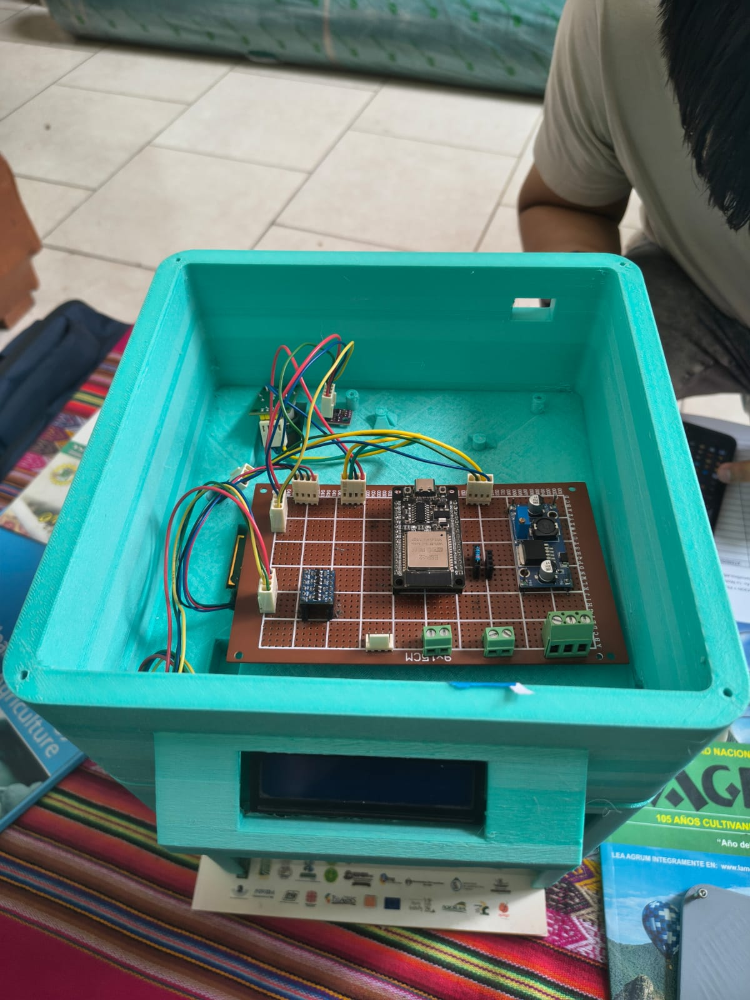
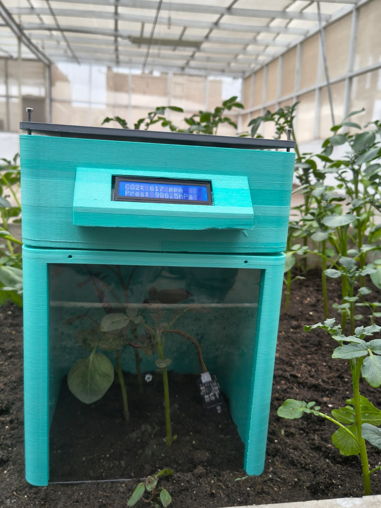
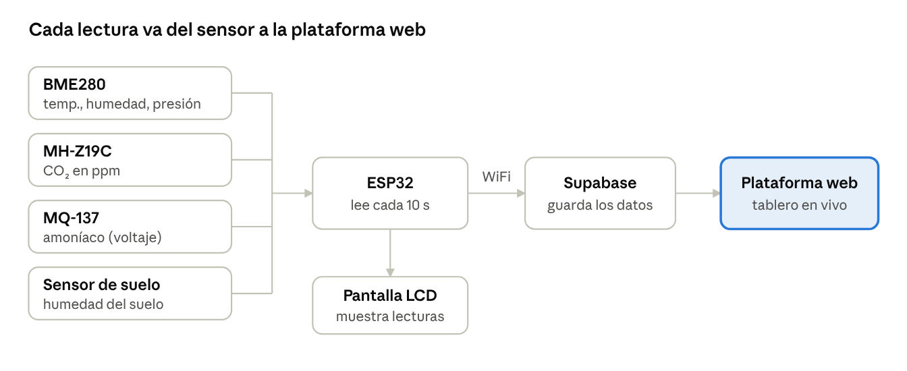
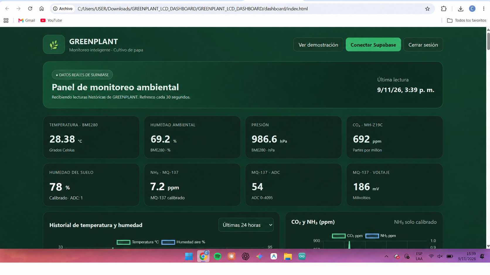
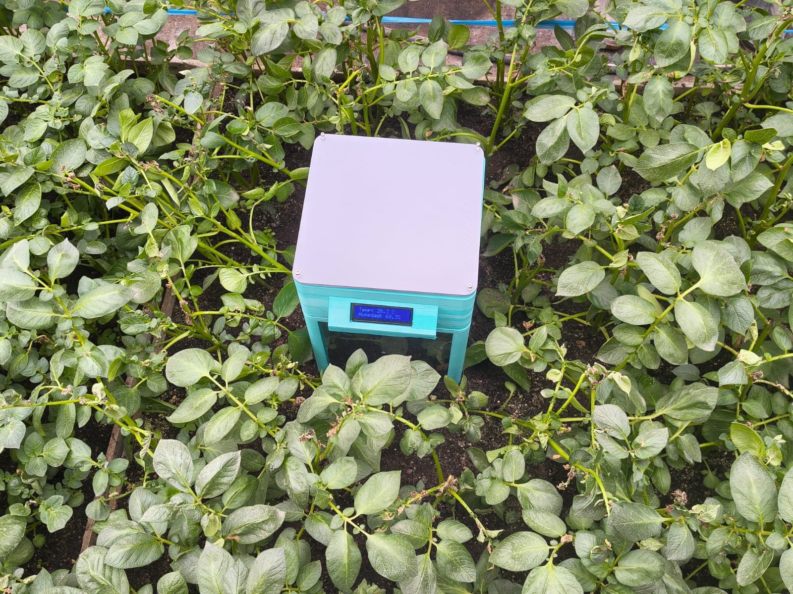

# GreenPlant – Informe TRL4

## Validación tecnológica en entorno de laboratorio – pruebas de baja fidelidad

**Proyecto:** prototipo integrado para el monitoreo de NH₃(g), CO₂(g) y variables ambientales en cultivo de papa (*Solanum tuberosum*) fertilizado con urea, variedades Única, Canchán y Amarilis.

| Campo | Información |
|---|---|
| Curso | Proyecto Integrador |
| Integrantes | Cesar Rodrigo Milla Gómez; Anderson Josue Delerna Infantes; Kevin Esty Carvallo Neciosup; Shedira Lumeris Sihuincha Palacin |
| Ingenieros | Umbert Lewis De La Cruz, Maria Rejas, Harry Rivera y Renzo Chan |
| Fecha de actualización | 13/11/2026 |
| Institución | Universidad Peruana Cayetano Heredia |
| Tema | TRL 4 de GREENPLANT — Validación en laboratorio |

## Contenido

1. [Resumen](#1-resumen)
2. [Prototipo con componentes integrados](#2-prototipo-con-componentes-integrados)
3. [Funcionamiento integral](#3-funcionamiento-integral)
4. [Cómo se hicieron las pruebas](#4-cómo-se-hicieron-las-pruebas)
5. [Resultados](#5-resultados)
6. [Condiciones del cultivo y fertilización](#6-condiciones-del-cultivo-y-fertilización)
7. [Rangos de monitoreo configurados](#7-rangos-de-monitoreo-configurados)
8. [Qué funcionó y qué falta](#8-qué-funcionó-y-qué-falta)
9. [Conclusión](#9-conclusión)
10. [Referencias](#10-referencias)

---

## 1. Resumen

GreenPlant ya es un prototipo armado que mide, envía y muestra datos por sí solo. El 9 de noviembre de 2026 se probó con tres variedades de papa (Única, Canchán y Amarilis) y registró 602 lecturas en la plataforma web. Con eso cubre los tres indicadores del TRL4 [1].

| Indicador del TRL4 | Qué pide | Evidencia de GreenPlant |
|---|---|---|
| Prototipo funcional con componentes básicos integrados | Que las piezas trabajen juntas en un solo equipo | Cámara impresa en 3D con sensores, ESP32, placa de circuito y pantalla LCD montados y conectados |
| Resultados de ensayos a nivel laboratorio | Datos reales tomados con el prototipo | 569 lecturas en tres muestras de 36 a 43 minutos, una por variedad, con sus promedios |
| Pruebas de baja fidelidad | Probar las funciones principales en un ambiente controlado | Prueba en invernadero: el equipo midió, mostró los valores en pantalla y los subió a la web cada 10 segundos |

Los sensores de amoníaco y de suelo ya están calibrados en la plataforma web. Falta comprobar esa calibración con una medición de referencia, como se detalla en la sección de pendientes.

## 2. Prototipo con componentes integrados

Todas las piezas están montadas en una sola cámara y conectadas a una placa de circuito. La parte de arriba guarda la electrónica y la parte de abajo, con ventana transparente, cubre la planta.

| Componente | Para qué sirve | Estado en la prueba |
|---|---|---|
| ESP32 | Lee los sensores y envía los datos por WiFi [2] | Funcionó |
| BME280 | Mide temperatura, humedad del aire y presión [3] | Funcionó, con cortes en la primera muestra |
| MH-Z19C | Mide CO₂ en ppm [4] | Funcionó |
| MQ-137 | Detecta amoníaco (NH₃) [5] | Funcionó: detectó cambios en el aire (señal de 0 a 2 914); ya calibrado, la web lo muestra en ppm (Captura 1) |
| Sensor capacitivo de suelo v1.2 | Mide humedad del suelo | Integrado y ya calibrado: la web muestra la humedad del suelo en porcentaje (Captura 1) |
| Pantalla LCD | Muestra las lecturas en el mismo equipo | Funcionó |
| Placa de circuito con regulador de voltaje | Une y alimenta todos los componentes | Funcionó |
| Cámara impresa en 3D (PETG) | Protege la electrónica y encierra el aire alrededor de la planta | Montada y usada en la prueba |

*Foto 1. Circuito electrónico dentro de la cámara: el ESP32 al centro, el regulador de voltaje a la derecha y los conectores de cada sensor.*

*Foto 2. Prototipo armado sobre una planta de papa. La pantalla muestra CO₂ de 617 ppm y presión de 986,5 hPa.*

## 3. Funcionamiento integral

El sistema trabaja completo, de punta a punta: los sensores miden, el ESP32 junta las lecturas, la pantalla las muestra y la plataforma web las guarda.

*Flujo de datos de GreenPlant · 4 sensores, 1 placa, 2 salidas.*

Durante la prueba llegó una lectura nueva a la base de datos cada 10 segundos, identificada como `ESP32_PAPA_01`. En las fotos la pantalla muestra los mismos tipos de valores que se guardaron en la web (CO₂, presión, temperatura y humedad).

*Captura 1. Plataforma web con datos reales de Supabase, lectura del 9 de noviembre a las 3:39 pm (muestra de Canchán). Temperatura (28,38 °C), humedad (69,2 %), presión (986,6 hPa), CO₂ (692 ppm) y la señal del MQ-137 (54 ADC, 186 mV) coinciden con la lectura guardada a esa hora. La plataforma también muestra los valores ya calibrados de humedad del suelo (78 %) y amoníaco (7,2 ppm) [6].*

## 4. Cómo se hicieron las pruebas

Se tomó una muestra de 30 a 40 minutos por cada variedad, el mismo día y con el mismo equipo, como indicó el profesor. Todos los valores de este informe salen del registro del equipo [6]. La cámara se colocó sobre una planta de cada variedad dentro del invernadero.

| Muestra | Variedad | Horario (9 nov 2026) | Duración | Lecturas |
|---:|---|---|---:|---:|
| 1 | Única | 1:02 pm a 1:45 pm | 43 min | 160 |
| 2 | Canchán | 3:26 pm a 4:02 pm | 36 min | 209 |
| 3 | Amarilis | 4:11 pm a 4:50 pm | 39 min | 200 |

*Foto 3. El equipo durante la medición, dentro del cultivo. La pantalla muestra 28,3 °C y 68,3 % de humedad.*

Antes de promediar se limpiaron los datos con tres reglas:

- No se cuentan las lecturas de CO₂ que marcan exactamente 500 ppm (18 en total). Es el valor que da el sensor mientras arranca.
- No se cuentan 7 lecturas de la muestra de Única (1:22 pm a 1:23 pm) donde la temperatura saltó a 33 °C y la humedad a 92 % en un minuto. Es un salto que no corresponde al ambiente.
- No se usa un bloque corto de 5 minutos (2:12 pm, 33 lecturas) porque no pertenece a ninguna de las tres muestras.

## 5. Resultados

El promedio general de las tres variedades fue 27,3 °C, 68,5 % de humedad del aire y 697 ppm de CO₂. El promedio general es el promedio de los tres promedios, así cada variedad pesa igual.

| Variable | Única | Canchán | Amarilis | Promedio general |
|---|---:|---:|---:|---:|
| Temperatura (°C) | 25,0 | 28,3 | 28,6 | 27,3 |
| Humedad del aire (%) | 72,7 | 66,8 | 65,9 | 68,5 |
| Presión (hPa) | 988,2 | 986,5 | 986,5 | 987,1 |
| CO₂ (ppm) | 711 | 672 | 707 | 697 |
| CO₂ mínimo y máximo (ppm) | 660 a 856 | 597 a 805 | 687 a 733 | 597 a 856 |
| Sensor de amoníaco MQ-137, en reposo (mV) | 142 | 176 | 183 | 167 |

Tres cosas para leer bien la tabla:

- La temperatura sube y la humedad baja de Única a Amarilis porque el invernadero se fue calentando durante la tarde. No es una diferencia entre variedades.
- En la muestra de Única la temperatura, la humedad y la presión salen de solo 29 lecturas. El BME280 no envió datos en 124 de las 160 lecturas de esa muestra.
- El MQ-137 se reporta en milivoltios porque el registro del 9 de noviembre guardó la señal cruda, sin la calibración. En la muestra de Amarilis subió a entre 1 751 y 2 470 mV durante 5 minutos (4:42 pm a 4:47 pm); ese tramo no entra en el valor “en reposo” y falta confirmar qué lo causó.

Lecturas del MQ-137 y del sensor capacitivo de suelo v1.2 registradas ese día, en el valor crudo que entrega el equipo (ADC, de 0 a 4095):

| Sensor | Única | Canchán | Amarilis | Promedio general |
|---|---:|---:|---:|---:|
| MQ-137, señal en reposo (ADC) | 0 | 42 | 52 | 31 |
| MQ-137, señal máxima (ADC) | 1 | 56 | 2 914 | 2 914 |
| Sensor de suelo v1.2, promedio (ADC) | 2,2 | 1,1 | 2,1 | 1,8 |
| Sensor de suelo v1.2, mínimo y máximo (ADC) | 1 a 4 | 0 a 46 | 0 a 11 | 0 a 46 |

El MQ-137 respondió: pasó de casi cero a 2 914 en la muestra de Amarilis. El sensor de suelo se quedó cerca de cero en las tres muestras, por eso aquí se muestra en valor crudo; el porcentaje ya calibrado se ve en la plataforma web (Captura 1).

## 6. Condiciones del cultivo y fertilización

Las tres variedades tienen cerca de 45 días y recibieron la misma dosis: 5 g de mezcla por planta en proporción 2:1:2. Lo que cambia entre ellas es el sustrato.

| Variedad | Sustrato |
|---|---|
| Única | 20 % tierra de chacra + 70 % turba + 10 % arena |
| Canchán | Tierra con turba |
| Amarilis | 100 % turba |

| Fertilizante | Partes | Cantidad por planta | Nutriente que aporta |
|---|---:|---:|---|
| Urea (46 % N) | 2 | 2 g | 0,92 g de nitrógeno |
| Cloruro de potasio (60 % K₂O) | 1 | 1 g | 0,60 g de K₂O |
| Fosfato amónico | 2 | 2 g | 0,22 a 0,36 g de nitrógeno y 0,92 a 1,04 g de P₂O₅, según sea monoamónico o diamónico |
| **Total** | **5** | **5 g** | **1,14 a 1,28 g de nitrógeno** |

La urea y el fosfato amónico son la fuente del amoníaco que el equipo busca detectar. Los gramos aplicados no permiten calcular cuántas ppm deberían aparecer: eso depende también del riego, la temperatura y los días desde la aplicación.

## 7. Rangos de monitoreo configurados

El equipo ya está configurado con estos rangos. Con ellos decide si una lectura es normal, si hay que vigilar o si corresponde una alerta.

| Variable | Rango | Qué significa |
|---|---|---|
| Amoníaco (MQ-137) | Menos de 5 ppm | Por debajo de lo que el sensor puede medir [5] |
| Amoníaco (MQ-137) | 5 a 10 ppm | Vigilancia |
| Amoníaco (MQ-137) | 10 a 20 ppm | Alerta preventiva |
| Amoníaco (MQ-137) | Más de 20 ppm | Alerta alta |
| Agua disponible en el suelo | 75 a 85 % | Objetivo en crecimiento vegetativo [7] |
| Agua disponible en el suelo | 75 % | Momento de regar [7] |

El sensor de suelo entrega un número crudo, no un porcentaje. Para convertirlo, el equipo usa dos lecturas de referencia de cada sustrato, una en seco y otra recién regado y escurrido, y aplica esta fórmula:

El resultado de la fórmula aparece directamente en la pantalla LCD del equipo, junto con el amoníaco en ppm, y también en la plataforma web.

**Foto 4:** pantalla del prototipo mostrando NH₃ 38,8 ppm y MQ 54. No se encontró una imagen independiente de esta pantalla entre los archivos multimedia extraídos del DOCX.

*Foto 4. La pantalla ya convierte la señal del MQ-137 a ppm. Para la misma señal (54), la pantalla muestra 38,8 ppm y la plataforma web 7,2 ppm; falta poner en la pantalla la misma fórmula calibrada de la web.*

## 8. Qué funcionó y qué falta

Las funciones principales pasaron la prueba; quedan tres ajustes antes de pasar al TRL5.

| Función probada | Resultado | Pendiente |
|---|---|---|
| Medir CO₂ | Funciona; valores entre 597 y 856 ppm | Esperar el arranque del sensor antes de guardar datos |
| Medir temperatura, humedad y presión | Funciona en las muestras 2 y 3 | Revisar la conexión del BME280, que se cortó en la muestra 1 |
| Detectar amoníaco | El sensor responde y la pantalla ya muestra ppm (Foto 4) | Comprobar la calibración del MQ-137 con una referencia; la pantalla del equipo y la web aún dan valores distintos |
| Medir humedad del suelo | Calibrado; la web muestra 78 % | Comprobar con el sustrato seco y mojado; la señal cruda del 9 de noviembre fue muy baja (0 a 46) |
| Mostrar datos en pantalla | Funciona | Ninguno |
| Enviar y guardar datos en la web | Funciona; 602 lecturas guardadas | Agregar una columna con la variedad de papa para no depender del horario |

## 9. Conclusión

GreenPlant alcanza el TRL4: es un prototipo con sus componentes integrados que capta datos reales y los publica en la plataforma web de forma continua. Las pruebas con Única, Canchán y Amarilis dieron un promedio de 27,3 °C, 68,5 % de humedad y 697 ppm de CO₂. Los resultados son confiables para este nivel: dentro de cada muestra la temperatura varió menos de 2 °C y la presión menos de 0,5 hPa, llegó una lectura cada 10 segundos y los valores de la plataforma web coinciden con los datos guardados. El siguiente paso es repetir las mediciones en más días.

## 10. Referencias

[1] G. Espinoza Yauri, “TRL 2, 3 y 4: Investigación aplicada,” presentación de clase, Oficina de Transferencia Tecnológica y Vinculación Empresarial, Dirección Universitaria de Vinculación y Emprendimiento, Univ. Peruana Cayetano Heredia, Lima, Perú, 2026.

[2] Espressif Systems, “ESP32 Series Datasheet,” ver. 5.2. [En línea]. Disponible: https://www.espressif.com/documentation/esp32_datasheet_en.pdf. Accedido: 13 nov. 2026.

[3] Bosch Sensortec, “BME280: Combined humidity and pressure sensor,” hoja de datos BST-BME280-DS002-15, rev. 1.6, sep. 2018. [En línea]. Disponible: https://www.bosch-sensortec.com/media/boschsensortec/downloads/datasheets/bst-bme280-ds002.pdf. Accedido: 13 nov. 2026.

[4] Zhengzhou Winsen Electronics Technology Co., Ltd., “Infrared CO2 Sensor Module (Model: MH-Z19C) User’s Manual,” ver. 1.2, may. 2021. [En línea]. Disponible: https://www.winsen-sensor.com/sensors/co2-sensor/mh-z19c.html. Accedido: 13 nov. 2026.

[5] Zhengzhou Winsen Electronics Technology Co., Ltd., “Ammonia Gas Sensor (Model: MQ137) Manual,” ver. 1.6, jul. 2021. [En línea]. Disponible: https://www.winsen-sensor.com/d/files/manual/mq137.pdf. Accedido: 13 nov. 2026.

[6] Equipo GreenPlant, “GREENPLANT_2026-11-09: lecturas del dispositivo ESP32_PAPA_01,” datos sin publicar, Univ. Peruana Cayetano Heredia, Lima, Perú, 9 nov. 2026.

[7] Utah State University Extension, “Potato: Irrigation,” Utah Vegetable Production and Pest Management Guide. [En línea]. Disponible: https://extension.usu.edu/vegetableguide/potato/irrigation. Accedido: 13 nov. 2026.
