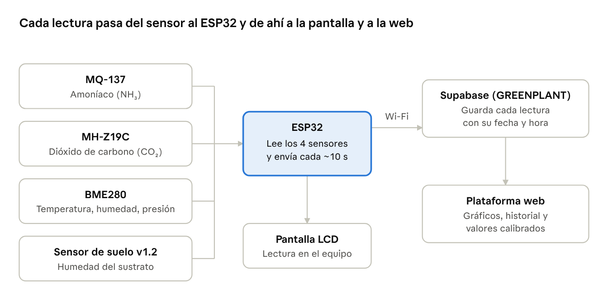
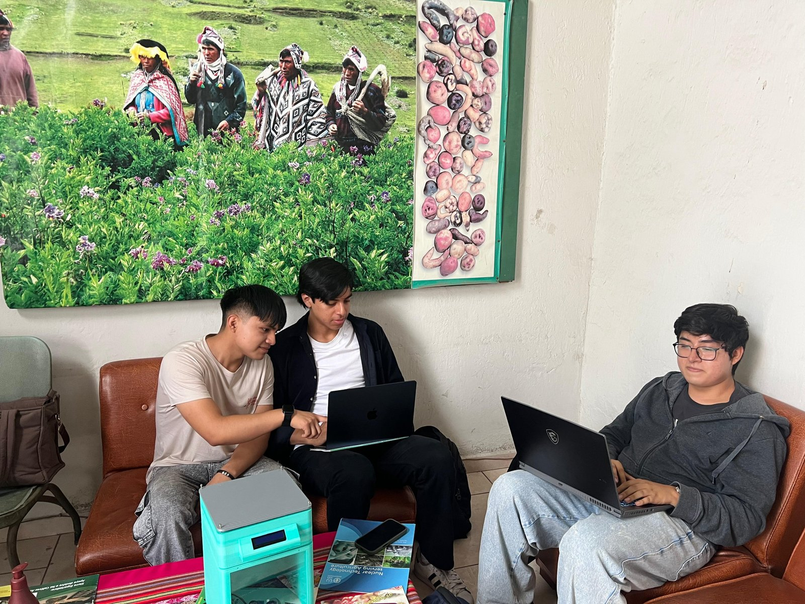
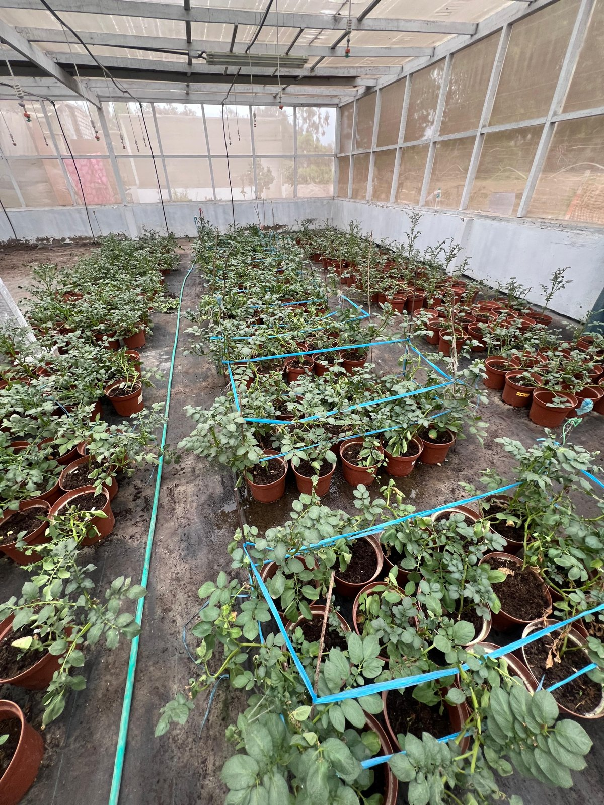
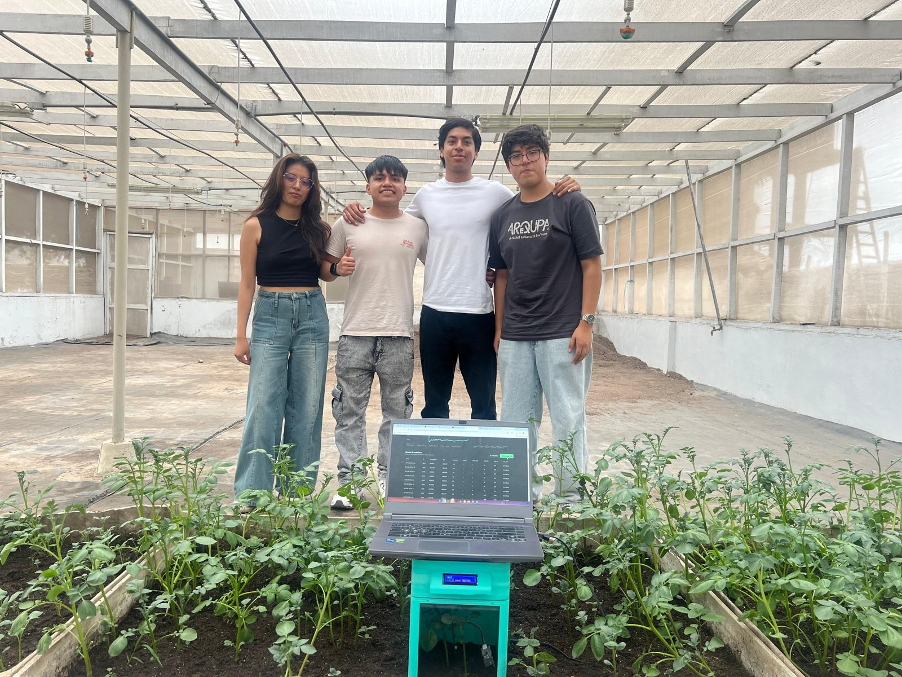
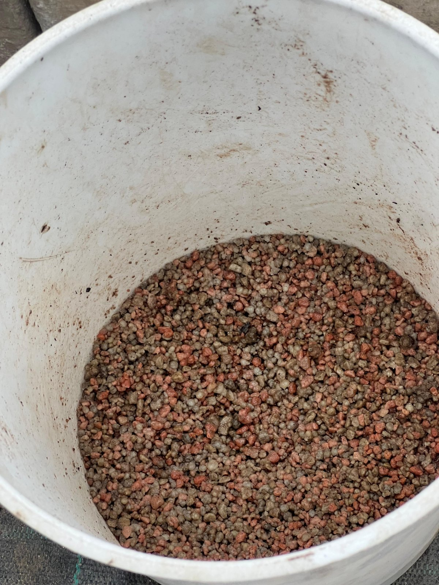
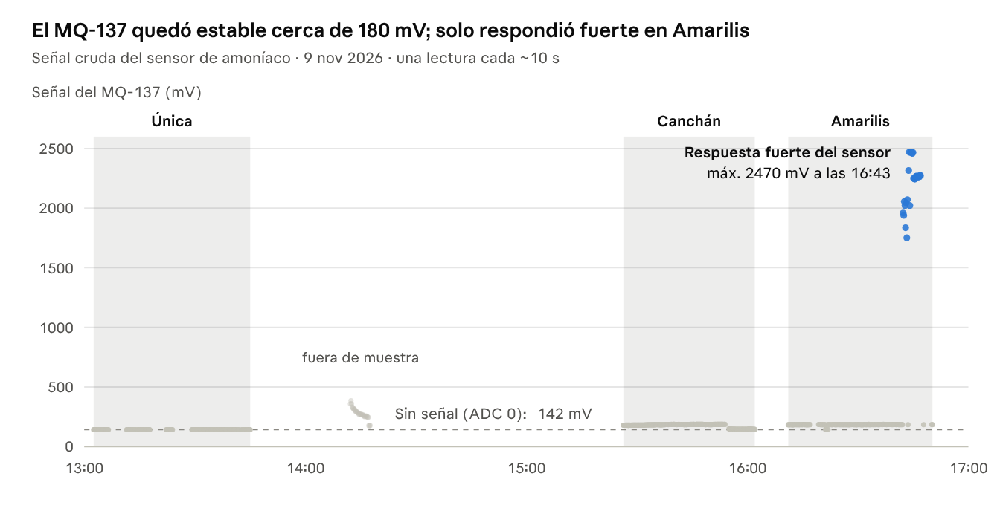

# GreenPlant – Informe TRL5

*24 de noviembre de 2026 · @lume*

**Nivel de madurez tecnológica (TRL 5) · Proyecto Integrador**

GreenPlant cumple la mayor parte del TRL 5: el prototipo ya está armado con todos sus componentes integrados y se probó sobre plantas de papa vivas, en tres variedades, el 9 de noviembre de 2026. Lo que falta para cerrarlo es calibrar el sensor de amoníaco a ppm con una referencia y repetir la prueba en más días.

| Campo       | Información                                                                                                                 |
|-------------|-----------------------------------------------------------------------------------------------------------------------------|
| Curso       | Proyecto Integrador                                                                                                         |
| Integrantes | Cesar Rodrigo Milla Gómez, Anderson Josue Delerna Infantes, Kevin Esty Carvallo Neciosup, Shedira Lumeris Sihuincha Palacin |
| Ingenieros  | Umbert Lewis De La Cruz, Maria Rejas, Harry Rivera y Renzo Chan                                                             |
| Institución | Universidad Peruana Cayetano Heredia                                                                                        |
| Tema        | TRL 5 de GREENPLANT: validación en entorno de laboratorio cercano al real                                                   |

## Contenido

- [1. Qué pide el TRL 5](#1-qué-pide-el-trl-5)
- [2. Prototipo estandarizado con componentes integrados](#2-prototipo-estandarizado-con-componentes-integrados)
- [3. Entorno simulado cercano al real](#3-entorno-simulado-cercano-al-real)
- [4. Resultados de los ensayos de laboratorio](#4-resultados-de-los-ensayos-de-laboratorio)
- [5. Pruebas de las características esperadas](#5-pruebas-de-las-características-esperadas)
- [6. Paquete tecnológico](#6-paquete-tecnológico)
- [7. Limitaciones y pasos hacia el TRL 6](#7-limitaciones-y-pasos-hacia-el-trl-6)
- [Referencias](#referencias)

---

## 1. Qué pide el TRL 5

Según la guía del curso, en el TRL 5 la tecnología se prueba con todos sus componentes integrados, en un entorno simulado parecido al real y midiendo todas sus características. Desde este nivel también empieza a importar el paquete tecnológico, que es todo el conocimiento necesario para fabricar y usar el producto.

La guía pide cinco evidencias. Este informe responde a cada una en una sección:

| Indicador del TRL 5                                                       | Dónde se responde | Estado                               |
|---------------------------------------------------------------------------|-------------------|--------------------------------------|
| Prototipo estandarizado con componentes integrados                        | Sección 2         | Cumplido                             |
| Entorno simulado cercano al real                                          | Sección 3         | Cumplido                             |
| Resultados de ensayos de laboratorio en condiciones cercanas a las reales | Sección 4         | Cumplido (un día de prueba)          |
| Pruebas de las características esperadas                                  | Sección 5         | Parcial: falta calibrar el NH₃ a ppm |
| Paquete tecnológico                                                       | Sección 6         | Iniciado                             |

Para proyectos de software, la guía añade que en este nivel el programa ya debe poder integrarse con sistemas existentes y correr en un procesador parecido al de uso real. En GreenPlant eso ya ocurre: el firmware corre en el mismo ESP32 del prototipo y envía los datos a Supabase y a la plataforma web.

## 2. Prototipo estandarizado con componentes integrados

Desde el 19 de noviembre de 2026 el prototipo está impreso y armado como una sola pieza. Una carcasa superior guarda la electrónica y la pantalla LCD, y va montada sobre un cuerpo de fondo abierto con un panel frontal transparente. El conjunto se coloca encima de la planta, de modo que el aire que rodea a la papa queda dentro de la cámara.

Flujo de datos del prototipo GreenPlant · 4 sensores, 1 microcontrolador, 3 salidas

Los cuatro sensores se conectan al mismo ESP32, que muestra cada lectura en la pantalla y la envía a Supabase. La plataforma web lee esos datos y los muestra al usuario.

| Componente                      | Qué mide o hace                                           | Salida                     |
|---------------------------------|-----------------------------------------------------------|----------------------------|
| MQ-137                          | Amoníaco (NH₃) en el aire de la cámara                    | Señal analógica (ADC y mV) |
| MH-Z19C                         | Dióxido de carbono (CO₂)                                  | ppm                        |
| BME280                          | Temperatura, humedad del aire y presión                   | °C, %, hPa                 |
| Sensor capacitivo de suelo v1.2 | Humedad del sustrato                                      | Señal analógica (ADC)      |
| ESP32                           | Lee los sensores, arma cada registro y lo envía por Wi-Fi | Registro cada ~10 s        |
| Pantalla LCD                    | Muestra la lectura en el propio equipo                    | Texto                      |
| Carcasa de PETG                 | Protege la electrónica y forma la cámara sobre la planta  | —                          |
| Supabase y plataforma web       | Guardan los datos y los muestran con gráficos             | Base de datos y panel web  |

El material de la cámara (PETG) se validó en el TRL 3 con simulaciones estructural y dinámica en SimScale.

*Figura 1. Prototipo armado: carcasa de PETG con la pantalla LCD arriba y la cámara de panel transparente abajo.*

## 3. Entorno simulado cercano al real

La prueba se hizo en laboratorio, pero sobre plantas de papa vivas, sembradas en sustrato y fertilizadas igual que en un cultivo. Así el prototipo mide el mismo tipo de aire que mediría en campo: el que sale del suelo fertilizado y de la planta.

**Qué lo acerca a la realidad:**

- **Plantas reales:** tres variedades de papa de unos 45 días (mes y medio).

- **Fertilización real:** 5 g de mezcla por planta, con urea, la fuente de amoníaco que el sistema debe vigilar.

- **Montaje como en uso:** la cámara se coloca encima de la planta, tal como se usaría en el cultivo.

- **Ambiente sin controlar:** la temperatura y la humedad variaron con la hora del día (de 25,0 a 28,5 °C en promedio), como pasaría afuera.

Las plantas se cultivan en macetas dentro de un invernadero, donde también se colocó el prototipo sobre las plantas (Figuras 2 y 3).

*Figura 2. Plantas de papa en maceta en el invernadero.*

*Figura 3. Prototipo colocado sobre plantas de papa en el invernadero, con la plataforma web abierta en la laptop.*

**Plantas y horarios de la prueba (9 de noviembre de 2026):**

| Variedad | Sustrato                                        | Edad    | Horario de la muestra | Lecturas |
|----------|-------------------------------------------------|---------|-----------------------|----------|
| Única    | 20 % tierra de chacra + 70 % turba + 10 % arena | 45 días | 13:02 a 13:45         | 160      |
| Canchán  | Tierra con turba                                | 45 días | 15:26 a 16:02         | 209      |
| Amarilis | 100 % turba                                     | 45 días | 16:11 a 16:50         | 200      |

Siguiendo la indicación del profesor, se tomó una muestra de 30 a 40 minutos por variedad y luego se promedió todo.

**Fertilización por planta (proporción 2:1:2, 5 g en total):**

| Fertilizante                  | Gramos  | Nitrógeno (N) | Fósforo (P₂O₅) | Potasio (K₂O) |
|-------------------------------|---------|---------------|----------------|---------------|
| Urea (46-0-0)                 | 2,0     | 0,92 g        | —              | —             |
| Cloruro de potasio (0-0-60)   | 1,0     | —             | —              | 0,60 g        |
| Fosfato monoamónico (11-52-0) | 2,0     | 0,22 g        | 1,04 g         | —             |
| **Total**                     | **5,0** | **1,14 g**    | **1,04 g**     | **0,60 g**    |

Los porcentajes son los grados comerciales habituales de cada fertilizante. Si el fosfato usado fue diamónico (18-46-0), el nitrógeno total sube a 1,28 g.

*Figura 4. Mezcla de fertilizantes (urea, cloruro de potasio y fosfato amónico) antes de aplicarla a las plantas.*

## 4. Resultados de los ensayos de laboratorio

El 9 de noviembre de 2026 el prototipo registró 602 lecturas entre las 13:02 y las 16:50, todas guardadas en Supabase. El promedio general fue de 27,3 °C, 68,5 % de humedad del aire, 987,1 hPa y 697 ppm de CO₂.

| Variable               | Única     | Canchán | Amarilis | Promedio general     |
|------------------------|-----------|---------|----------|----------------------|
| Lecturas en la muestra | 160       | 209     | 200      | 569                  |
| Temperatura (°C)       | 25,0      | 28,3    | 28,5     | 27,3                 |
| Humedad del aire (%)   | 72,7      | 66,8    | 65,9     | 68,5                 |
| Presión (hPa)          | 988,2     | 986,5   | 986,5    | 987,1                |
| CO₂ (ppm)              | 711       | 672     | 707      | 697                  |
| MQ-137 en reposo (mV)  | Sin señal | 175,8   | 183,3    | 179,6 (2 variedades) |

El promedio general es el promedio de los tres promedios, para que cada variedad pese igual. Las otras 33 lecturas del día se tomaron entre muestras (14:12 a 14:17) y no entran en ninguna variedad.

**Cómo se limpiaron los datos:**

- **Datos que no llegó a enviar el BME280 o el MH-Z19C:** se estimaron con las lecturas vecinas de la misma muestra, quedan marcados en el Excel y no entran en ningún promedio.

- **Arranque del sensor de CO₂:** las lecturas de 500 ppm son el valor que da el MH-Z19C al encender y se dejaron fuera.

- **Salto brusco en Única (13:22:57 a 13:23:57):** 7 lecturas de temperatura y humedad saltaron a más de 30 °C y 90 % y volvieron al minuto; no entran en el promedio.

### Amoníaco (MQ-137)

GreenPlant_TRL5.xlsx, hoja Datos, columna MQ-137 (mV) · 602 lecturas del 9 nov 2026

El sensor de amoníaco se leyó en señal cruda, porque todavía no está calibrado a ppm con una referencia. Lo que muestra el día:

- **Única (13:02 a 13:45):** el sensor no dio señal (ADC 0, que el ESP32 registra como 142 mV). Lo más probable es que aún estuviera calentándose: el MQ-137 necesita precalentarse antes de medir, y a las 14:12 ya respondía y se estabilizó cerca de 176 mV.

- **Canchán y Amarilis:** la señal se mantuvo estable entre 177 y 187 mV, que es su nivel de reposo. Desde las 15:55 Canchán bajó a unos 145 mV hasta el final de su muestra; la causa no quedó registrada.

- **Amarilis, 16:42 a 16:47:** 27 lecturas subieron a entre 1 751 y 2 470 mV. Es una respuesta clara del sensor, pero no se anotó qué la provocó, así que no se puede atribuir todavía a la planta.

La plataforma web, que convierte la señal con su calibración, mostró 7,2 ppm de NH₃ y 78 % de humedad del suelo a las 15:39. Ese es el único valor de amoníaco en ppm con fuente registrada (una captura de pantalla). El sensor de suelo dio valores crudos muy bajos (ADC 1 a 2 la mayor parte del tiempo), por lo que conviene revisar su conexión y su conversión a %.

## 5. Pruebas de las características esperadas

De las ocho funciones que el prototipo debía cumplir, seis se comprobaron en la prueba y dos quedaron a medias: la lectura de amoníaco en ppm y la de humedad del suelo.

| Característica esperada              | Qué se comprobó el 9 nov 2026                                                                                                     | Resultado |
|--------------------------------------|-----------------------------------------------------------------------------------------------------------------------------------|-----------|
| Registrar datos de forma continua    | 602 lecturas de 13:02 a 16:50, una cada ~10 s, con 4 cortes de 2 a 5 min dentro de las muestras                                   | Cumple    |
| Enviar los datos a la nube           | Las 602 lecturas quedaron en Supabase y se ven en la plataforma web                                                               | Cumple    |
| Medir temperatura, humedad y presión | Valores estables por variedad; el BME280 no envió algunos datos, que se marcaron como estimados                                   | Cumple    |
| Medir CO₂                            | Promedio de 697 ppm, dentro del rango del MH-Z19C (400 a 2 000 ppm en su versión básica)                                          | Cumple    |
| Detectar amoníaco (NH₃)              | El sensor responde (reposo 177 a 187 mV, pico de 2 470 mV), pero aún no está calibrado a ppm y no dio señal en la primera muestra | Parcial   |
| Medir humedad del suelo              | La web mostró 78 %, pero la señal cruda es muy baja (ADC 1 a 2)                                                                   | Parcial   |
| Mostrar la lectura en el equipo      | La pantalla LCD muestra la lectura en tiempo real                                                                                 | Cumple    |
| Trabajar montado sobre la planta     | La carcasa de PETG impresa se colocó sobre las plantas sin problemas                                                              | Cumple    |

*Nota: en esta versión Markdown, los resultados se actualizan editando directamente la tabla.*

## 6. Paquete tecnológico

El paquete tecnológico de GreenPlant ya tiene la base técnica (diseño, componentes, pruebas y código), pero aún faltan los manuales y la parte regulatoria. Según la guía, el paquete reúne todo el conocimiento necesario para producir y distribuir el producto, y se organiza en tres bloques: bases tecnológicas, normatividad y propiedad intelectual.

| Bloque                | Elemento                                        | Qué contiene en GreenPlant                                                                                                                | Estado    |
|-----------------------|-------------------------------------------------|-------------------------------------------------------------------------------------------------------------------------------------------|-----------|
| Bases tecnológicas    | Caracterización de la tecnología                | Informes TRL 1 a TRL 5 y documento técnico para la OPI-UPCH                                                                               | En avance |
| Bases tecnológicas    | Diseño y especificaciones del producto          | Lista de componentes (sección 2); faltan cantidades, proveedores y costos                                                                 | En avance |
| Bases tecnológicas    | Planos y memoria de cálculo de la carcasa       | Modelo 3D impreso en PETG y simulaciones en SimScale (TRL 3)                                                                              | En avance |
| Bases tecnológicas    | Esquema electrónico                             | Esquemáticos y PCB del Taller 02 de electrónica; falta la versión final del prototipo                                                     | En avance |
| Bases tecnológicas    | Software                                        | Firmware del ESP32, base de datos en Supabase y plataforma web; falta subir el código final al repositorio                                | En avance |
| Bases tecnológicas    | Especificaciones de prueba (control de calidad) | Criterios de la sección 5 y rangos de alerta de NH₃ (5–10 ppm vigilancia, 10–20 ppm alerta preventiva, más de 20 ppm alerta alta)         | En avance |
| Bases tecnológicas    | Manual de usuario                               | Cómo colocar la cámara, encenderla, esperar el precalentamiento del MQ-137 y leer la web                                                  | Pendiente |
| Bases tecnológicas    | Manual de producción y ensamble                 | Pasos de impresión, cableado, carga del firmware y prueba final                                                                           | Pendiente |
| Normatividad          | Permisos y normas aplicables                    | Por identificar antes de vender el equipo (por ejemplo, la homologación de equipos con Wi-Fi)                                             | Pendiente |
| Propiedad intelectual | Tipo y número de expediente                     | Formulario de declaración de invención v4.0, ficha de detalles y documento técnico para la OPI-UPCH; número de expediente aún no asignado | En avance |

Los rangos de alerta de NH₃ son un criterio del equipo. El límite inferior coincide con el mínimo que el MQ-137 puede medir, 5 ppm, según su fabricante.

## 7. Limitaciones y pasos hacia el TRL 6

El TRL 6 pide un informe de desempeño del prototipo en un entorno cercano al real o en una planta piloto. Para llegar ahí, el equipo tiene que cerrar primero estas cinco brechas:

| Limitación actual                          | Qué hacer                                                                                                                                  |
|--------------------------------------------|--------------------------------------------------------------------------------------------------------------------------------------------|
| Solo hay un día de prueba                  | Repetir la medición de las tres variedades en al menos tres días distintos y comparar los promedios                                        |
| El MQ-137 no está calibrado a ppm          | Precalentarlo el tiempo que indica el fabricante, medir su resistencia en aire limpio (Ro) y validar contra una referencia de NH₃ conocida |
| No se sabe qué causó el pico de 16:42      | Llevar una bitácora con la hora de riego, fertilización, apertura de la cámara y movimientos de cables                                     |
| No hay comparación con un control          | Medir una maceta sin urea junto a una con urea, con el mismo sustrato y a la misma hora                                                    |
| El sensor de suelo da señal cruda muy baja | Revisar su conexión y calibrarlo con el método de secado al horno (ASTM D2216)                                                             |

También conviene guardar cada export de Supabase tal como sale, sin editar, para que cualquier revisor pueda comprobar los promedios desde el archivo original.

## Referencias

\[1\] G. Espinoza Yauri, “TRL 5, 6 y 7: Desarrollo tecnológico,” Oficina de Transferencia Tecnológica y Vinculación Empresarial, DUIE, Universidad Peruana Cayetano Heredia, material del curso, 2026.

\[2\] J. C. Mankins, “Technology readiness assessments: A retrospective,” *Acta Astronautica*, vol. 65, n.os 9–10, pp. 1216–1223, 2009, doi: [10.1016/j.actaastro.2009.03.058](https://doi.org/10.1016/j.actaastro.2009.03.058).

\[3\] OECD, *Frascati Manual 2015: Guidelines for Collecting and Reporting Data on Research and Experimental Development*. París: OECD Publishing, 2015.

\[4\] J. Solleiro y R. Castañón, *Gestión tecnológica: conceptos y prácticas*, 2016.

\[5\] Zhengzhou Winsen Electronics Technology Co., Ltd., “Ammonia gas sensor (model: MQ137): Manual,” ver. 1.6, jul. 2021. \[En línea\]. Disponible: <https://www.winsen-sensor.com/d/files/manual/mq137.pdf>

\[6\] Zhengzhou Winsen Electronics Technology Co., Ltd., “Infrared CO₂ sensor module (model: MH-Z19C): User’s manual,” ver. 1.2, 14-may-2021. \[En línea\]. Disponible: <https://www.winsen-sensor.com/d/files/mh-z19c-pins%26terminal-type-co2-manual(ver1_2).pdf>

\[7\] Bosch Sensortec, “BME280: Data sheet,” rev. 1.24, feb. 2024. \[En línea\]. Disponible: <https://www.bosch-sensortec.com/media/boschsensortec/downloads/datasheets/bst-bme280-ds002.pdf>

\[8\] Espressif Systems, “ESP32 series datasheet,” ver. 5.3. \[En línea\]. Disponible: <https://documentation.espressif.com/esp32_datasheet_en.html>

\[9\] Utah State University Extension, “Potato: Irrigation,” Vegetable Guide. Consultado: 24-nov-2026. \[En línea\]. Disponible: <https://extension.usu.edu/vegetableguide/potato/irrigation>

\[10\] ASTM International, *Standard Test Methods for Laboratory Determination of Water (Moisture) Content of Soil and Rock by Mass*, ASTM D2216-19, 2019.

\[11\] Equipo GREENPLANT, “GreenPlant_TRL5.xlsx” (datos del dispositivo ESP32_PAPA_01, 9 nov 2026) y repositorio [Cesrm27/PI_Equipo_01](https://github.com/Cesrm27/PI_Equipo_01).
