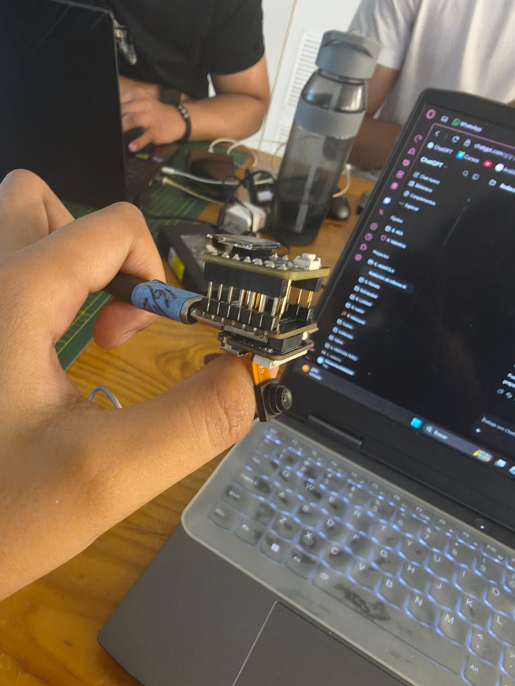
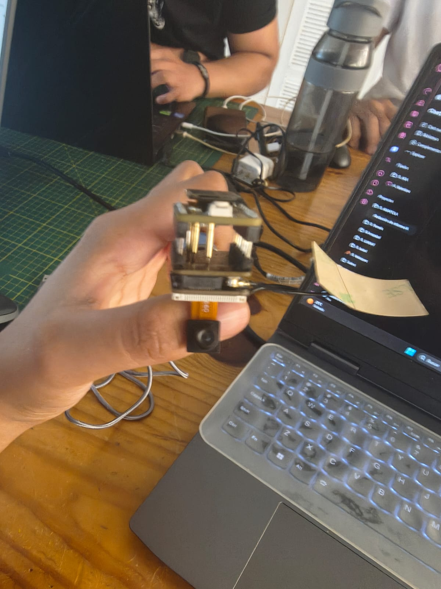
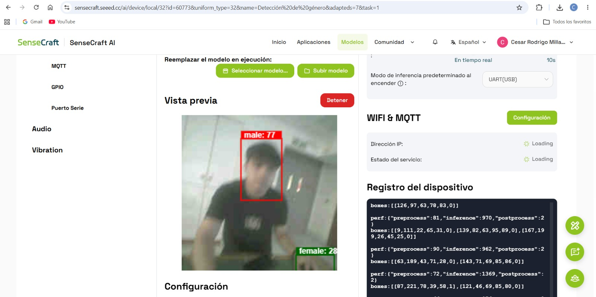
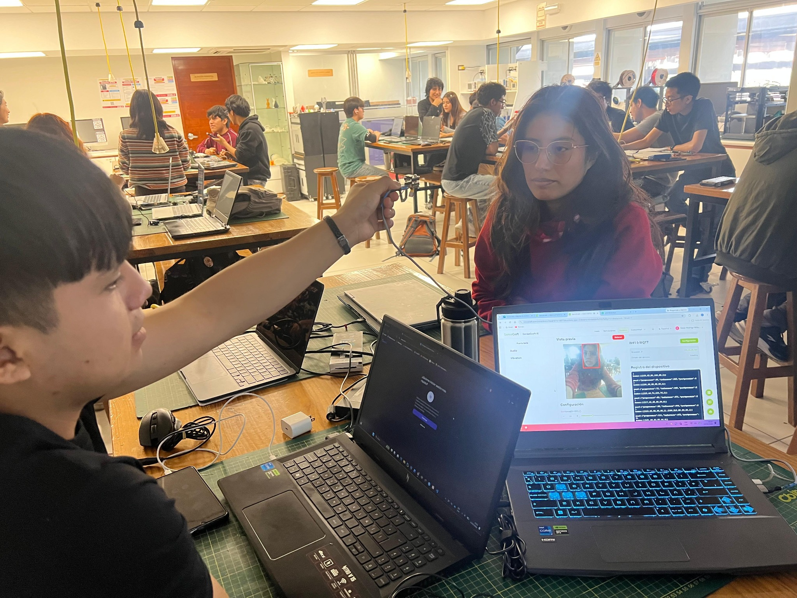
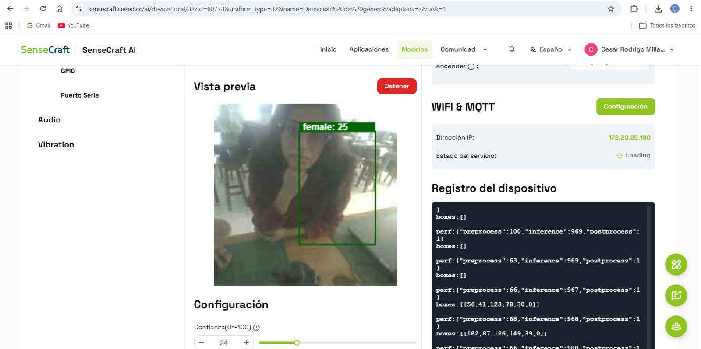
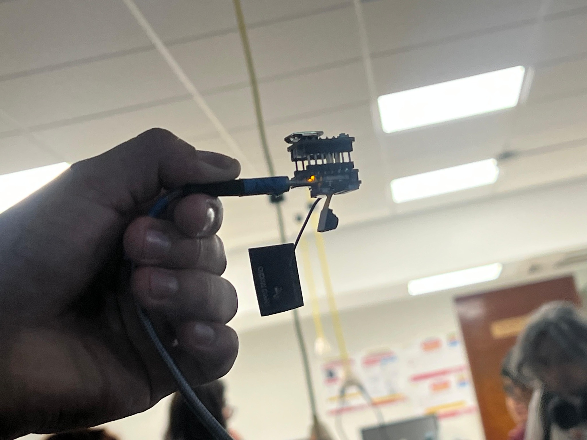

# INFORME DE LABORATORIO

**TALLER DE INTERNET DE LAS COSAS (IoT) · ESP32**

# Implementación y prueba del modelo de detección de género en XIAO ESP32S3 Sense

| Datos del informe | Información |
| --- | --- |
| Curso | Proyecto Integrador |
| Integrantes | Cesar Rodrigo Milla Gómez Anderson Josue Delerna Infantes Kevin Esty Carvallo Neciosup Shedira Lumeris Sihuincha Palacin |
| Ingenieros | Umbert Lewis De La Cruz, Maria Rejas, Harry Rivera, Renzo Chan |
| Fecha | 13/10/2026 |
| Institución | Universidad Peruana Cayetano Heredia |
| Tema | Detección de género con SenseCraft AI y prueba de GPIO |

---

## Contenido

- [1. Introducción](#1-introducción)
- [2. Descripción del dispositivo XIAO ESP32S3 Sense](#2-descripción-del-dispositivo-xiao-esp32s3-sense)
- [3. Modelo implementado: Detección de género](#3-modelo-implementado-detección-de-género)
- [4. Pruebas realizadas del modelo](#4-pruebas-realizadas-del-modelo)
- [4.1. Primera etapa: prueba general de detección](#41-primera-etapa-prueba-general-de-detección)
- [4.1.1. Interpretación del número de confianza](#411-interpretación-del-número-de-confianza)
- [4.2. Segunda etapa: configuración y prueba de GPIO](#42-segunda-etapa-configuración-y-prueba-de-gpio)
- [5. Resultados y observaciones](#5-resultados-y-observaciones)
- [6. Conclusiones](#6-conclusiones)
## 1. Introducción

En el presente trabajo se implementó y probó un modelo de inteligencia artificial utilizando la placa XIAO ESP32S3 Sense, un dispositivo compacto que permite desarrollar aplicaciones de visión artificial y procesamiento de imágenes en el propio equipo (Edge AI).

La placa incorpora un microcontrolador ESP32-S3 y un módulo de cámara que permite capturar imágenes. Para esta práctica se utilizó la plataforma SenseCraft AI y se seleccionó el modelo de «Detección de género», basado en Swift-YOLO, para observar cómo clasifica las personas que aparecen frente a la cámara.

El trabajo se desarrolló en dos etapas. Primero se comprobó el reconocimiento visual general de las categorías «male» y «female». Después se configuró la salida GPIO para que se encendiera un LED al detectar la categoría «female». Las fotografías y capturas presentadas a continuación documentan el procedimiento y los resultados observados.

## 2. Descripción del dispositivo XIAO ESP32S3 Sense

La XIAO ESP32S3 Sense es una placa de desarrollo orientada a proyectos de Internet de las Cosas (IoT), visión por computadora e inteligencia artificial. Su formato pequeño facilita la integración en prototipos, mientras que la cámara permite adquirir imágenes para analizarlas con modelos optimizados.

Entre sus características destacan el microcontrolador ESP32-S3 de doble núcleo, la cámara OV2640, memoria externa y pines GPIO para conectar componentes electrónicos. En esta práctica, la cámara se utilizó como entrada del modelo y la salida GPIO como medio de activación del LED.

*Figura 1. Vista lateral del montaje con la XIAO ESP32S3 Sense.*

En la Figura 1 se aprecia el conjunto de la placa, el módulo de cámara y la conexión utilizada durante la práctica. El equipo se sostuvo manualmente para dirigir la cámara hacia los participantes.

*Figura 2. Vista frontal del módulo de cámara utilizado.*

En la Figura 2 se observa la posición del módulo de cámara, encargado de capturar las imágenes que posteriormente analiza el modelo.

## 3. Modelo implementado: Detección de género

Se seleccionó el modelo «Detección de género» de SenseCraft AI, basado en Swift-YOLO. El sistema analiza las imágenes capturadas y asigna etiquetas como «male» (masculino) y «female» (femenino), acompañadas por recuadros que señalan la detección.

Estas etiquetas son estimaciones automáticas basadas en la apariencia visual; no permiten establecer la identidad de género de una persona. La finalidad de la práctica fue comprobar la respuesta técnica del modelo y su integración con el dispositivo.

## 4. Pruebas realizadas del modelo

### 4.1. Primera etapa: prueba general de detección

Inicialmente se puso en funcionamiento el modelo desde SenseCraft AI para verificar que la cámara capturara imágenes y que la plataforma mostrara resultados de clasificación. Se realizaron pruebas con integrantes del equipo frente al dispositivo.

*Figura 3. Detección de la categoría «male» en SenseCraft AI.*

En la Figura 3 se observa un recuadro rojo con la etiqueta «male: 77» alrededor de una persona. Esta captura evidencia que el modelo produjo una clasificación masculina durante la prueba. También se aprecia parcialmente otra detección en el borde inferior de la vista previa.

*Figura 4. Prueba de reconocimiento con los integrantes (Kevin) y (Shedira Lumeris).*

En la Figura 4 se observa al integrante (Kevin) sosteniendo la cámara y orientándola hacia su compañera (Shedira Lumeris). El resultado se revisó en una computadora portátil mediante la interfaz de SenseCraft AI.

*Figura 5. Resultado de la detección de la categoría «female».*

En la Figura 5 se observa que el modelo clasificó a la integrante (Shedira Lumeris) con la etiqueta «female: 25», indicada por un recuadro verde. La cifra corresponde al valor mostrado por la interfaz en esa captura; no se utiliza aquí como medida independiente de exactitud.

#### 4.1.1. Interpretación del número de confianza

En SenseCraft AI, el número que acompaña a cada etiqueta representa la confianza que el modelo asigna a esa detección. Se expresa en una escala de 0 a 100: cuanto mayor es el valor, mayor es la seguridad de la predicción para esa imagen. Sin embargo, no equivale a la precisión general del modelo ni garantiza que la clasificación sea correcta.

En la Figura 3 aparece «male: 77», lo que indica una confianza de 77 sobre 100 para la categoría masculina en esa detección. En la Figura 5 aparece «female: 25», es decir, una confianza de 25 sobre 100 para la categoría femenina. Aunque se muestra un recuadro verde, este segundo resultado tiene una confianza considerablemente menor y debe interpretarse con cautela.

En la misma Figura 5 se observa el control «Confianza (0–100)» ajustado a 24. Este parámetro funciona como umbral mínimo para mostrar detecciones: una predicción con confianza de 25 puede visualizarse al superar el valor configurado de 24. Aumentar el umbral puede reducir detecciones poco seguras, pero también puede omitir personas cuando la imagen tiene iluminación o enfoque deficientes.

Para la activación mediante GPIO, es importante diferenciar la etiqueta reconocida del umbral de confianza. El equipo estableció la categoría «female» como condición de encendido del LED; no obstante, las fotografías disponibles no permiten confirmar qué umbral de confianza se configuró específicamente para la salida GPIO.

*Figura 6. Acercamiento de la cámara hacia la integrante (Shedira Lumeris).*

En la Figura 6 se muestra otra vista de la prueba presencial. La cámara se ubicó frente a la participante para obtener una imagen adecuada para el reconocimiento.

### 4.2. Segunda etapa: configuración y prueba de GPIO

Después de la prueba general, el equipo configuró la función GPIO para que la salida asociada al LED se activara cuando el modelo detectara la categoría «female». De esta forma, la clasificación visual se vinculó con una respuesta física del dispositivo.

*Figura 7. Indicador luminoso encendido en el montaje de la placa.*

En la Figura 7 se observa un indicador luminoso encendido en el conjunto de la XIAO ESP32S3 Sense. Durante esta etapa se comprobó la respuesta del LED ante la condición «female» configurada por el equipo. La fotografía por sí sola no permite distinguir si la luz corresponde a un indicador integrado o a la salida GPIO.

Para dejar documentada la configuración exacta del GPIO —pin utilizado, condición de activación y estado de salida— sería necesario añadir una captura específica de ese ajuste. Las imágenes disponibles muestran el montaje y el indicador encendido, pero no todos los parámetros de configuración.

## 5. Resultados y observaciones

Las capturas de SenseCraft AI muestran detecciones de las categorías «male» y «female». La prueba con (Kevin) y (Shedira Lumeris) permitió observar el procedimiento de captura de imágenes y la clasificación mostrada por la plataforma. En la segunda etapa, el equipo vinculó la detección «female» con el encendido de un LED mediante GPIO.

Como observación, los resultados dependen de factores como la iluminación, la orientación de la cámara y la calidad de la imagen. Las capturas presentadas evidencian detecciones puntuales, pero no constituyen una evaluación estadística de precisión del modelo.

## 6. Conclusiones

La práctica permitió implementar y probar el modelo de detección de género en la XIAO ESP32S3 Sense mediante SenseCraft AI. Se observaron clasificaciones visuales en las categorías «male» y «female», lo que permitió comprobar el funcionamiento general del reconocimiento.

Asimismo, la etapa GPIO permitió trabajar la relación entre la salida del modelo de inteligencia artificial y la activación de un componente físico. La experiencia mostró cómo una placa compacta puede integrar captura de imágenes, inferencia y control electrónico en un mismo prototipo.
