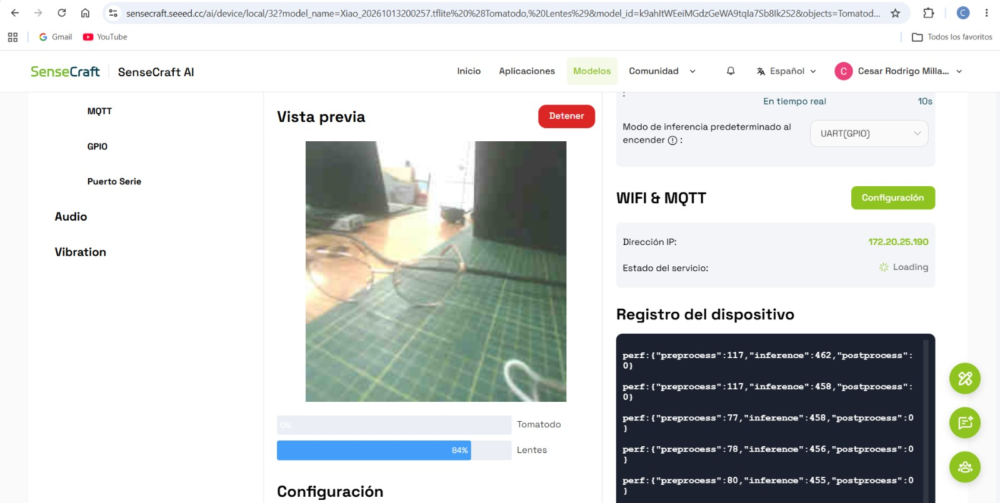
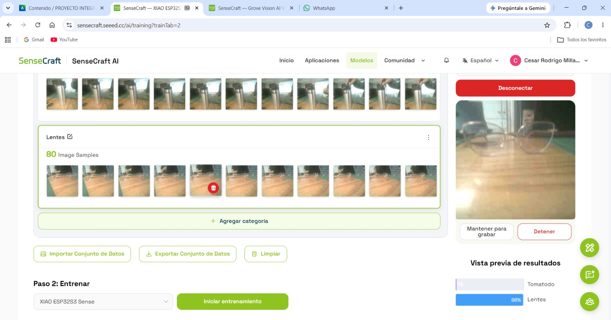
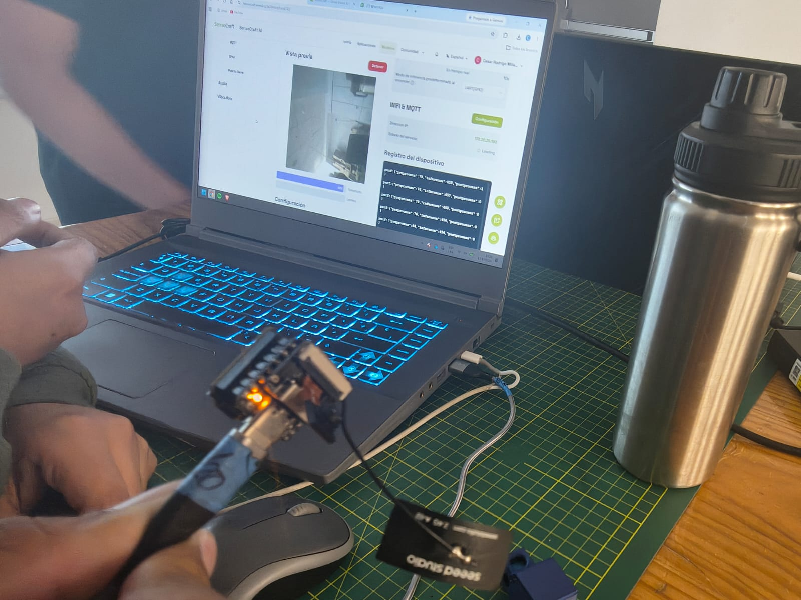
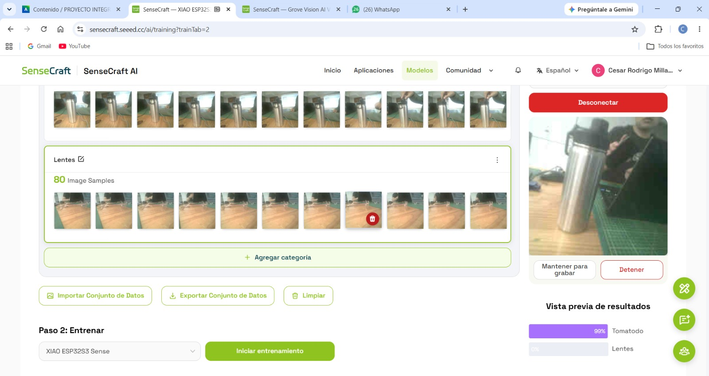
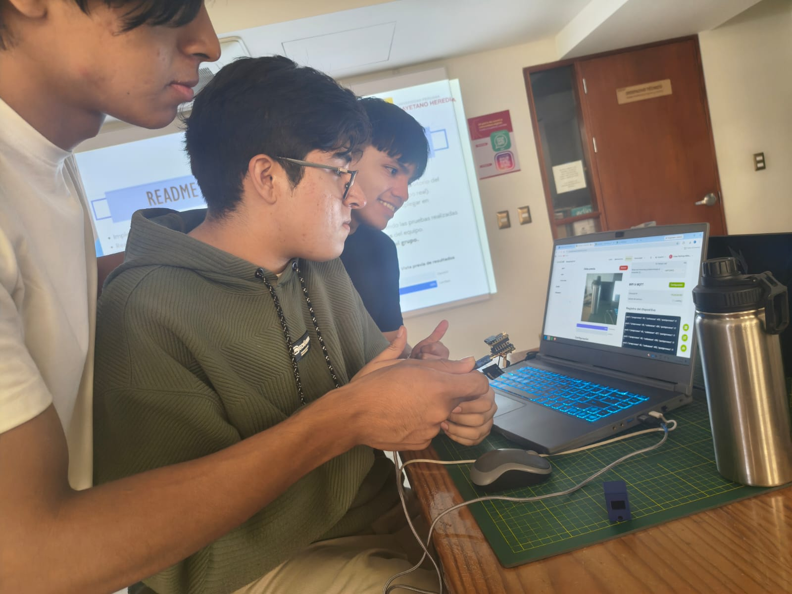

# TALLER DE INTERNET DE LAS COSAS (IoT) · ESP32

# INFORME DE LABORATORIO

**Creación y prueba de un modelo propio de clasificación de imágenes en XIAO ESP32S3 Sense**

<table>
<colgroup>
<col style="width: 50%" />
<col style="width: 50%" />
</colgroup>
<thead>
<tr class="header">
<th>Datos del informe</th>
<th>Información</th>
</tr>
</thead>
<tbody>
<tr class="odd">
<td>Curso</td>
<td>Proyecto Integrador</td>
</tr>
<tr class="even">
<td>Integrantes</td>
<td>Cesar Rodrigo Milla Gómez 
Anderson Josue Delerna Infantes 
Kevin Esty Carvallo Neciosup 
Shedira Lumeris Sihuincha Palacin</td>
</tr>
<tr class="odd">
<td>Ingenieros</td>
<td>Umbert Lewis De La Cruz, Maria Rejas, Harry Rivera, Renzo Chan</td>
</tr>
<tr class="even">
<td>Fecha</td>
<td>13/10/2026</td>
</tr>
<tr class="odd">
<td>Institución</td>
<td>Universidad Peruana Cayetano Heredia</td>
</tr>
</tbody>
</table>

# Contenido

- [1. Introducción](#1-introducción)

- [2. Objetivos](#2-objetivos)

- [3. Descripción del dispositivo y plataforma](#3-descripción-del-dispositivo-y-plataforma)

- [4. Desarrollo de la práctica](#4-desarrollo-de-la-práctica)

- [5. Resultados y observaciones](#5-resultados-y-observaciones)

- [6. Conclusiones](#6-conclusiones)

# 1. Introducción

En esta práctica se trabajó con la placa XIAO ESP32S3 Sense y la plataforma SenseCraft AI para crear un modelo propio de clasificación de imágenes. A diferencia de la actividad anterior, en la que se utilizó un modelo ya disponible, esta vez se reunieron imágenes de objetos seleccionados por el equipo y se utilizó el entorno de entrenamiento de la plataforma.

Las categorías escogidas fueron «Tomatodo» y «Lentes». Primero se capturaron muestras para cada categoría, después se revisaron los resultados en la vista previa y se probó el modelo en el dispositivo. También se examinó la placa durante las pruebas. La consigna de la actividad incluye probar una salida GPIO y subir el modelo al repositorio del grupo; esas acciones se diferencian de los resultados que pueden verificarse en las capturas entregadas.

# 2. Objetivos

Crear un modelo de inteligencia artificial por equipo, recopilar imágenes de entrenamiento, ejecutar pruebas de clasificación con la XIAO ESP32S3 Sense y documentar los resultados obtenidos. Como actividades complementarias, se planteó verificar una salida GPIO y publicar el modelo en el repositorio del grupo.

# 3. Descripción del dispositivo y plataforma

La XIAO ESP32S3 Sense es una placa compacta con microcontrolador ESP32-S3 y módulo de cámara, adecuada para capturar imágenes y ejecutar modelos optimizados de inteligencia artificial. SenseCraft AI permite organizar muestras por categorías, entrenar modelos de clasificación y observar sus predicciones en una vista previa.

***Figura 1. Vista del módulo de cámara y montaje de la placa.***

En la Figura 1 se observa el módulo de cámara montado en el conjunto utilizado para las pruebas. La cámara se orientó hacia los objetos de interés para recoger imágenes y evaluar las predicciones.

# 4. Desarrollo de la práctica

## 4.1. Creación del conjunto de datos

El equipo seleccionó dos clases de objetos cotidianos: un tomatodo y unos lentes. Se capturaron imágenes desde distintos encuadres con el fin de proporcionar ejemplos para el entrenamiento. En las capturas se aprecia que la categoría «Lentes» contiene 80 muestras de imagen.

***Figura 2. Muestras de entrenamiento y prueba de lentes.***

En la Figura 2 se observa la categoría «Lentes» con 80 imágenes registradas. La vista previa de resultados muestra 98 % para «Lentes» y 1 % para «Tomatodo» en ese instante, lo que indica que el modelo favoreció la clase esperada para la imagen de lentes.

***Figura 3. Participación del equipo durante la recolección de imágenes.***

En la Figura 3 se documenta la actividad en el laboratorio con la cámara y la interfaz de SenseCraft AI. Se observa la manipulación del dispositivo mientras se trabaja con la captura de ejemplos para el modelo.

## 4.2. Entrenamiento y pruebas de clasificación

Una vez reunidas las muestras, se utilizó la opción de entrenamiento para la placa XIAO ESP32S3 Sense. Después se realizaron pruebas con objetos colocados frente a la cámara y se compararon los porcentajes mostrados por la plataforma.

***Figura 4. Vista previa con detección de lentes.***

En la Figura 4 la plataforma muestra 98 % para «Lentes» y 1 % para «Tomatodo». Esta captura sirve como evidencia de una predicción de la clase «Lentes» durante las pruebas.

***Figura 5. Vista previa de la categoría tomatodo.***

En la Figura 5 se observa un tomatodo en la imagen de la cámara. La vista previa indica 99 % para «Tomatodo» y 0 % para «Lentes», mostrando una clasificación favorable a la categoría del objeto presentado.

***Figura 6. Interfaz de recolección y entrenamiento del modelo.***

En la Figura 6 se aprecia el área de categorías y el botón «Iniciar entrenamiento», correspondiente al proceso de preparación del modelo para la XIAO ESP32S3 Sense.

### 4.2.1. Interpretación del nivel de confianza

Durante las pruebas, SenseCraft AI mostró un porcentaje de confianza para cada categoría del modelo («Tomatodo» y «Lentes»). Este valor representa el grado de seguridad que el modelo asigna a una predicción en esa imagen concreta. No equivale al porcentaje de precisión general del sistema ni garantiza que la clasificación sea correcta.

En la Figura 4 se observa 98 % de confianza para «Lentes» y 1 % para «Tomatodo». Esto significa que, para esa imagen, el modelo favoreció claramente la categoría «Lentes». En la Figura 5 se registra 99 % para «Tomatodo» y 0 % para «Lentes», lo que indica una predicción predominantemente de «Tomatodo».

Asimismo, en la Figura 9, durante la ejecución en el dispositivo, se aprecia 84 % para «Lentes» y 0 % para «Tomatodo». Aunque la confianza de «Lentes» es menor que el 98 % de la Figura 4, sigue siendo la categoría con el valor más alto en esa captura. Los porcentajes visibles pueden estar redondeados y no necesariamente sumar 100 %.

El nivel de confianza también puede utilizarse para definir un umbral de activación en una automatización GPIO. Por ejemplo, si se eligiera un umbral de 80 %, el sistema podría programarse para activar una salida únicamente cuando la clase objetivo alcanzara al menos ese valor. Este 80 % es solo un ejemplo explicativo: las capturas proporcionadas no permiten confirmar el umbral ni el pin configurado por el equipo.

Por ello, para evaluar correctamente el modelo conviene revisar varias imágenes nuevas, comparar la etiqueta predicha con el objeto real y registrar los errores. Una confianza alta en una imagen aislada no demuestra por sí sola una exactitud alta del modelo.

## 4.3. Ejecución del modelo en el dispositivo

***Figura 7. Prueba de predicción en SenseCraft AI.***

En la Figura 7 se muestra la interfaz de SenseCraft AI durante una prueba. La vista previa y los porcentajes de clasificación permiten revisar la respuesta del modelo para el objeto que aparece frente a la cámara.

***Figura 8. Prueba del dispositivo y revisión de resultados por integrantes del equipo.***

En la Figura 8 se observa a integrantes del equipo utilizando la placa junto a una computadora portátil para verificar la vista previa y los registros del dispositivo.

***Figura 9. Vista previa del modelo cargado en la placa.***

En la Figura 9 se observa la interfaz del modelo propio con las clases «Tomatodo» y «Lentes». La captura muestra 84 % para «Lentes» y 0 % para «Tomatodo» en ese instante. Este resultado se interpreta como una predicción puntual, no como precisión global del modelo.

## 4.4. Verificación de la salida GPIO

***Figura 10. Indicadores luminosos visibles en el montaje.***

En la Figura 10 se aprecian luces encendidas en la placa durante las pruebas. Sin embargo, esta fotografía no permite confirmar qué pin GPIO fue configurado ni que la iluminación haya sido activada específicamente por la clasificación de uno de los objetos.

Para completar la evidencia solicitada de GPIO se recomienda incorporar una captura de la configuración de la condición y del pin, además de una fotografía o secuencia que muestre la activación correspondiente. Tampoco se incluye una captura que confirme la subida del modelo al repositorio del grupo.

# 5. Resultados y observaciones

Las capturas muestran que el modelo propio pudo producir predicciones diferenciadas para las categorías «Lentes» y «Tomatodo». En las pruebas documentadas se observaron valores de 98 % para lentes y 99 % para tomatodo, según la imagen presentada en cada momento. Estos valores son salidas de la interfaz para ejemplos específicos y no deben interpretarse como una evaluación completa de exactitud. Los porcentajes mostrados son niveles de confianza de predicciones individuales, no porcentajes de acierto medidos sobre todo el conjunto de pruebas.

La calidad de la imagen, el encuadre, la iluminación y la variedad de muestras pueden afectar las predicciones. Para evaluar el modelo de manera más rigurosa sería conveniente utilizar imágenes nuevas y registrar tanto los aciertos como los errores.

# 6. Conclusiones

La actividad permitió practicar el proceso de creación de un modelo de clasificación de imágenes, desde la recopilación de muestras hasta la prueba de predicciones en SenseCraft AI con la XIAO ESP32S3 Sense. Se obtuvieron resultados visibles para las categorías «Tomatodo» y «Lentes».

Las evidencias entregadas documentan el uso del dispositivo y los resultados de clasificación. Quedan por documentar de forma específica la configuración de GPIO y la publicación del modelo en el repositorio, requisitos incluidos en la consigna de laboratorio.
