

# INFORME DE LABORATORIO

**TALLER DE INTERNET DE LAS COSAS · IoT ESP32**

## Implementación y prueba de un clasificador de lentes y tomatodo en XIAO ESP32S3 Sense

---

## Datos del informe

| Datos del informe | Información |
|:---|:---|
| **Curso** | Proyecto Integrador |
| **Integrantes** | Cesar Rodrigo Milla Gómez Anderson Josue Delerna Infantes Kevin Esty Carvallo Neciosup Shedira Lumeris Sihuincha Palacin |
| **Ingenieros** | Umbert Lewis De La Cruz, Maria Rejas, Harry Rivera y Renzo Chan |
| **Fecha** | 13/10/2026 |
| **Institución** | Universidad Peruana Cayetano Heredia |
| **Tema** | Clasificación de lentes y tomatodo con TinyML y Edge Impulse, implementación en Arduino IDE y pruebas en SenseCraft |

---

## Contenido

- [1. Introducción](#1-introducción)
- [2. Métodos](#2-métodos)
- [3. Resultados](#3-resultados)
  - [3.1 Dataset con imágenes y etiquetas](#31-dataset-con-imágenes-y-etiquetas)
  - [3.2 Pruebas estadísticas de validación y prueba](#32-pruebas-estadísticas-de-validación-y-prueba)
  - [3.3 Pruebas con Edge Impulse y ejecución del paso 6](#33-pruebas-con-edge-impulse-y-ejecución-del-paso-6)
  - [3.4 Pruebas en SenseCraft](#34-pruebas-en-sensecraft)
- [4. Discusión](#4-discusión)
  - [Interpretación de la confianza](#interpretación-de-la-confianza)
  - [Fuente de la práctica](#fuente-de-la-práctica)

---

## 1. Introducción

TinyML permite ejecutar modelos de aprendizaje automático en dispositivos con memoria y capacidad de procesamiento limitadas. En esta práctica se trabajó con la placa XIAO ESP32S3 Sense y su cámara para clasificar imágenes de dos objetos cotidianos: lentes y un tomatodo. Edge Impulse se utilizó para organizar los datos, entrenar el modelo y generar los archivos necesarios para su implementación.

El objetivo de la práctica fue desarrollar un modelo capaz de distinguir lentes y un tomatodo a partir de imágenes, y comprobar su funcionamiento en la placa XIAO ESP32S3 Sense. Para ello se siguió el proceso de captura, etiquetado, entrenamiento y evaluación. Las pruebas realizadas con Arduino IDE y SenseCraft permitieron observar las predicciones y comprender el significado de los porcentajes de confianza.

## 2. Métodos

Se utilizaron una placa XIAO ESP32S3 Sense con cámara, una computadora, una conexión USB y los objetos seleccionados: lentes y un tomatodo. El trabajo se desarrolló con Edge Impulse para preparar y entrenar el modelo, Arduino IDE para ejecutarlo en la placa y SenseCraft para visualizar la imagen capturada y los resultados. La guía de laboratorio sirvió como referencia para el procedimiento.

El conjunto de datos reunió 100 imágenes de las dos clases y se dividió en 80 muestras para entrenamiento y 20 para prueba. Se generaron las características de las imágenes y se utilizó una arquitectura MobileNetV2 con entradas de 96 × 96 píxeles y dos clases de salida. Mediante transferencia de aprendizaje, se adaptó una red previamente entrenada a la clasificación de los objetos de la práctica.

La evaluación comprendió los resultados de validación del entrenamiento, la clasificación de una imagen individual y la prueba del modelo con las 20 muestras reservadas. Se revisaron las matrices de confusión y las puntuaciones obtenidas. Luego se generó la biblioteca para Arduino y se realizaron pruebas con la cámara, observando las salidas del monitor serie y de SenseCraft. Las fotografías de Lumeris y Anderson acompañan las etapas en las que participaron.

Para interpretar los resultados se distinguieron tres medidas: la exactitud, que resume los aciertos en un conjunto de imágenes; la confianza, que expresa la puntuación de una predicción individual; y el tiempo de clasificación, que indica cuánto tarda el modelo en procesar una entrada. Los valores presentados corresponden a las capturas de la práctica.

## 3. Resultados

Los resultados se organizan en los cuatro apartados solicitados: dataset con imágenes y etiquetas, dos evaluaciones estadísticas, pruebas con Edge Impulse y pruebas en SenseCraft. Cada imagen incluye su interpretación, y las fotografías de laboratorio se ubican junto a la prueba correspondiente.

### 3.1 Dataset con imágenes y etiquetas

**Imagen 1. Creación del proyecto en Edge Impulse**

> **Interpretación:** El proyecto CesarM-project-1 reúne las etapas de preparación de datos, entrenamiento y evaluación del clasificador. Su creación permitió organizar en un mismo espacio las imágenes de lentes y tomatodo y los resultados del modelo. El destino Cortex-M4F mostrado en la plataforma corresponde a la referencia utilizada para estimar recursos; la placa empleada en la práctica fue la XIAO ESP32S3 Sense.

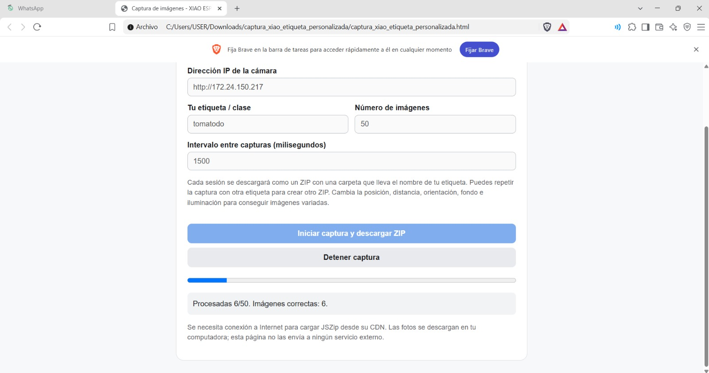

**Imagen 2. Captura de imágenes del tomatodo**

> **Interpretación:** Se configuró la captura de 50 imágenes de la clase Tomatodo, con un intervalo de 1500 milisegundos, equivalente a 1,5 segundos entre capturas. La pantalla registra un avance de 6 imágenes procesadas de las 50 previstas. Esta etapa generó las muestras necesarias para que el modelo aprendiera las características visuales del objeto.

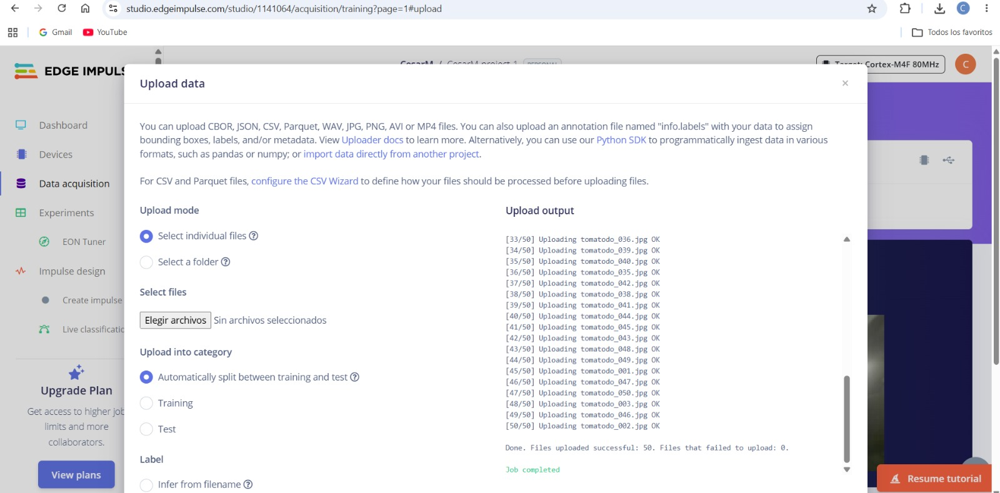

**Imagen 3. Carga de imágenes a la plataforma**

> **Interpretación:** La ventana Upload data muestra la carga de las imágenes y la selección de una división automática entre entrenamiento y prueba. Los mensajes de carga confirman que los archivos fueron aceptados. La etiqueta asignada identifica el objeto presente en cada muestra y sirve como referencia durante el aprendizaje; por ello, la correspondencia entre imagen y etiqueta es fundamental para entrenar el clasificador.

**Imagen 4. Registro inicial de la clase tomatodo**

> **Interpretación:** La plataforma registra las primeras 50 imágenes, correspondientes al tomatodo, con una distribución de 80 % para entrenamiento y 20 % para prueba. La vista previa muestra una de las muestras y permite comprobar su contenido y etiqueta. En esta etapa, el conjunto de datos todavía contiene una sola clase; posteriormente se incorporaron las imágenes de lentes.

**Imagen 5. Conjunto de datos con ambas clases**

> **Interpretación:** Después de añadir la clase Lentes, el conjunto reunió 100 imágenes: 80 destinadas al entrenamiento y 20 a la prueba. En la lista aparecen registros de ambas clases y la vista previa muestra los lentes. Esta incorporación completó las dos categorías que el modelo debía distinguir y permitió continuar con el procesamiento de las imágenes.

**Imagen 6. Generación y exploración de características**

> **Interpretación:** Se generaron las características de las 80 imágenes de entrenamiento de Lentes y Tomatodo. En el gráfico, cada punto representa una muestra y su color identifica la clase. La separación de buena parte de los puntos sugiere diferencias visuales aprovechables para la clasificación. El gráfico es una representación reducida de las características, por lo que la calidad del modelo debe comprobarse con las evaluaciones posteriores.

### 3.2 Pruebas estadísticas de validación y prueba

**Imagen 7. Arquitectura del modelo y resultados de validación**

> **Interpretación:** La arquitectura MobileNetV2 utiliza imágenes de 96 × 96 píxeles y produce una salida para cada una de las dos clases. La exactitud de validación fue 75 %. La matriz de confusión muestra que se reconoció correctamente el 100 % de los lentes y el 55,6 % de los tomatodos; el 44,4 % restante de los tomatodos se clasificó como lentes. Estos porcentajes describen los aciertos y errores de validación, no la confianza de una predicción individual.

**Imagen 8. Distribución de las muestras clasificadas**

> **Interpretación:** Los puntos rojos corresponden a imágenes de tomatodo clasificadas incorrectamente, lo que coincide con los errores de la matriz de confusión. La precisión ponderada de 0,84 resume la calidad de las predicciones positivas por clase; la sensibilidad de 0,75 resume la recuperación de las clases reales. El F1 ponderado de 0,74 combina precisión y sensibilidad y refleja el equilibrio entre ambas medidas.

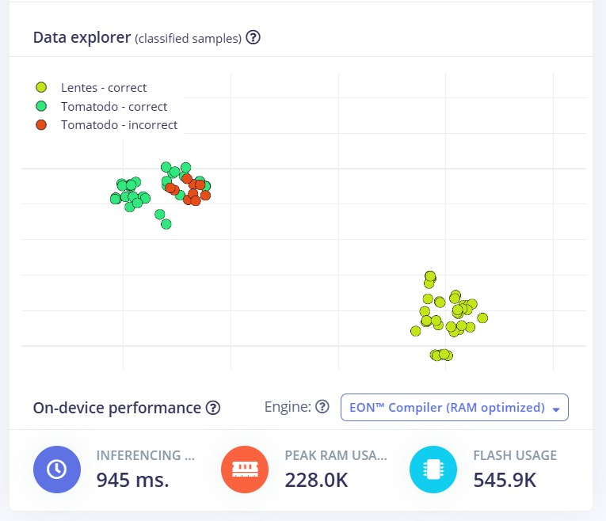

**Imagen 9. Estimación de recursos para ejecutar el modelo**

> **Interpretación:** La plataforma estima 945 ms de inferencia, un uso máximo de RAM de 228,0 K y un uso de Flash de 545,9 K con EON Compiler optimizado para RAM. La RAM corresponde a memoria de trabajo durante la ejecución, mientras que la Flash almacena el modelo y el programa. Estas estimaciones permiten valorar los recursos necesarios y dependen de la configuración de referencia seleccionada en Edge Impulse.

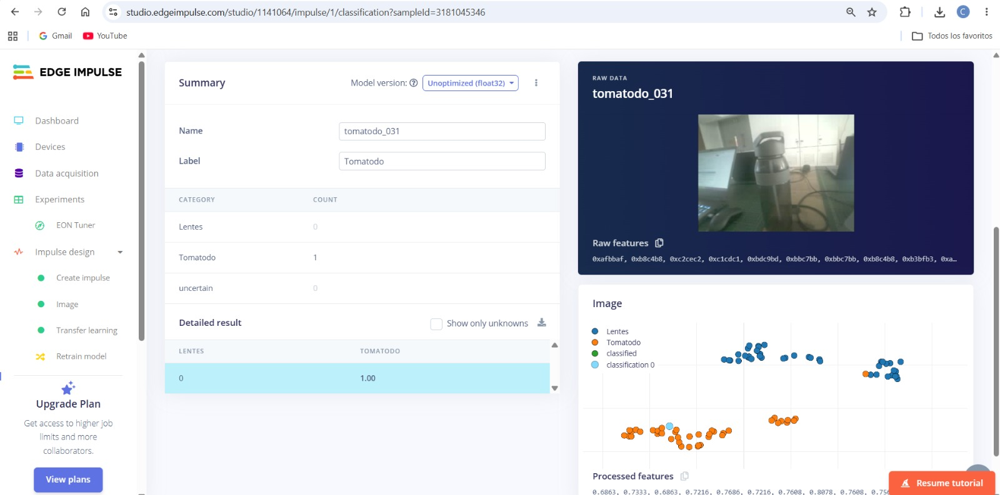

**Imagen 10. Clasificación individual de un tomatodo**

> **Interpretación:** La imagen tomatodo_031 fue clasificada como Tomatodo con una puntuación mostrada de 1,00, equivalente a una confianza redondeada de 100 %, y 0 para Lentes. La clase predicha coincide con la etiqueta de la muestra. El resultado indica una preferencia clara del modelo por Tomatodo en esta entrada; su alcance se limita a la imagen evaluada.

**Imagen 11. Evaluación del conjunto de prueba**

> **Interpretación:** La evaluación Model testing de la versión float32 obtuvo 100 % de exactitud en las 20 muestras de prueba. La matriz de confusión muestra aciertos para ambas clases y las métricas reportadas alcanzan 1,00. Esto significa que todas las imágenes de ese conjunto fueron clasificadas correctamente. El resultado debe distinguirse del 75 % de validación, ya que corresponde a otra evaluación y a otras muestras.

### 3.3 Pruebas con Edge Impulse y ejecución del paso 6

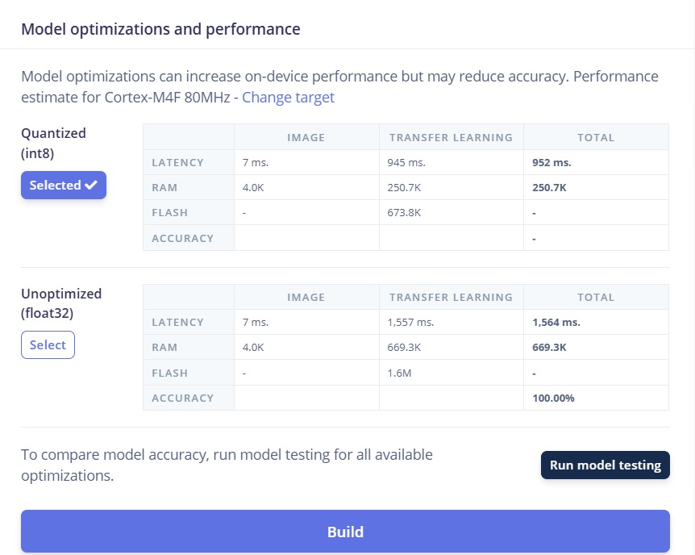

**Imagen 12. Comparación de las versiones del modelo**

> **Interpretación:** La versión int8 presenta una latencia total estimada de 952 ms y RAM de 250,7 K; float32 registra 1564 ms y 669,3 K. La cuantización reduce los recursos estimados. La pantalla indica que la referencia es Cortex-M4F a 80 MHz. Solo float32 muestra exactitud de 100 %; el campo de int8 está vacío, por lo que esta imagen no permite afirmar que ambas versiones tengan igual exactitud.

**Imagen 13. Generación de la biblioteca para Arduino**

> **Interpretación:** El mensaje Built Arduino library confirma que la biblioteca del modelo se generó correctamente. Este archivo permite incorporar el clasificador al programa de Arduino y preparar su ejecución en la XIAO ESP32S3 Sense. La exportación conecta el entrenamiento realizado en Edge Impulse con la implementación que después se observa en el monitor serie.

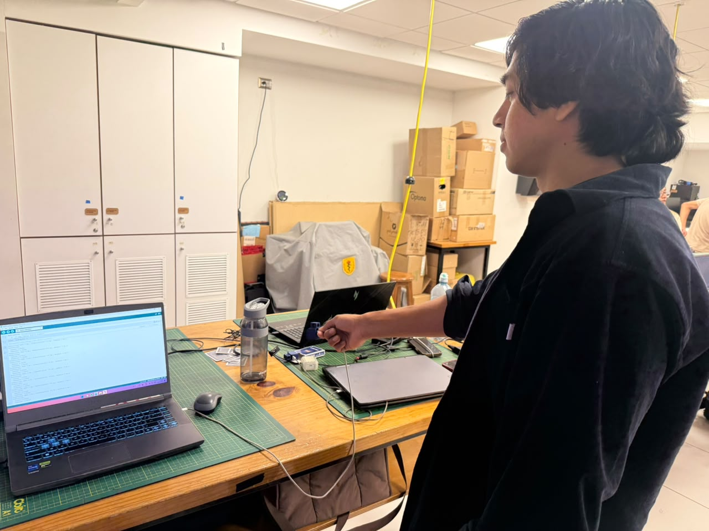

**Imagen 14. Participación de Anderson durante la implementación en Arduino**

> **Interpretación:** Anderson aparece junto al montaje utilizado durante la implementación en Arduino. La fotografía complementa la generación de la biblioteca presentada arriba y sitúa esta etapa en el entorno de laboratorio: la computadora, la placa y los objetos forman parte del equipo de prueba. La confirmación técnica de la exportación se observa en la captura de Edge Impulse.

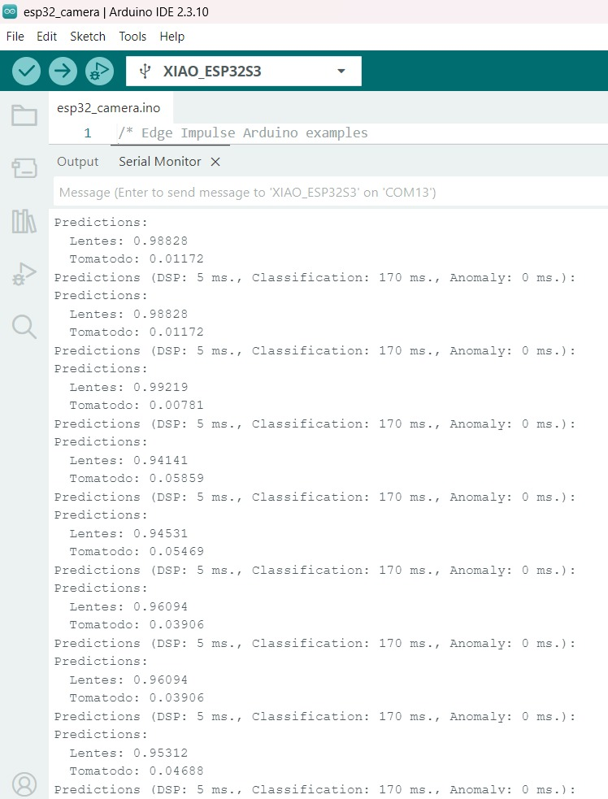

**Imagen 15. Predicciones de lentes en el monitor serie**

> **Interpretación:** El monitor serie muestra predicciones sucesivas del modelo ejecutado en la XIAO ESP32S3. En una lectura, Lentes alcanza 0,98828, equivalente a 98,828 % de confianza, frente a 0,01172 o 1,172 % para Tomatodo. El modelo selecciona Lentes por tener la puntuación mayor. También se reportan 5 ms de procesamiento y 170 ms de clasificación, que expresan el tiempo empleado en esas etapas.

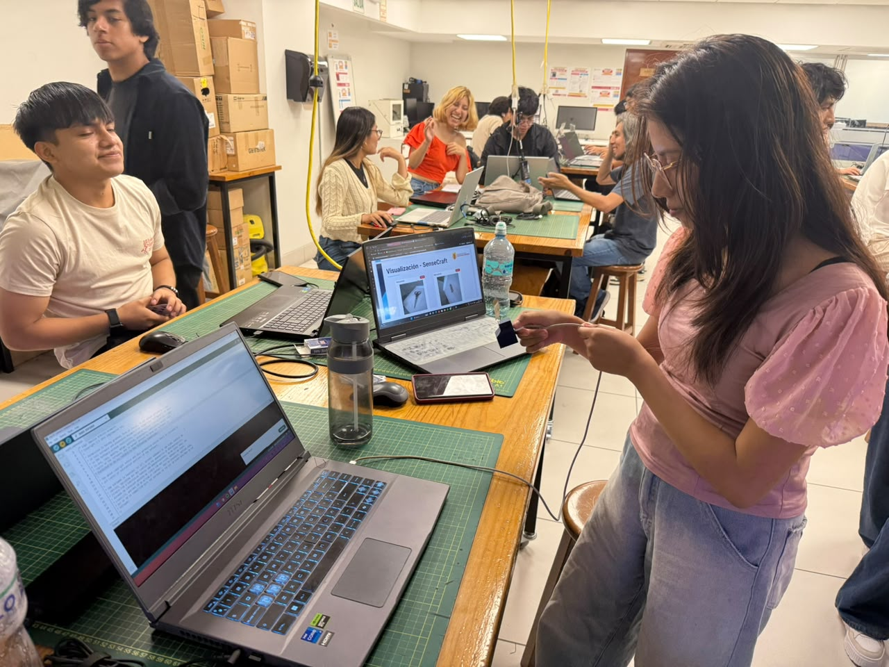

**Imagen 16. Participación de Lumeris durante las pruebas del monitor serie**

> **Interpretación:** Lumeris participa en las pruebas junto a la computadora y los objetos de clasificación. Esta fotografía acompaña los resultados del monitor serie y relaciona la salida del programa con el trabajo realizado en el laboratorio. En la captura anterior, el modelo asigna 98,828 % de confianza a Lentes; ese valor proviene del registro del programa y sirve para interpretar la predicción presentada.

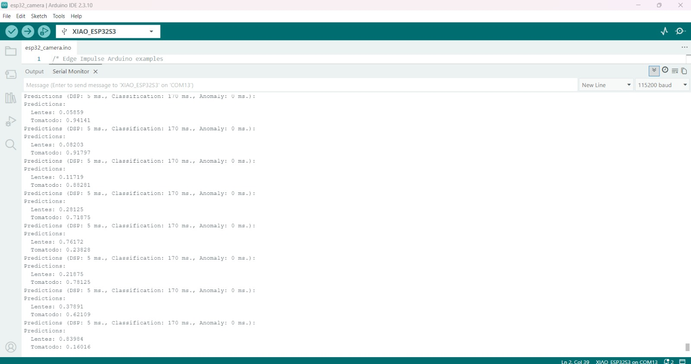

**Imagen 17. Variación de las predicciones durante la ejecución**

> **Interpretación:** Las lecturas muestran que la clase con mayor puntuación cambia durante la ejecución. En una de ellas, Tomatodo obtiene 0,94141, equivalente a 94,141 % de confianza; en otra, Lentes alcanza 0,76172, equivalente a 76,172 %. El programa continúa procesando nuevas entradas y mostrando sus resultados. Sin la imagen de la cámara asociada a cada lectura, no se puede determinar si esos cambios corresponden a cambios del objeto o a errores de clasificación.

### 3.4 Pruebas en SenseCraft

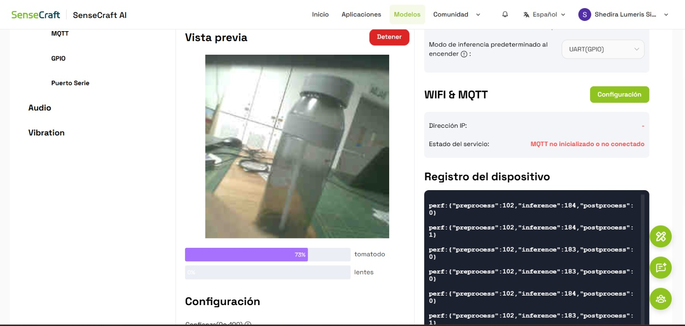

**Imagen 18. Visualización del tomatodo en SenseCraft**

> **Interpretación:** SenseCraft muestra el tomatodo en la vista previa y una confianza de 73 % para esa clase. La predicción coincide con el objeto que ocupa la mayor parte de la imagen. El porcentaje representa la puntuación mostrada para esa captura concreta. La interfaz también permite observar el registro de ejecución del dispositivo, vinculando la imagen recibida con la respuesta del clasificador.

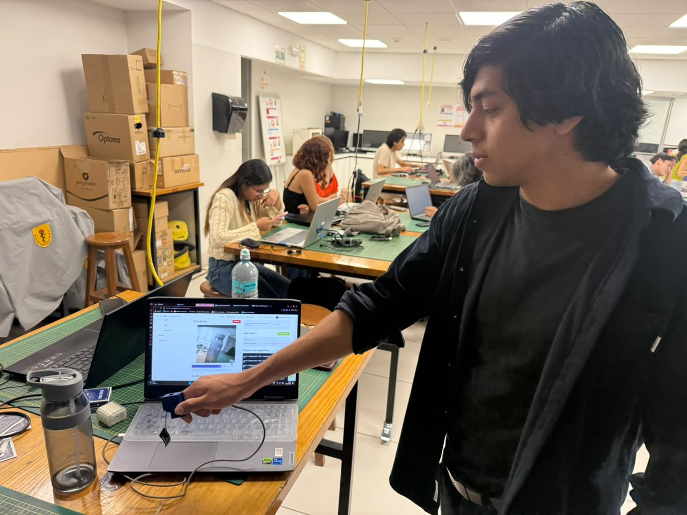

**Imagen 19. Anderson enfoca el tomatodo durante la prueba en SenseCraft**

> **Interpretación:** Anderson orienta la cámara hacia el tomatodo mientras observa la interfaz de SenseCraft en la computadora. La fotografía complementa la captura anterior, en la que se registra 73 % de confianza para Tomatodo. Juntas, las dos imágenes muestran la prueba física y su resultado: presentar el objeto ante la cámara y revisar la clasificación en pantalla.

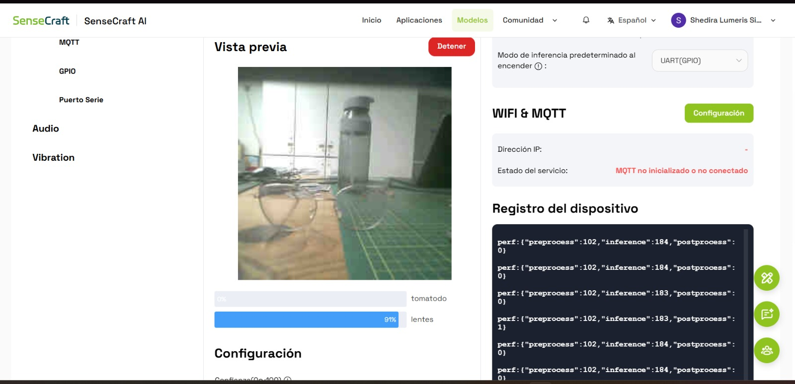

**Imagen 20. Visualización de lentes en SenseCraft**

> **Interpretación:** La vista previa contiene lentes en primer plano y un tomatodo al fondo. SenseCraft muestra 91 % de confianza para Lentes, por lo que esa es la clase favorecida en la captura. El resultado corresponde a la clasificación de la imagen completa. La presencia de ambos objetos no implica que el modelo los localice o los detecte simultáneamente.

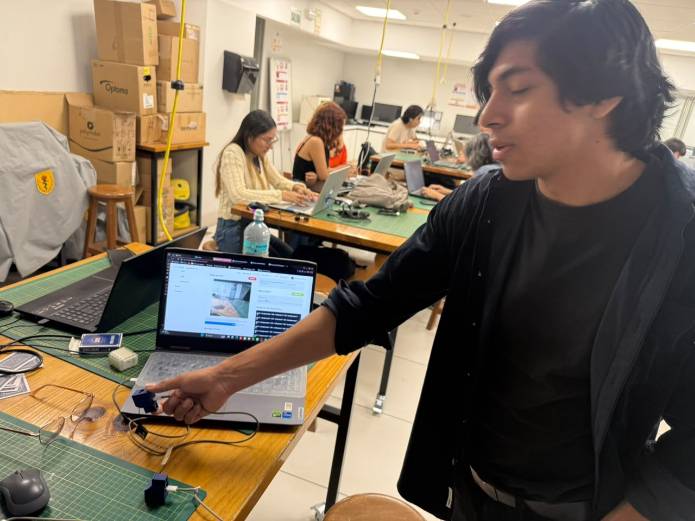

**Imagen 21. Anderson enfoca los lentes durante la prueba en SenseCraft**

> **Interpretación:** Anderson sostiene la cámara y la orienta hacia los lentes durante la prueba. Esta fotografía se relaciona con la captura anterior de SenseCraft, donde Lentes alcanza 91 % de confianza. La disposición del equipo permite observar cómo el encuadre de la cámara se refleja en la vista previa y cómo se consulta la respuesta del modelo en la computadora.

## 4. Discusión

Los resultados muestran que el modelo logró diferenciar lentes y tomatodo, aunque el desempeño varió entre las evaluaciones. En validación se obtuvo una exactitud global de 75 %. La matriz de confusión permite precisar esta diferencia: los lentes alcanzaron 100 % de reconocimiento, mientras que el tomatodo obtuvo 55,6 % y se confundió con lentes en 44,4 % de los casos. Por tanto, la principal dificultad de esa evaluación estuvo en la clase Tomatodo.

En el conjunto de prueba, la versión float32 clasificó correctamente las 20 imágenes y alcanzó 100 % de exactitud. Este resultado corresponde a las muestras reservadas para esa evaluación. El 75 % de validación y el 100 % de prueba deben leerse en su propio contexto, porque proceden de conjuntos diferentes. Las capturas no permiten establecer por qué se produjo la diferencia ni confirmar si hubo cambios del modelo entre ambas evaluaciones.

### Interpretación de la confianza

Los porcentajes de confianza permiten interpretar cada predicción. Por ejemplo, el monitor serie muestra 0,98828 para Lentes y 0,01172 para Tomatodo; al multiplicar esos valores por 100 se obtienen 98,828 % y 1,172 %, respectivamente. En esa captura, la puntuación favorece claramente a Lentes. Estos valores describen la respuesta a una imagen concreta, mientras que la exactitud se calcula comparando varias predicciones con sus etiquetas reales.

En SenseCraft se registró 73 % de confianza para Tomatodo y 91 % para Lentes en dos escenas distintas. Las fotografías de Anderson permiten relacionar cada resultado con la orientación de la cámara hacia el objeto correspondiente. Ambas pruebas muestran cómo se presenta la salida del clasificador durante su uso. Una puntuación elevada expresa mayor confianza del modelo en esa entrada, pero no constituye una garantía de que todas las predicciones futuras serán correctas.

## Conclusiones

Se logró implementar un clasificador de lentes y tomatodo y observar sus predicciones en la XIAO ESP32S3 Sense, mediante el monitor serie y SenseCraft. Las evidencias vinculan la preparación del conjunto de datos, el entrenamiento y las pruebas de laboratorio.

La validación obtuvo **75 % de exactitud**, con mayor dificultad para reconocer el tomatodo. La versión float32 alcanzó **100 % en las 20 imágenes de prueba**; este resultado se limita a ese conjunto y no confirma la exactitud de la versión int8 seleccionada para exportación.

Las pruebas visuales mostraron **73 % de confianza para Tomatodo** y **91 % para Lentes**. Estos valores describen predicciones individuales y deben distinguirse de la exactitud global. La evidencia permite concluir que el sistema funcionó en las escenas documentadas, pero no determinar su tasa de aciertos en todas las condiciones de uso.

### Fuente de la práctica

Guía TinyML con Edge Impulse. Material de laboratorio proporcionado para la práctica. Las 21 capturas y fotografías incluidas corresponden a las evidencias aportadas del trabajo realizado.
