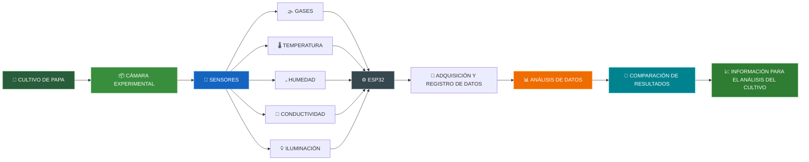
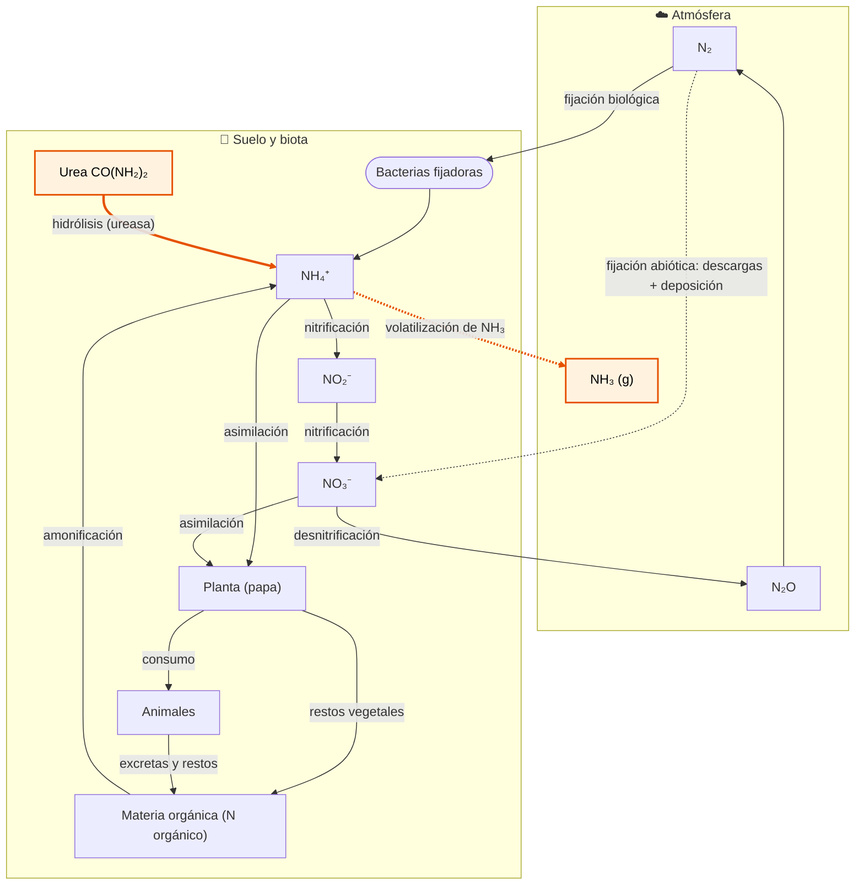

<p align="center">
  
</p>

<p align="center">
  <strong>Sistema para el monitoreo experimental del cultivo de papa y sus emisiones gaseosas</strong>
</p>

<p align="center">
  <strong>PROYECTO INTEGRADOR · 2026-II</strong>
  <br>
  <sub>Universidad Peruana Cayetano Heredia · Ingeniería Informática + Ingeniería Industrial</sub>
</p>

<p align="center">
  
  
  
  
  
</p>

<br>

<p align="center">
  
</p>

---

# 🌱 Simulación del funcionamiento de GREENPLANT


# 🔄 Flujo principal

**Cultivo → Cámara → Sensores → ESP32 → Datos → Análisis → Comparación**

GREENPLANT busca obtener datos del cultivo de papa bajo condiciones experimentales controladas para posteriormente analizarlos y encontrar patrones relacionados con las variables medidas.

---

# 🌍 Objetivos de Desarrollo Sostenible

<p align="center">
  
  
  
</p>

## 🌱 ODS 13 · Acción por el Clima

GREENPLANT se relaciona con el **ODS 13: Acción por el Clima**, debido a que busca contribuir al monitoreo y análisis experimental de gases asociados a actividades agrícolas.

El proyecto utiliza **IoT y sensores** para generar información que permita estudiar el comportamiento de las variables medidas durante los ensayos.

### 🎯 Meta 13.3 · Educación y sensibilización sobre el cambio climático

La **Meta 13.3** busca mejorar la educación, la sensibilización y la capacidad humana e institucional relacionada con la mitigación, adaptación y reducción de los efectos del cambio climático.

GREENPLANT se relaciona con esta meta mediante la **generación de información experimental sobre gases y variables ambientales**, promoviendo el uso de tecnologías de monitoreo y el análisis de fenómenos relacionados con el ambiente y la actividad agrícola.

---

## 🌾 ODS 2 · Hambre Cero

GREENPLANT se relaciona con el **ODS 2: Hambre Cero**, debido a que el proyecto se enfoca en el **cultivo de papa** y busca generar información experimental sobre las condiciones que rodean su desarrollo.

Mediante el monitoreo de **NH₃, CO₂ y variables ambientales y del sustrato**, el proyecto busca obtener datos que permitan analizar y comparar las condiciones del cultivo, contribuyendo al estudio de procesos relacionados con la producción agrícola.

### 🎯 Meta 2.4 · Agricultura sostenible

La **Meta 2.4** busca garantizar sistemas de producción de alimentos sostenibles y promover prácticas agrícolas resilientes que incrementen la productividad, ayuden a mantener los ecosistemas, fortalezcan la adaptación al cambio climático y mejoren progresivamente la calidad del suelo.

GREENPLANT se relaciona con esta meta mediante el **estudio experimental del cultivo de papa**, considerando variables del suelo, condiciones ambientales y gases presentes durante los ensayos. La información obtenida puede contribuir al análisis de las condiciones asociadas al desarrollo del cultivo.

---

## ⚙️ ODS 9 · Industria, Innovación e Infraestructura

GREENPLANT se relaciona con el **ODS 9: Industria, Innovación e Infraestructura**, debido a que propone el desarrollo de una solución tecnológica basada en **IoT, sensores y un ESP32** para el monitoreo experimental del cultivo de papa.

El proyecto integra **hardware, sensores, adquisición y registro de datos** para construir una herramienta tecnológica que permita realizar mediciones de **NH₃, CO₂ y variables ambientales y del sustrato**, fortaleciendo el uso de tecnologías de monitoreo e innovación aplicadas al ámbito agrícola.

### 🎯 Meta 9.5 · Investigación científica e innovación tecnológica

La **Meta 9.5** busca mejorar la investigación científica, fortalecer las capacidades tecnológicas y fomentar la innovación, incluyendo el incremento de las actividades de investigación y desarrollo.

GREENPLANT se relaciona directamente con esta meta al desarrollar un **prototipo experimental basado en sensores, IoT y adquisición de datos**, orientado a la generación de información para el estudio del cultivo de papa.

El proyecto integra conocimientos de **electrónica, programación, sensores, adquisición de datos y análisis experimental**, utilizando estas tecnologías para abordar una problemática relacionada con el monitoreo agrícola.

---

# 🌱 GREENPLANT

> **Una solución experimental orientada al monitoreo del cultivo de papa mediante sensores y adquisición de datos.**

## 🎯 Nuestro enfoque

GREENPLANT busca desarrollar un **prototipo experimental para el cultivo de papa**, utilizando una cámara cerrada, sensores y un sistema de adquisición de datos.

El sistema permitirá registrar información relacionada con:

<pre align="center">
🌱 CULTIVO DE PAPA
        ↓
📦 CÁMARA EXPERIMENTAL
        ↓
📡 SENSORES
        ↓
💾 REGISTRO DE DATOS
        ↓
🧹 PROCESAMIENTO
        ↓
📊 ANÁLISIS Y PATRONES
        ↓
📈 COMPARACIÓN
</pre>


# 📸 Fotografía del Equipo

<p align="center">
  
</p>

<p align="center">
  <em>Figura 1. Fotografía del equipo 01</em>
</p>

---

# 👥 Integrantes del Equipo

<div align="center">

| Foto | Nombre | Rol | Intereses |
|------|--------|-----|-----------|
|  | **Cesar Rodrigo Milla Gómez** | Responsable de función general, análisis de información y seguridad | Investigación, tecnología y análisis |
|  | **Anderson Josue Delerna Infantes** | Responsable de geometría, energía, control y software | Programación, automatización y desarrollo |
|  | **Kevin Esty Carvallo Neciosup** | Líder del equipo y responsable de sensores, hardware y adquisición de datos | Sensores, programación y sistemas |
|  | **Shedira Lumeris Sihuincha Palacin** | Responsable de estructura, comunicaciones, ergonomía, calidad y documentación | Procesos, análisis y organización |

</div>

---
# 📌 Resumen del Proyecto

## 🌱 ¿Qué es GREENPLANT?

**GREENPLANT** es un prototipo experimental orientado al **monitoreo del cultivo de papa**, mediante sensores y adquisición de datos.

El sistema utilizará una **cámara experimental cerrada**, en la cual se colocará una planta joven de papa junto con su sustrato.

Dentro de la cámara se realizarán mediciones controladas de gases y variables relacionadas con las condiciones del cultivo.

### 📡 Las mediciones podrán incluir:

- 🌫️ Gases presentes en la cámara
- 🌡️ Temperatura ambiental
- 💧 Humedad ambiental
- 🌡️ Temperatura del suelo
- 💧 Humedad del suelo
- 💡 Iluminación
- ⏱️ Tiempo de experimentación

De acuerdo con el enfoque planteado para el proyecto, se prestará especial atención al monitoreo de **amoniaco gaseoso (NH₃)** y **dióxido de carbono (CO₂)** en el cultivo de papa.

Los datos obtenidos serán almacenados para posteriormente **analizarlos y compararlos**, buscando identificar variaciones y relaciones entre las variables registradas durante los ensayos.

---

# 🌱 GREENPLANT — Proyecto integrador

## 🌿 Propósito del proyecto

Desarrollar un prototipo experimental de monitoreo para el cultivo de papa que permita registrar las concentraciones de amoníaco gaseoso (**NH₃**) y dióxido de carbono (**CO₂**), junto con variables ambientales y del sustrato.

Mediante el uso de sensores, un microcontrolador ESP32 y una cámara experimental, GREENPLANT busca obtener datos organizados que permitan analizar y comparar el comportamiento de estos gases bajo distintas condiciones de experimentación. La información generada podrá contribuir al estudio del manejo de la urea y de los factores asociados a las posibles pérdidas de nitrógeno.

---

## ⚠️ Problemática

La agricultura utiliza fertilizantes nitrogenados, entre ellos la **urea**, para proporcionar nitrógeno a los cultivos. Sin embargo, después de su aplicación, la urea experimenta transformaciones físico-químicas en el suelo que pueden favorecer la volatilización de amoníaco gaseoso (**NH₃**). La magnitud de este proceso depende de factores como el pH, la temperatura, la humedad del suelo, las propiedades del sustrato y el método de aplicación del fertilizante [1], [6].

La volatilización del NH₃ puede provocar pérdidas de nitrógeno y reducir la eficiencia del fertilizante. Además, el amoníaco puede reaccionar en la atmósfera y contribuir a la formación de material particulado fino (PM₂.₅). Su deposición también puede contribuir a la alteración de ecosistemas, la acidificación y la eutrofización en determinadas condiciones [7], [9], [13], [14].

Por otra parte, el **CO₂** es una variable de interés porque puede relacionarse con procesos de respiración e intercambio gaseoso del sistema suelo-planta. En el cultivo de papa, su concentración puede verse influida por la respiración de las raíces y la actividad de los microorganismos del suelo. Cuando existe iluminación, la fotosíntesis también puede consumir CO₂ [3].

Por ello, el CO₂ registrado dentro de una cámara experimental no debe atribuirse automáticamente a la aplicación de urea. Del mismo modo, detectar NH₃ no permite determinar por sí solo cuánto nitrógeno se ha perdido.

El problema consiste en obtener información experimental organizada que permita estudiar las variaciones de NH₃ y CO₂ y relacionarlas con las condiciones del cultivo, la temperatura, la humedad y el manejo de la fertilización.

Ante esta necesidad, GREENPLANT propone integrar sensores y un ESP32 para:

🔬 **Medir** → 💾 **Registrar** → 🧠 **Analizar** → 📊 **Comparar**

El sistema permitirá recopilar datos durante ensayos controlados, identificar tendencias y comparar los resultados obtenidos bajo diferentes condiciones experimentales.

> **Consideración científica:** una concentración expresada en ppm no equivale directamente a una masa de gas emitida ni a una pérdida de nitrógeno en kg/ha. Para calcular una pérdida total de nitrógeno sería necesario emplear un método de medición de emisiones validado y considerar las características y condiciones de la cámara experimental.

---

## ❓ Pregunta de investigación

¿Cómo se relacionan las dosis y el manejo de la urea, junto con las condiciones ambientales, con las concentraciones de NH₃ y CO₂ en ensayos controlados con plantas de papa, y cómo pueden utilizarse esos resultados, junto con información agronómica, para orientar un uso más eficiente del fertilizante y reducir aplicaciones excesivas?

---

## 🔬 Hipótesis

Las dosis y el manejo de la urea, junto con las condiciones ambientales y del sustrato, se relacionan con variaciones en las concentraciones de NH₃ y CO₂ registradas durante los ensayos experimentales con cultivos de papa.

---

## 📚 Estudios que anteceden

La propuesta de GREENPLANT se fundamenta en investigaciones relacionadas con la volatilización de amoníaco, la fertilización nitrogenada en papa y la medición de gases mediante cámaras experimentales.

| Estudio | Aporte principal | Relación con GREENPLANT |
|:---|:---|:---|
| **Sunderlage y Cook (2018)** [1] | Analizaron la influencia de las propiedades del suelo y de los aditivos del fertilizante en la volatilización de NH₃ proveniente de la urea. | Sustenta la importancia de considerar las propiedades del sustrato y las condiciones de aplicación. |
| **Lee et al. (2024)** [2] | Compararon la volatilización de amoníaco en suelos fertilizados con urea y sulfato de amonio en diferentes cultivos, incluida la papa. | Proporciona un antecedente directamente relacionado con el estudio de la volatilización de NH₃ en condiciones de fertilización. |
| **Baneschi et al. (2023)** [3] | Presentaron un protocolo basado en cámaras cerradas para medir la respiración del suelo mediante CO₂ y reducir la incertidumbre de las mediciones. | Respalda la importancia de controlar el procedimiento experimental y analizar cuidadosamente las concentraciones registradas. |
| **García Espinoza (2022)** [4] | Estudió dosis de nitrógeno y fósforo en el rendimiento y la eficiencia agronómica del cultivo de papa de la variedad UNICA en Apata-Jauja. | Aporta antecedentes sobre fertilización nitrogenada y respuesta agronómica de la papa. |
| **Seminario Cunya et al. (2017)** [5] | Evaluaron el rendimiento de cosecha de diecisiete cultivares de papa del grupo Phureja. | Aporta contexto sobre la evaluación agronómica de cultivares de papa; no debe interpretarse como una medición de emisiones si el estudio no las reporta. |
| **Engel, Jones y Wallander (2011)** [6] | Estudiaron la volatilización de amoníaco a partir de urea aplicada sobre suelos fríos y estrategias para mitigarla mediante NBPT. | Aporta información sobre factores y estrategias de manejo que pueden influir en la pérdida de NH₃. |

### 🔎 Conclusión de los antecedentes

Los estudios revisados muestran que las propiedades del suelo, el manejo de la fertilización y las condiciones experimentales pueden influir en la volatilización de NH₃ y en las mediciones de CO₂.

A partir de estos antecedentes, GREENPLANT propone integrar sensores, adquisición de datos y una cámara experimental para observar el comportamiento de estos gases y generar información que facilite su análisis comparativo.

---

## 🧪 Urea y nitrógeno

La urea comercial suele contener aproximadamente un **46 % de nitrógeno en masa**. Para convertir una dosis de nitrógeno expresada en kg N/ha a una cantidad equivalente de urea, se puede emplear la siguiente relación:

$$
\text{Urea (kg/ha)} = \frac{\text{N (kg/ha)}}{0.46}
$$

Por ejemplo, una aplicación de 150 kg de urea/ha contiene aproximadamente:

$$
150 \times 0.46 = 69\text{ kg N/ha}
$$

Este resultado corresponde al nitrógeno aplicado mediante el fertilizante; no representa la cantidad absorbida por la planta ni la cantidad perdida al ambiente.

La volatilización de NH₃ no presenta un porcentaje único para todos los cultivos y suelos. La FAO recoge rangos de referencia que dependen del método de aplicación y de las condiciones ambientales y edáficas [7]. Dichos valores sirven como contexto general y **no deben considerarse resultados experimentales de GREENPLANT**.

---

## 📏 Medición e interpretación de los datos

Durante los ensayos, GREENPLANT busca registrar las concentraciones de NH₃ y CO₂, junto con variables ambientales y del sustrato.

Para facilitar la interpretación de los resultados, se propone registrar:

- Concentración de NH₃ en ppm.
- Concentración de CO₂ en ppm.
- Temperatura ambiental.
- Humedad relativa.
- Humedad del sustrato.
- Fecha, hora y duración del ensayo.
- Tratamiento y cantidad de urea aplicada.
- Superficie de la parcela o dimensiones del recipiente experimental.
- Tiempo transcurrido desde la aplicación del fertilizante.
- Condiciones de la cámara y características de los sensores.

### Cálculos descriptivos

**Cambio de concentración de NH₃ durante el ensayo:**

$$
\Delta C_{NH_3}=C_{\text{final}}-C_{\text{inicial}}
$$

**Tasa media de cambio durante una hora:**

$$
r=\frac{C_{\text{final}}-C_{\text{inicial}}}{60}
$$

En esta expresión, la tasa se expresa en ppm/min cuando el intervalo de medición es de 60 minutos.

Estos cálculos permiten describir la evolución de la concentración. Sin embargo, **no convierten automáticamente las lecturas en una tasa de emisión de masa**.

Si se desea estimar el porcentaje de nitrógeno perdido por volatilización, es necesario cuantificar la masa de nitrógeno emitida como NH₃-N mediante un método validado:

$$
\%N_{\text{perdido}}=
\frac{\text{kg N emitido como NH}_3\text{-N}}
{\text{kg N aplicado}}\times100
$$

Una lectura aislada del sensor en ppm no proporciona directamente el numerador de esta ecuación.

### Consideraciones sobre la cámara experimental

La cámara utilizada en GREENPLANT debe mantenerse en condiciones controladas y documentarse de manera consistente. Si existe poco intercambio de aire, los gases pueden acumularse y la concentración medida puede cambiar con el tiempo.

Por esta razón, los ensayos de aproximadamente una hora permitirán analizar principalmente la evolución de las concentraciones durante ese intervalo. No necesariamente representarán la pérdida acumulada de nitrógeno durante todo el periodo de volatilización, que puede continuar durante más tiempo [11], [12].

Los resultados deberán interpretarse considerando las características de la cámara, la calibración de los sensores, el tiempo de medición y las condiciones del sustrato.

---

## 🌎 Consecuencias ambientales de la volatilización de NH₃

La pérdida de NH₃ puede tener consecuencias ambientales importantes:

1. **Pérdida de nitrógeno disponible:** parte del nitrógeno aplicado abandona la zona de aplicación y deja de estar inmediatamente disponible para el cultivo.
2. **Contaminación del aire:** el NH₃ puede reaccionar con compuestos ácidos y contribuir a la formación de partículas finas PM₂.₅, asociadas con efectos perjudiciales para la salud.
3. **Deposición de nitrógeno:** el amoníaco puede desplazarse en la atmósfera y depositarse en suelos, vegetación y cuerpos de agua.
4. **Acidificación y eutrofización:** la deposición y transformación de compuestos nitrogenados puede contribuir a cambios en el suelo y el agua, al exceso de nutrientes y a alteraciones en los ecosistemas.
5. **Efectos indirectos sobre el clima:** el nitrógeno depositado puede participar en procesos que generen emisiones de óxido nitroso (N₂O), un gas de efecto invernadero potente [7], [9], [13], [14].

GREENPLANT busca aportar información experimental para estudiar el comportamiento de las concentraciones registradas y contribuir al análisis del manejo de la urea. El sistema no demuestra por sí solo una reducción de la contaminación a escala de campo, pues esto requiere validación experimental adecuada.

---

## ♻️ Ciclo del nitrógeno

El ciclo del nitrógeno describe cómo este elemento circula entre la atmósfera, el suelo y los seres vivos mediante procesos biológicos, químicos y físicos. Es fundamental para la formación de proteínas, ácidos nucleicos y otras moléculas esenciales para el crecimiento de las plantas.

### 🌎 Diagrama del ciclo del nitrógeno




# 🎯 Objetivo general

Desarrollar un prototipo experimental que permita monitorear y registrar las concentraciones de NH₃ y CO₂, junto con variables ambientales y del sustrato, para analizar su comportamiento durante ensayos controlados con plantas de papa bajo distintas condiciones de fertilización y aportar evidencia para orientar un uso más eficiente de la urea.

---

# 🎯 Objetivos específicos

- Identificar las principales regiones productoras de papa en el Perú y recopilar información documentada sobre dosis y prácticas de fertilización con urea.
- Describir las transformaciones químicas de la urea relacionadas con la formación de NH₃ y explicar los procesos vinculados al CO₂.
- Diseñar e implementar un prototipo con ESP32 y sensores para registrar NH₃, CO₂ y variables ambientales y del sustrato.
- Registrar y organizar las concentraciones obtenidas durante los ensayos experimentales.
- Graficar y analizar las variaciones de las concentraciones de los gases en función del tiempo y de las condiciones de experimentación.
- Comparar los resultados obtenidos bajo distintas condiciones de fertilización.
- Elaborar una orientación preliminar sobre el manejo de la urea a partir de los resultados experimentales y de referencias agronómicas, evitando recomendar dosis universales sin análisis de suelo ni validación en campo.

---

## 🌍 Relación con los Objetivos de Desarrollo Sostenible

- **ODS 2: Hambre cero — Meta 2.4.** Relación con el estudio y desarrollo de prácticas agrícolas sostenibles y resilientes.
- **ODS 9: Industria, innovación e infraestructura — Meta 9.5.** Relación con la investigación aplicada y el desarrollo de capacidades tecnológicas.
- **ODS 13: Acción por el clima — Meta 13.3.** Relación educativa con el análisis de procesos ambientales vinculados al CO₂ y al manejo del nitrógeno.

Estas relaciones representan la orientación potencial del proyecto; el prototipo no demuestra por sí mismo el cumplimiento de las metas de los ODS.

---

# 📖 Referencias bibliográficas

[1] M. Sunderlage and R. L. Cook, “Soil Property and Fertilizer Additive Effects on Ammonia Volatilization from Urea,” *Soil Science Society of America Journal*, vol. 82, no. 1, pp. 253–259, 2018. https://doi.org/10.2136/sssaj2017.05.0151

[2] Y.-J. Lee et al., “Comparison of ammonia volatilization in paddy and field soils fertilized with urea and ammonium sulfate during rice, potato, and Chinese cabbage cultivation,” *Atmospheric Pollution Research*, vol. 15, no. 4, art. 102049, 2024. https://doi.org/10.1016/j.apr.2024.102049

[3] I. Baneschi et al., “Non-steady-state closed dynamic chamber to measure soil CO₂ respiration: A protocol to reduce uncertainty,” *Frontiers in Environmental Science*, vol. 10, art. 1048948, 2023. https://doi.org/10.3389/fenvs.2022.1048948

[4] C. M. García Espinoza, *Efecto de dosis de nitrógeno y fósforo en el rendimiento y eficiencia agronómica del cultivo de papa (Solanum tuberosum L.). Apata-Jauja*. Tesis, Universidad Nacional del Centro del Perú, 2022. Repositorio institucional: https://repositorio.uncp.edu.pe/. Pendiente de confirmar el enlace específico de la tesis.

[5] J. F. Seminario Cunya, A. Seminario Cunya, A. Domínguez Palacios y B. Escalante Zumaeta, “Rendimiento de cosecha de diecisiete cultivares de papa (Solanum tuberosum L.) del grupo Phureja,” *Scientia Agropecuaria*, vol. 8, no. 3, 2017. https://doi.org/10.17268/sci.agropecu.2017.03.01

[6] R. Engel, C. Jones, and R. Wallander, “Ammonia Volatilization from Urea and Mitigation by NBPT following Surface Application to Cold Soils,” *Soil Science Society of America Journal*, vol. 75, no. 6, pp. 2348–2357, 2011. https://doi.org/10.2136/sssaj2011.0229

[7] Food and Agriculture Organization of the United Nations (FAO), “Global estimates of gaseous emissions of NH₃, NO and N₂O from agricultural land.” https://www.fao.org/4/y2780E/y2780e04.htm

[8] Ministerio de Desarrollo Agrario y Riego (MIDAGRI), “Más de 700 mil agricultores de 19 regiones sustentan la producción de papa en el país,” 2025. https://www.gob.pe/institucion/midagri/noticias/1178150-midagri-mas-de-700-mil-agricultores-de-19-regiones-sustentan-la-produccion-de-papa-en-el-pais

[9] N. Rayne and C. Bandura, “Ammonia loss from urea-containing fertilizers,” University of Wisconsin–Madison Division of Extension. https://cropsandsoils.extension.wisc.edu/articles/ammonia-loss-from-urea-containing-fertilizers/

[10] “The Effect of Nucleating Agents on Enzyme-Induced Carbonate Precipitation and Corresponding Microscopic Mechanisms,” *Materials*, 2022. https://pmc.ncbi.nlm.nih.gov/articles/PMC9457418/

[11] Martins et al. (2021), “A simple and easy method to measure ammonia volatilization: Accuracy under field conditions,” *Pedosphere*. https://www.sciencedirect.com/science/article/pii/S1002016020600777

[12] Araújo et al. (2010), “Calibration of a semi-opened static chamber for the quantification of volatilized ammonia from soil,” *Pesquisa Agropecuária Brasileira*. https://doi.org/10.1590/S1678-3921.pab2009.v44.1961

[13] European Environment Agency (EEA). Información sobre deposición de nitrógeno y sus efectos en la eutrofización y biodiversidad. https://www.eea.europa.eu/

[14] U.S. Environmental Protection Agency (EPA). “Progress Report – Atmospheric Deposition.” Actualizado el 17 de abril de 2024. https://www.epa.gov/power-sector/progress-report-atmospheric-deposition
---


# 👤 Público Objetivo

**GREENPLANT** estará dirigido principalmente a usuarios relacionados con el **estudio, producción y monitoreo agrícola**.

### 👨‍🌾 Agricultores
Interesados en conocer mejor las condiciones de sus cultivos.

### 🔬 Investigadores
Para realizar ensayos y analizar datos relacionados con cultivos.

### 🎓 Estudiantes
Como herramienta experimental para proyectos académicos.

### 🏫 Instituciones educativas
Para actividades de investigación y experimentación.

> El proyecto se plantea inicialmente para el **cultivo de papa**, pudiendo posteriormente adaptarse a otros cultivos.

---

# 🧪 Variables y Gases a Monitorear

GREENPLANT utilizará diferentes sensores para obtener información de los gases, del ambiente y del sustrato presentes dentro de la cámara experimental. La selección de estas variables responde a la necesidad de relacionar las concentraciones de **NH₃ y CO₂** con las condiciones en las que se desarrolla el ensayo.

<div align="center">

| Variable | Función | Justificación y fuente |
|:---|:---|:---|
| 🧪 **NH₃** | Monitoreo de amoníaco gaseoso | Se selecciona debido a que la aplicación de fertilizantes nitrogenados como la urea puede generar volatilización de NH₃, cuya magnitud depende de las condiciones del suelo y del ambiente **[3], [4], [5]**. |
| 🌫️ **CO₂** | Monitoreo de dióxido de carbono gaseoso | Se selecciona porque el CO₂ está relacionado con procesos de respiración e intercambio gaseoso del sistema suelo-planta y puede ser estudiado mediante cámaras cerradas **[1], [2], [7]**. |
| 🌡️ **Temperatura ambiental** | Medición de la temperatura dentro de la cámara | Se considera una variable de control porque la temperatura puede influir en los procesos relacionados con la volatilización de NH₃ y en el comportamiento fisiológico del cultivo **[4], [5]**. |
| 💧 **Humedad ambiental** | Medición de la humedad relativa | Se incluye para caracterizar las condiciones ambientales de la cámara y mantener un registro de las condiciones en las que se realizan las mediciones. |
| 🌡️ **Temperatura del suelo** | Caracterización de las condiciones térmicas del sustrato | Se incluye debido a que la temperatura del suelo puede influir en los procesos de transformación y volatilización asociados al nitrógeno aplicado al sustrato **[4], [5]**. |
| 💧 **Humedad del suelo** | Medición de la humedad del sustrato | Se incluye debido a que el contenido de agua del suelo puede influir en la volatilización de NH₃ y constituye una condición importante para interpretar los resultados del ensayo **[3], [4], [5]**. |
| 💡 **Iluminación** | Medición de la intensidad de luz | Se incluye para caracterizar las condiciones de iluminación de la planta, debido a que la intensidad lumínica influye en la fotosíntesis y el intercambio de CO₂ en el cultivo de papa **[7], [12]**. |
| ⏱️ **Tiempo** | Registro temporal de cada medición | Se incluye para observar la evolución de las concentraciones de NH₃ y CO₂ y de las demás variables durante el ensayo, permitiendo comparar su comportamiento a lo largo del tiempo **[1], [2]**. |

</div>

### 🔧 Selección de los componentes

La selección de los sensores y componentes se realiza considerando su **principio de medición, rango de operación, compatibilidad con el sistema de adquisición y disponibilidad para la implementación del prototipo**.

<div align="center">

| Componente | Variable asociada | Justificación de selección | Fuente |
|:---|:---|:---|:---:|
| **ME3-NH₃** | NH₃ | Sensor electroquímico diseñado específicamente para detectar amoníaco. Presenta un rango de medición de **0–100 ppm**, resolución de **0.5 ppm** y tiempo de respuesta T90 ≤ 90 s, características que permiten utilizarlo para el monitoreo experimental de NH₃ **[8]**. | **[8]** |
| **MH-Z19C** | CO₂ | Sensor NDIR diseñado para la detección de CO₂. Dispone de salida UART/PWM, compensación de temperatura y rangos de medición que incluyen **400–2000, 400–5000 y 400–10000 ppm**, según la configuración **[9]**. | **[9]** |
| **BME280** | Temperatura y humedad ambiental | Permite obtener temperatura y humedad relativa mediante un mismo sensor y dispone de interfaces **I²C y SPI**, facilitando su integración con el sistema de adquisición **[11]**. | **[11]** |
| **ESP32** | Adquisición de datos | Se utiliza como controlador principal debido a que dispone de interfaces de comunicación y periféricos adecuados para integrar sensores y procesar sus lecturas. El ESP32 incorpora ADC, UART, I²C, SPI y conectividad inalámbrica, facilitando la adquisición y transmisión de datos **[10]**. | **[10]** |

</div>

> ⚠️ **Nota importante:**  
> La selección definitiva de sensores para **temperatura del suelo, humedad del suelo e iluminación** dependerá de la **viabilidad técnica, disponibilidad, compatibilidad y validación de los componentes** durante el desarrollo del prototipo.

# 📦 Cámara Experimental

GREENPLANT contará con una **cámara experimental cerrada** destinada a realizar mediciones controladas del cultivo de papa.

La cámara permitirá mantener un volumen de medición definido y facilitar la instalación de los sensores.

### 📏 Diseño aproximado

| Característica | Valor |
|----------------|-------|
| Altura total | 22 – 24 cm |
| Diámetro exterior | 18 – 20 cm |
| Diámetro interior | 16 – 17 cm |
| Altura útil interna | 15 – 18 cm |
| Grosor de paredes | 3 – 4 mm |
| Volumen interno | 2.5 – 3.5 L |
| Planta | Planta joven de papa |

### ⚙️ Características principales

- 📦 Cámara experimental cerrada.
- 🌱 Espacio para una planta joven de papa.
- 🔍 Tapa superior transparente.
- 💡 Sistema de iluminación artificial.
- 🔬 Soportes para sensores.
- 🔌 Entradas organizadas para cables.
- 🚪 Sistema de ventilación.
- 🛠️ Estructura diseñada para facilitar el montaje y desmontaje.
- 🧹 Facilidad de limpieza entre ensayos.

---

# ⚙️ Funcionamiento del Sistema

<details>
<summary>🌱 <strong>Ver cómo funcionará GREENPLANT</strong> ⬇️</summary>

<br>

### 1️⃣ Preparación

Se seleccionará una planta joven de papa y se colocará dentro de la cámara experimental junto con su sustrato.

### 2️⃣ Instalación

Se instalarán los sensores correspondientes dentro de la cámara y en el sustrato.

### 3️⃣ Medición

Los sensores realizarán mediciones de gases y variables ambientales y del suelo.

- 🌫️ NH₃
- 🌫️ CO₂
- 🌡️ Temperatura
- 💧 Humedad
- 💡 Iluminación

### 4️⃣ Adquisición

El **ESP32** recibirá las lecturas generadas por los sensores.

### 5️⃣ Registro

Los datos serán registrados junto con información como:

- Identificación del cultivo.
- Número de ensayo.
- Fecha.
- Tiempo de medición.
- Variables ambientales.
- Variables del sustrato.
- Concentraciones gaseosas.

### 6️⃣ Procesamiento

Los datos serán organizados y preparados para su análisis.

### 7️⃣ Comparación

Los resultados de los ensayos podrán compararse para observar diferencias en el comportamiento de las variables medidas.

<br>

<div align="center">

🌱 **PAPA**  
⬇️  
📦 **CÁMARA EXPERIMENTAL**  
⬇️  
📡 **SENSORES**  
⬇️  
⚙️ **ESP32**  
⬇️  
💾 **DATOS**  
⬇️  
📊 **ANÁLISIS**  
⬇️  
📈 **COMPARACIÓN**

</div>

</details>

---

# 🧠 ¿Dónde está nuestra innovación?

GREENPLANT no busca afirmar que los sensores, el ESP32 o las cámaras experimentales sean tecnologías nuevas.

La propuesta de innovación está en **integrar sensores de gases, variables ambientales y variables del sustrato dentro de una cámara experimental**, generando un conjunto de datos que permita analizar y comparar las condiciones del cultivo.

| Enfoque convencional | GREENPLANT |
|----------------------|---------------|
| 🌫️ Medición individual | 📡 Múltiples variables |
| 🔢 Obtiene valores | 💾 Registra datos |
| 📊 Observación manual | 📊 Análisis de datos |
| 📍 Mediciones aisladas | ⏱️ Registro temporal |
| 🌱 Un ensayo | 📊 Comparación entre ensayos |
| 👨‍🔬 Interpretación manual | 🔎 Comparación de resultados |

Por ello, la propuesta busca pasar de:

> **“¿Qué concentración de gas se obtuvo?”**

a:

> **“¿Cómo varían las concentraciones gaseosas al relacionarlas con las condiciones ambientales y del sustrato del cultivo de papa?”**

---

# 📊 Análisis de Datos

Los datos experimentales generados por GREENPLANT serán organizados para facilitar su análisis y comparación.

### 📋 El conjunto de datos podrá incluir:

| Variable | Información |
|----------|-------------|
| 🌱 Cultivo | Identificación del cultivo |
| 🌫️ NH₃ | Concentración medida |
| 🌫️ CO₂ | Concentración medida |
| 🌡️ Temperatura | Condición ambiental |
| 💧 Humedad | Condición ambiental |
| 🌡️ Temperatura del suelo | Condición del sustrato |
| 💧 Humedad del suelo | Condición del sustrato |
| 💡 Iluminación | Condición experimental |
| ⏱️ Tiempo | Momento de la medición |

### 🔄 Flujo de análisis

```text
📡 ADQUISICIÓN DE DATOS
          ↓
💾 ALMACENAMIENTO
          ↓
🧹 ORGANIZACIÓN DE DATOS
          ↓
📊 ANÁLISIS
          ↓
🔎 COMPARACIÓN
          ↓
📈 RESULTADOS EXPERIMENTALES
```
# 📖 Referencias

[1] K. Kusa, T. Sawamoto, R. Hu, and R. Hatano, “Comparison of the closed-chamber and gas concentration gradient methods for measurement of CO₂ and N₂O fluxes in two upland field soils,” *Soil Science and Plant Nutrition*, vol. 54, no. 5, pp. 777–785, 2008, doi: 10.1111/j.1747-0765.2008.00292.x.

[2] I. Baneschi, B. Raco, M. Magnani, M. Giamberini, M. Lelli, P. Mosca, A. Provenzale, L. Coppo, and M. Guidi, “Non-steady-state closed dynamic chamber to measure soil CO₂ respiration: A protocol to reduce uncertainty,” *Frontiers in Environmental Science*, vol. 10, 1048948, 2023, doi: 10.3389/fenvs.2022.1048948.

[3] B. Sunderlage and R. L. Cook, “Soil Property and Fertilizer Additive Effects on Ammonia Volatilization from Urea,” *Soil Science Society of America Journal*, vol. 82, no. 1, pp. 253–259, 2018, doi: 10.2136/sssaj2017.05.0151.

[4] M. Klimczyk, A. Siczek, and L. Schimmelpfennig, “Improving the efficiency of urea-based fertilization leading to reduction in ammonia emission,” *Science of the Total Environment*, vol. 771, 145483, 2021, doi: 10.1016/j.scitotenv.2021.145483.

[5] Y.-J. Lee, E.-C. Im, G. Lee, S.-C. Hong, C.-G. Lee, and S.-J. Park, “Comparison of ammonia volatilization in paddy and field soils fertilized with urea and ammonium sulfate during rice, potato, and Chinese cabbage cultivation,” *Atmospheric Pollution Research*, vol. 15, no. 4, 102049, 2024, doi: 10.1016/j.apr.2024.102049.

[6] M. Chatzitriantafyllou, P. Stavropoulos, S. Kallergi, M. Mavroeidis, I. Roussis, S. Karydogianni, D. Bilalis, and I. Kakabouki, “Optimizing Nitrogen Fertilization in Potato (Solanum tuberosum L.) Cultivation: A Review Regarding Inhibitor Use, Multifaceted Assessment Indicators, and Pathways to Sustainable Intensification,” *Applied Sciences*, vol. 16, no. 5, 2565, 2026, doi: 10.3390/app16052565.

[7] M. S. Perez-Trejo, H. W. Janes, and C. Frenkel, “Mobilization of Respiratory Metabolism in Potato Tubers by Carbon Dioxide,” *Plant Physiology*, vol. 67, no. 3, pp. 514–517, 1981, doi: 10.1104/pp.67.3.514.

[8] Winsen Electronics, “ME3-NH3 Electrochemical Gas Sensor,” Winsen Electronics, 2026.

[9] Winsen Electronics, “MH-Z19C NDIR CO₂ Sensor for HVAC and IAQ,” Winsen Electronics, 2026.

[10] Espressif Systems, “ESP32 Series Datasheet,” Espressif Systems, 2026.

[11] Bosch Sensortec, “BME280: Combined humidity, pressure and temperature sensor,” Bosch Sensortec, Datasheet.

[12] V. I. Chikov, A. L. Mikhailov, O. A. Timofeeva, and L. A. Khamidullina, “Photosynthetic carbon metabolism in potato leaves under changes in light intensity,” Russian Journal of Plant Physiology, vol. 63, no. 1, pp. 70–76, 2016, doi: 10.1134/S1021443716010040.

